# Finance-Track — Android Development Blueprint

**A comprehensive, production-grade guide for building a companion Android application for the Finance-Track personal finance management system.**

This document is the single source of truth for an Android developer starting from scratch. It covers every backend feature, every API endpoint, every data model, every security concern, and every integration quirk you need to know. Read it top-to-bottom before writing a single line of code.

---

## Table of Contents

1. [Complete System & Functionality Analysis](#1-complete-system--functionality-analysis)
2. [Pre-Development & Onboarding Guide](#2-pre-development--onboarding-guide)
3. [Feature-by-Feature Implementation Strategy](#3-feature-by-feature-implementation-strategy)
4. [API Integration Reference](#4-api-integration-reference)
5. [Authentication & Security](#5-authentication--security)
6. [Local Data & Caching](#6-local-data--caching)
7. [Error Handling Strategy](#7-error-handling-strategy)
8. [Development Considerations & Pitfalls](#8-development-considerations--pitfalls)
9. [Common Issues & Roadblocks](#9-common-issues--roadblocks)

---

## 1. Complete System & Functionality Analysis

### 1.1 Current Capabilities

The Finance-Track backend is a **Flask REST API** serving a personal finance management application. The Android app must replicate or complement all of the following features:

| Feature Area | Capabilities |
|---|---|
| **Authentication** | Email+password registration, login, logout (JWT revocation), forgot password (OTP via email), login OTP verification, password reset |
| **Expense Tracking** | CRUD operations, filtering (category, date range, payment method, search), sorting, pagination, duplication, account balance auto-deduction |
| **Income Tracking** | CRUD operations, filtering (category, date range, search), sorting, pagination, account balance auto-credit |
| **Accounts** | Multi-account management (cash, bank, credit card, UPI, wallet, investment), inter-account transfers, soft-delete, balance tracking |
| **Budgets** | Category-based or overall budgets, weekly/monthly periods, utilization tracking (spent vs. budget), alert thresholds |
| **Financial Goals** | Goal creation with target amounts/deadlines/priority, contributions (with account deduction), withdrawals (with account credit), auto-completion detection |
| **Savings Pots** | Named savings containers, deposit/withdraw with account linkage, balance tracking |
| **Recurring Transactions** | Scheduled expense/income with frequencies (daily/weekly/monthly/quarterly/yearly), auto-add, pause/resume, skip next occurrence |
| **Dashboard** | Summary cards (total balance, today's expenses/income, monthly totals, savings rate), charts (expense by category, income sources, weekly trend, 6-month comparison), smart insights |
| **Reports** | Spending breakdown by category, income vs. expense comparison, 6-month savings trend, spending heatmap by day of week, CSV export |
| **Calendar** | Unified view of expenses, income, recurring due dates, and goal deadlines |
| **Notifications** | System notifications for budget alerts, recurring reminders, weekly/monthly summaries, mark read/delete |
| **Settings** | Profile management, theme (dark/light), currency, timezone, date format, category management, password change, data export (JSON), database backup/restore, account deletion (with OTP) |
| **Admin Panel** | User management (list, activate/deactivate, role change, delete), audit logs, admin dashboard |

### 1.2 Backend Architecture Summary

```
Client (Android/Web) → Flask REST API → SQLAlchemy ORM → SQLite/PostgreSQL
                                    ↓
                              APScheduler (background jobs)
                                    ↓
                              Email Service (SMTP)
```

- **Base URL**: `http://<host>:<port>/api/v1`
- **API Style**: RESTful with JSON request/response bodies
- **Authentication**: JWT (HS256) Bearer tokens
- **Database**: SQLite (development), PostgreSQL (production)
- **Background Processing**: APScheduler runs 5 cron jobs (recurring transaction processing, reminders, budget alerts, weekly/monthly summaries)

### 1.3 Data Models & Relationships

The system has **16 database tables** organized around a central `User` entity. Every table has a `user_id` foreign key ensuring complete data isolation between users.

```mermaid
erDiagram
    USERS {
        string id PK "UUID v4"
        string name
        string email UK
        string password_hash
        boolean is_verified
        boolean is_active
        string role "user|admin"
        datetime last_login
    }

    ACCOUNTS {
        int id PK
        string user_id FK
        string name
        string type "cash|bank|credit_card|upi|wallet|investment"
        decimal balance "12,2"
        string currency "Default INR"
        string institution
        boolean is_active "Soft delete"
        boolean is_hidden
    }

    CATEGORIES {
        int id PK
        string user_id FK "nullable, null=system default"
        string name
        string type "expense|income|recurring_expense|recurring_income"
        string icon
        string color "hex"
        boolean is_default
        int parent_id FK "self-referencing"
    }

    EXPENSES {
        int id PK
        string user_id FK
        decimal amount "12,2"
        int category_id FK
        int subcategory_id FK
        date date
        time time
        string payment_method
        int account_id FK
        string merchant
        text notes
        boolean is_recurring_generated
        int recurring_id FK
    }

    INCOME {
        int id PK
        string user_id FK
        decimal amount "12,2"
        string source
        int category_id FK
        date date
        string payment_method
        int account_id FK
        text notes
        boolean is_recurring_generated
        int recurring_id FK
    }

    BUDGETS {
        int id PK
        string user_id FK
        int category_id FK "null=overall"
        decimal amount "12,2"
        string period "weekly|monthly"
        int month "1-12"
        int year
        int alert_threshold "Default 80%"
        boolean is_active
    }

    GOALS {
        int id PK
        string user_id FK
        string title
        decimal target_amount
        decimal current_amount
        date deadline
        string priority "low|medium|high"
        boolean is_completed
    }

    GOAL_CONTRIBUTIONS {
        int id PK
        int goal_id FK
        string user_id FK
        int account_id FK
        decimal amount "12,2"
        string type "manual|auto|withdrawal"
        date date
    }

    RECURRING_TRANSACTIONS {
        int id PK
        string user_id FK
        string type "expense|income"
        string title
        decimal amount "12,2"
        int category_id FK
        string frequency "daily|weekly|monthly|quarterly|yearly"
        string payment_method
        int account_id FK
        date start_date
        date end_date
        date next_due_date
        boolean is_active
        boolean is_paused
        boolean auto_add
        int reminder_days_before "Default 3"
    }

    SAVINGS_POTS {
        int id PK
        string user_id FK
        string name
        decimal balance "12,2"
        string icon
        string color "hex"
        boolean is_active
    }

    SAVINGS_POT_TRANSACTIONS {
        int id PK
        int pot_id FK
        string user_id FK
        int account_id FK
        decimal amount "12,2"
        string type "deposit|withdrawal"
        date date
    }

    NOTIFICATIONS {
        int id PK
        string user_id FK
        string title
        text message
        string type "emi_due|budget_exceeded|system|weekly_summary|monthly_summary"
        boolean is_read
        string related_entity_type
        int related_entity_id
    }

    SETTINGS {
        int id PK
        string user_id FK "unique"
        string currency "Default INR"
        string timezone "Default Asia/Kolkata"
        string theme "light|dark|system"
        string date_format "Default DD/MM/YYYY"
        int session_timeout_minutes "Default 60"
        boolean notification_email
        boolean notification_browser
    }

    AUDIT_LOGS {
        int id PK
        string user_id FK
        string action
        string entity_type
        string entity_id
        text details
        string ip_address
    }

    USERS ||--o{ ACCOUNTS : "owns"
    USERS ||--o{ EXPENSES : "owns"
    USERS ||--o{ INCOME : "owns"
    USERS ||--o{ BUDGETS : "owns"
    USERS ||--o{ GOALS : "owns"
    USERS ||--o{ RECURRING_TRANSACTIONS : "owns"
    USERS ||--o{ SAVINGS_POTS : "owns"
    USERS ||--o{ NOTIFICATIONS : "receives"
    USERS ||--o| SETTINGS : "has"
    ACCOUNTS ||--o{ EXPENSES : "debited"
    ACCOUNTS ||--o{ INCOME : "credited"
    ACCOUNTS ||--o{ GOAL_CONTRIBUTIONS : "funds"
    ACCOUNTS ||--o{ SAVINGS_POT_TRANSACTIONS : "funds"
    CATEGORIES ||--o{ EXPENSES : "categorizes"
    CATEGORIES ||--o{ INCOME : "categorizes"
    CATEGORIES ||--o{ BUDGETS : "limits"
    GOALS ||--o{ GOAL_CONTRIBUTIONS : "has"
    SAVINGS_POTS ||--o{ SAVINGS_POT_TRANSACTIONS : "has"
    RECURRING_TRANSACTIONS ||--o{ EXPENSES : "generates"
    RECURRING_TRANSACTIONS ||--o{ INCOME : "generates"
```



### 1.4 Critical Business Rules

These rules are enforced server-side and must be respected by the Android app:

1. **Account Balance Integrity**: When an expense is created with an `account_id`, the account balance decreases atomically. When income is created, the balance increases. Updates reverse the old effect and apply the new one. Deletes reverse the effect.

2. **Goal Auto-Completion**: When a goal's `current_amount >= target_amount`, the goal is automatically marked `is_completed = true`.

3. **Goal Deletion Refunds**: Deleting a goal refunds all contributions back to their source accounts.

4. **Savings Pot Balance**: Deposits deduct from accounts and credit the pot. Withdrawals do the reverse.

5. **Recurring Auto-Generation**: The backend scheduler creates Expense/Income records at midnight for due recurring transactions with `auto_add = true`.

6. **First User = Admin**: The first registered user automatically gets the `admin` role.

7. **Email Enumeration Prevention**: Forgot-password and OTP endpoints always return success regardless of whether the email exists in the system.

8. **Token Revocation**: Logout adds the JWT's `jti` to an in-memory blacklist. Revoked tokens return 401.

---

## 2. Pre-Development & Onboarding Guide

### 2.1 Prerequisites

**Knowledge Requirements:**
- Kotlin (primary language for modern Android)
- Android Jetpack (ViewModel, LiveData/StateFlow, Navigation, Room, DataStore)
- Retrofit2 + OkHttp for networking
- MVVM / Clean Architecture patterns
- Material Design 3 components
- Coroutines and Flow for async operations
- Gradle build system

**Environment Setup:**
- Android Studio Hedgehog (2023.1.1) or newer
- JDK 17+
- Android SDK 34 (compileSdk)
- Minimum SDK: API 24 (Android 7.0) — covers 97%+ of active devices
- Backend server running (local development: `http://10.0.2.2:5000` for emulator, or device IP for physical device)

### 2.2 Recommended Tech Stack

All libraries listed below are **mature, widely adopted, and actively maintained**. They have been selected for stability, community support, and compatibility across Android versions.

| Layer | Library | Version (min) | Purpose |
|---|---|---|---|
| **Language** | Kotlin | 1.9+ | Primary language |
| **Architecture** | MVVM + Clean Architecture | — | Separation of concerns |
| **UI Toolkit** | Jetpack Compose | 1.5+ | Declarative UI (preferred) or XML layouts |
| **DI** | Hilt (Dagger) | 2.48+ | Dependency injection |
| **Networking** | Retrofit2 + OkHttp | 2.9+ / 4.12+ | HTTP client |
| **Serialization** | Moshi or kotlinx.serialization | 1.15+ / 1.6+ | JSON parsing |
| **Local DB** | Room | 2.6+ | Offline caching |
| **Preferences** | DataStore (Preferences) | 1.0+ | App settings, token storage |
| **Secure Storage** | EncryptedSharedPreferences (Jetpack Security) | 1.1+ | JWT token storage |
| **Image Loading** | Coil (Compose) or Glide | 2.5+ / 4.16+ | Avatar/image loading |
| **Charts** | Vico or MPAndroidChart | 1.13+ / 1.9+ | Dashboard charts |
| **Navigation** | Navigation Compose | 2.7+ | Screen navigation |
| **Async** | Kotlin Coroutines + Flow | 1.7+ | Async operations, reactive data |
| **Pagination** | Paging 3 | 3.2+ | Paginated lists |
| **Date/Time** | java.time (API 26+) or ThreeTenABP | — | Date handling |
| **Testing** | JUnit5 + Mockk + Turbine | — | Unit & integration tests |
| **UI Testing** | Compose Testing | — | UI tests |
| **Logging** | Timber | 5.0+ | Debug logging |
| **Loading States** | Shimmer (Facebook) | 0.5+ | Skeleton loading |

**Why These Choices:**
- **Jetpack Compose over XML**: Modern declarative UI, less boilerplate, better state management, Google's recommended approach. If the team is more comfortable with XML, that works too — the API integration layer is identical.
- **Hilt over Koin/Dagger**: Official Google DI solution, compile-time safety, excellent ViewModel integration.
- **Retrofit over Ktor**: More mature, larger community, better documentation for REST APIs.
- **Moshi over Gson**: Kotlin-first, code generation for models, null-safety.
- **Room over SQLDelight**: Official Android ORM, excellent Kotlin Flow integration, compile-time verification.

### 2.3 Project Architecture

Follow **Clean Architecture** with three layers:

```
app/
├── src/main/java/com/financetrack/
│   ├── FinanceTrackApp.kt              # Application class (Hilt entry point)
│   ├── MainActivity.kt                 # Single Activity
│   │
│   ├── core/                           # Shared utilities
│   │   ├── di/                         # Hilt modules
│   │   │   ├── AppModule.kt            # App-wide bindings
│   │   │   ├── NetworkModule.kt        # Retrofit, OkHttp, Moshi
│   │   │   ├── DatabaseModule.kt       # Room database
│   │   │   └── RepositoryModule.kt     # Repository bindings
│   │   ├── network/                    # Network layer
│   │   │   ├── ApiService.kt           # Retrofit interface
│   │   │   ├── AuthInterceptor.kt      # JWT token injection
│   │   │   ├── TokenAuthenticator.kt   # 401 handling
│   │   │   └── NetworkResult.kt        # Sealed class for API responses
│   │   ├── database/                   # Room database
│   │   │   ├── FinanceDatabase.kt      # Room database class
│   │   │   ├── dao/                    # Data Access Objects
│   │   │   └── entity/                 # Room entities
│   │   ├── security/                   # Security utilities
│   │   │   ├── TokenManager.kt         # JWT storage (EncryptedSharedPreferences)
│   │   │   └── BiometricManager.kt     # Biometric auth (optional)
│   │   ├── util/                       # General utilities
│   │   │   ├── Constants.kt            # App constants
│   │   │   ├── Extensions.kt           # Kotlin extensions
│   │   │   ├── DateFormatter.kt        # Date formatting
│   │   │   └── CurrencyFormatter.kt    # Currency formatting (INR)
│   │   └── ui/                         # Shared UI components
│   │       ├── theme/                  # Material3 theme
│   │       ├── components/             # Reusable composables
│   │       │   ├── LoadingScreen.kt
│   │       │   ├── ErrorScreen.kt
│   │       │   ├── EmptyState.kt
│   │       │   ├── AmountText.kt
│   │       │   ├── CategoryChip.kt
│   │       │   └── DatePicker.kt
│   │       └── navigation/             # Navigation graph
│   │           └── AppNavigation.kt
│   │
│   ├── data/                           # Data layer
│   │   ├── remote/                     # API data sources
│   │   │   ├── AuthRemoteDataSource.kt
│   │   │   ├── ExpenseRemoteDataSource.kt
│   │   │   ├── IncomeRemoteDataSource.kt
│   │   │   ├── AccountRemoteDataSource.kt
│   │   │   ├── BudgetRemoteDataSource.kt
│   │   │   ├── GoalRemoteDataSource.kt
│   │   │   ├── RecurringRemoteDataSource.kt
│   │   │   ├── SavingsPotRemoteDataSource.kt
│   │   │   ├── DashboardRemoteDataSource.kt
│   │   │   ├── ReportRemoteDataSource.kt
│   │   │   ├── CalendarRemoteDataSource.kt
│   │   │   ├── NotificationRemoteDataSource.kt
│   │   │   └── SettingsRemoteDataSource.kt
│   │   ├── local/                      # Local data sources
│   │   │   ├── ExpenseLocalDataSource.kt
│   │   │   ├── IncomeLocalDataSource.kt
│   │   │   ├── AccountLocalDataSource.kt
│   │   │   └── CategoryLocalDataSource.kt
│   │   ├── model/                      # Data models (DTOs + Room entities)
│   │   │   ├── dto/                    # API request/response models
│   │   │   │   ├── AuthDto.kt
│   │   │   │   ├── ExpenseDto.kt
│   │   │   │   ├── IncomeDto.kt
│   │   │   │   ├── AccountDto.kt
│   │   │   │   ├── BudgetDto.kt
│   │   │   │   ├── GoalDto.kt
│   │   │   │   ├── RecurringDto.kt
│   │   │   │   ├── SavingsPotDto.kt
│   │   │   │   ├── DashboardDto.kt
│   │   │   │   ├── ReportDto.kt
│   │   │   │   ├── CalendarDto.kt
│   │   │   │   ├── NotificationDto.kt
│   │   │   │   └── SettingsDto.kt
│   │   │   └── entity/                 # Room entities (cached data)
│   │   │       ├── ExpenseEntity.kt
│   │   │       ├── IncomeEntity.kt
│   │   │       ├── AccountEntity.kt
│   │   │       └── CategoryEntity.kt
│   │   └── repository/                 # Repository implementations
│   │       ├── AuthRepositoryImpl.kt
│   │       ├── ExpenseRepositoryImpl.kt
│   │       ├── IncomeRepositoryImpl.kt
│   │       ├── AccountRepositoryImpl.kt
│   │       ├── BudgetRepositoryImpl.kt
│   │       ├── GoalRepositoryImpl.kt
│   │       ├── RecurringRepositoryImpl.kt
│   │       ├── SavingsPotRepositoryImpl.kt
│   │       ├── DashboardRepositoryImpl.kt
│   │       ├── ReportRepositoryImpl.kt
│   │       ├── CalendarRepositoryImpl.kt
│   │       ├── NotificationRepositoryImpl.kt
│   │       └── SettingsRepositoryImpl.kt
│   │
│   ├── domain/                         # Domain layer
│   │   ├── model/                      # Domain models
│   │   │   ├── User.kt
│   │   │   ├── Expense.kt
│   │   │   ├── Income.kt
│   │   │   ├── Account.kt
│   │   │   ├── Budget.kt
│   │   │   ├── Goal.kt
│   │   │   ├── RecurringTransaction.kt
│   │   │   ├── SavingsPot.kt
│   │   │   ├── Notification.kt
│   │   │   ├── Category.kt
│   │   │   └── Settings.kt
│   │   ├── repository/                 # Repository interfaces
│   │   │   ├── AuthRepository.kt
│   │   │   ├── ExpenseRepository.kt
│   │   │   ├── IncomeRepository.kt
│   │   │   ├── AccountRepository.kt
│   │   │   ├── BudgetRepository.kt
│   │   │   ├── GoalRepository.kt
│   │   │   ├── RecurringRepository.kt
│   │   │   ├── SavingsPotRepository.kt
│   │   │   ├── DashboardRepository.kt
│   │   │   ├── ReportRepository.kt
│   │   │   ├── CalendarRepository.kt
│   │   │   ├── NotificationRepository.kt
│   │   │   └── SettingsRepository.kt
│   │   └── usecase/                    # Use cases (business logic)
│   │       ├── auth/
│   │       │   ├── LoginUseCase.kt
│   │       │   ├── RegisterUseCase.kt
│   │       │   └── LogoutUseCase.kt
│   │       ├── expense/
│   │       │   ├── GetExpensesUseCase.kt
│   │       │   ├── CreateExpenseUseCase.kt
│   │       │   ├── UpdateExpenseUseCase.kt
│   │       │   └── DeleteExpenseUseCase.kt
│   │       ├── income/
│   │       │   ├── GetIncomeUseCase.kt
│   │       │   ├── CreateIncomeUseCase.kt
│   │       │   └── DeleteIncomeUseCase.kt
│   │       ├── account/
│   │       │   ├── GetAccountsUseCase.kt
│   │       │   ├── CreateAccountUseCase.kt
│   │       │   └── TransferUseCase.kt
│   │       ├── dashboard/
│   │       │   └── GetDashboardUseCase.kt
│   │       ├── report/
│   │       │   └── GetReportsUseCase.kt
│   │       ├── budget/
│   │       │   └── GetBudgetsUseCase.kt
│   │       ├── goal/
│   │       │   ├── GetGoalsUseCase.kt
│   │       │   └── ContributeToGoalUseCase.kt
│   │       ├── recurring/
│   │       │   └── GetRecurringUseCase.kt
│   │       ├── savings/
│   │       │   └── GetSavingsPotsUseCase.kt
│   │       ├── notification/
│   │       │   └── GetNotificationsUseCase.kt
│   │       └── settings/
│   │           └── GetSettingsUseCase.kt
│   │
│   └── presentation/                   # Presentation layer
│       ├── auth/
│       │   ├── login/
│       │   │   ├── LoginScreen.kt
│       │   │   └── LoginViewModel.kt
│       │   ├── register/
│       │   │   ├── RegisterScreen.kt
│       │   │   └── RegisterViewModel.kt
│       │   └── forgotpassword/
│       │       ├── ForgotPasswordScreen.kt
│       │       └── ForgotPasswordViewModel.kt
│       ├── dashboard/
│       │   ├── DashboardScreen.kt
│       │   └── DashboardViewModel.kt
│       ├── expenses/
│       │   ├── list/
│       │   │   ├── ExpenseListScreen.kt
│       │   │   └── ExpenseListViewModel.kt
│       │   ├── add/
│       │   │   ├── AddExpenseScreen.kt
│       │   │   └── AddExpenseViewModel.kt
│       │   └── edit/
│       │       ├── EditExpenseScreen.kt
│       │       └── EditExpenseViewModel.kt
│       ├── income/
│       │   ├── list/
│       │   │   ├── IncomeListScreen.kt
│       │   │   └── IncomeListViewModel.kt
│       │   ├── add/
│       │   │   ├── AddIncomeScreen.kt
│       │   │   └── AddIncomeViewModel.kt
│       │   └── edit/
│       │       ├── EditIncomeScreen.kt
│       │       └── EditIncomeViewModel.kt
│       ├── accounts/
│       │   ├── list/
│       │   │   ├── AccountListScreen.kt
│       │   │   └── AccountListViewModel.kt
│       │   ├── detail/
│       │   │   ├── AccountDetailScreen.kt
│       │   │   └── AccountDetailViewModel.kt
│       │   └── transfer/
│       │       ├── TransferScreen.kt
│       │       └── TransferViewModel.kt
│       ├── budgets/
│       │   ├── list/
│       │   │   ├── BudgetListScreen.kt
│       │   │   └── BudgetListViewModel.kt
│       │   └── add/
│       │       ├── AddBudgetScreen.kt
│       │       └── AddBudgetViewModel.kt
│       ├── goals/
│       │   ├── list/
│       │   │   ├── GoalListScreen.kt
│       │   │   └── GoalListViewModel.kt
│       │   ├── detail/
│       │   │   ├── GoalDetailScreen.kt
│       │   │   └── GoalDetailViewModel.kt
│       │   └── contribute/
│       │       ├── ContributeScreen.kt
│       │       └── ContributeViewModel.kt
│       ├── recurring/
│       │   ├── list/
│       │   │   ├── RecurringListScreen.kt
│       │   │   └── RecurringListViewModel.kt
│       │   └── add/
│       │       ├── AddRecurringScreen.kt
│       │       └── AddRecurringViewModel.kt
│       ├── savings/
│       │   ├── list/
│       │   │   ├── SavingsPotListScreen.kt
│       │   │   └── SavingsPotListViewModel.kt
│       │   └── detail/
│       │       ├── SavingsPotDetailScreen.kt
│       │       └── SavingsPotDetailViewModel.kt
│       ├── reports/
│       │   ├── ReportsScreen.kt
│       │   └── ReportsViewModel.kt
│       ├── calendar/
│       │   ├── CalendarScreen.kt
│       │   └── CalendarViewModel.kt
│       ├── notifications/
│       │   ├── NotificationListScreen.kt
│       │   └── NotificationListViewModel.kt
│       ├── settings/
│       │   ├── SettingsScreen.kt
│       │   └── SettingsViewModel.kt
│       └── admin/
│           ├── AdminDashboardScreen.kt
│           ├── AdminUsersScreen.kt
│           └── AdminViewModel.kt
│
├── src/main/res/                       # Resources
│   ├── values/
│   │   ├── strings.xml
│   │   ├── colors.xml
│   │   └── themes.xml
│   └── drawable/                       # Icons, illustrations
│
└── build.gradle.kts                    # App-level build config
```

### 2.4 Gradle Dependencies

```kotlin
// build.gradle.kts (app-level)
plugins {
    id("com.android.application")
    id("org.jetbrains.kotlin.android")
    id("com.google.dagger.hilt.android")
    id("com.google.devtools.ksp")
    id("org.jetbrains.kotlin.plugin.serialization")
}

android {
    compileSdk = 34
    defaultConfig {
        minSdk = 24
        targetSdk = 34
        versionCode = 1
        versionName = "1.0.0"
    }
    buildFeatures {
        compose = true
    }
}

dependencies {
    // Core
    implementation("androidx.core:core-ktx:1.12.0")
    implementation("androidx.lifecycle:lifecycle-runtime-ktx:2.7.0")
    implementation("androidx.lifecycle:lifecycle-viewmodel-compose:2.7.0")
    implementation("androidx.activity:activity-compose:1.8.2")

    // Splash Screen (Android 12+ requirement)
    implementation("androidx.core:core-splashscreen:1.0.1")

    // Compose BOM
    implementation(platform("androidx.compose:compose-bom:2024.01.00"))
    implementation("androidx.compose.ui:ui")
    implementation("androidx.compose.ui:ui-graphics")
    implementation("androidx.compose.ui:ui-tooling-preview")
    implementation("androidx.compose.material3:material3")
    implementation("androidx.compose.material:material-icons-extended")

    // Navigation
    implementation("androidx.navigation:navigation-compose:2.7.6")

    // Hilt DI
    implementation("com.google.dagger:hilt-android:2.48.1")
    ksp("com.google.dagger:hilt-android-compiler:2.48.1")
    implementation("androidx.hilt:hilt-navigation-compose:1.1.0")

    // Networking
    implementation("com.squareup.retrofit2:retrofit:2.9.0")
    implementation("com.squareup.retrofit2:converter-moshi:2.9.0")
    implementation("com.squareup.okhttp3:okhttp:4.12.0")
    implementation("com.squareup.okhttp3:logging-interceptor:4.12.0")

    // JSON Serialization
    implementation("com.squareup.moshi:moshi:1.15.0")
    implementation("com.squareup.moshi:moshi-kotlin:1.15.0")
    ksp("com.squareup.moshi:moshi-kotlin-codegen:1.15.0")

    // Room (local caching) + SQLCipher (encryption)
    implementation("androidx.room:room-runtime:2.6.1")
    implementation("androidx.room:room-ktx:2.6.1")
    ksp("androidx.room:room-compiler:2.6.1")
    implementation("net.zetetic:android-database-sqlcipher:4.5.4")
    implementation("androidx.sqlite:sqlite-framework:2.4.0")

    // DataStore
    implementation("androidx.datastore:datastore-preferences:1.0.0")

    // Security (EncryptedSharedPreferences + Biometric)
    implementation("androidx.security:security-crypto:1.1.0-alpha06")
    implementation("androidx.biometric:biometric:1.1.0")

    // Paging 3
    implementation("androidx.paging:paging-runtime-ktx:3.2.1")
    implementation("androidx.paging:paging-compose:3.2.1")

    // Charts (Vico - Compose-native)
    implementation("com.patrykandpatrick.vico:compose-m3:1.13.1")

    // Calendar
    implementation("com.kizitonwose:calendar-compose:2.4.1")

    // Image Loading
    implementation("io.coil-kt:coil-compose:2.5.0")

    // Date/Time (for API < 26)
    implementation("com.jakewharton.threetenabp:threetenabp:1.4.6")

    // Logging
    implementation("com.jakewharton.timber:timber:5.0.1")

    // Shimmer loading
    implementation("com.facebook.shimmer:shimmer:0.5.0")

    // Google Drive Backup/Restore
    implementation("com.google.android.gms:play-services-auth:20.7.0")
    implementation("com.google.http-client:google-http-client-gson:1.43.3")
    implementation("com.google.api-services:drive-v3-rev20240123-2.0.0")

    // WorkManager (background sync jobs)
    implementation("androidx.work:work-runtime-ktx:2.9.0")

    // Root Detection (RootBeer)
    implementation("com.scottyab:rootbeer-lib:0.1.0")

    // Testing
    testImplementation("junit:junit:4.13.2")
    testImplementation("io.mockk:mockk:1.13.8")
    testImplementation("org.jetbrains.kotlinx:kotlinx-coroutines-test:1.7.3")
    testImplementation("app.cash.turbine:turbine:1.0.0")
    androidTestImplementation("androidx.test.ext:junit:1.1.5")
    androidTestImplementation("androidx.compose.ui:ui-test-junit4")
}
```

---

## 3. Feature-by-Feature Implementation Strategy

### 3.1 Authentication

**Backend Endpoints:**
| Action | Method | Endpoint | Rate Limit |
|---|---|---|---|
| Register | POST | `/api/v1/auth/register` | 5/min |
| Login (password) | POST | `/api/v1/auth/login` | 10/min |
| Send Login OTP | POST | `/api/v1/auth/send-login-otp` | 5/min |
| Verify Login OTP | POST | `/api/v1/auth/verify-login-otp` | 10/min |
| Logout | POST | `/api/v1/auth/logout` | — |
| Forgot Password | POST | `/api/v1/auth/forgot-password` | 3/min |
| Verify Reset OTP | POST | `/api/v1/auth/verify-reset-otp` | 5/min |
| Reset Password | POST | `/api/v1/auth/reset-password` | 5/min |

**Rate Limits (all endpoints):**
| Scope | Limit |
|---|---|
| Auth endpoints | See table above (strict) |
| All other endpoints | 200 per hour (global default) |

> Handle `429 RATE_LIMIT_EXCEEDED` gracefully. Show: "Too many requests. Please wait a moment and try again."

**Android Implementation:**

1. **Login Flow (Password):**
   - User enters email + password
   - POST to `/api/v1/auth/login`
   - On success: store `token` in `EncryptedSharedPreferences`, store `user` object in DataStore
   - Navigate to Dashboard
   - On failure: show error message from `error.message`

2. **Login Flow (OTP — Alternative):**
   - User enters email → POST `/api/v1/auth/send-login-otp` (OTP sent to email)
   - User enters OTP → POST `/api/v1/auth/verify-login-otp`
   - On success: returns same `{ token, user }` as password login
   - 10-minute OTP expiry, max 5 attempts

2. **Registration Flow:**
   - Collect name, email, password, confirm_password
   - Client-side validation: email format, password match, password strength (8+ chars, uppercase, lowercase, digit)
   - POST to `/api/v1/auth/register`
   - On success: store token + user, navigate to Dashboard

3. **Token Management:**
   - Store JWT in `EncryptedSharedPreferences` (NOT regular SharedPreferences or plaintext)
   - Inject token via OkHttp `Interceptor` on every request: `Authorization: Bearer <token>`
   - On 401 response: clear token, navigate to login screen
   - On logout: call POST `/api/v1/auth/logout`, then clear local token

4. **Forgot Password Flow:**
   - Step 1: Enter email → POST `/api/v1/auth/forgot-password`
   - Step 2: Enter OTP → POST `/api/v1/auth/verify-reset-otp`
   - Step 3: Enter new password → POST `/api/v1/auth/reset-password`

**Critical Security Notes:**
- NEVER store the JWT in `SharedPreferences` (unencrypted). Use `EncryptedSharedPreferences` backed by Android Keystore.
- NEVER log the token in production builds.
- Clear token on app uninstall (EncryptedSharedPreferences handles this automatically).
- Implement token expiry handling: if the API returns `TOKEN_EXPIRED`, redirect to login.

---

### 3.2 Expense Management

**Backend Endpoints:**
| Action | Method | Endpoint |
|---|---|---|
| List | GET | `/api/v1/expenses?page=1&per_page=20&category_id=1&date_from=2026-01-01&date_to=2026-01-31&search=swiggy&sort_by=date&sort_order=desc` |
| Create | POST | `/api/v1/expenses` |
| Get | GET | `/api/v1/expenses/:id` |
| Update | PUT | `/api/v1/expenses/:id` |
| Delete | DELETE | `/api/v1/expenses/:id` |
| Duplicate | POST | `/api/v1/expenses/:id/duplicate` |

**Android Implementation:**

1. **Expense List Screen:**
   - Use `PagingSource` with Retrofit for paginated loading
   - Filter chips: category, date range, payment method
   - Search bar with debounce (300ms) to avoid excessive API calls
   - Pull-to-refresh
   - Swipe-to-delete with undo (Snackbar)
   - FAB (Floating Action Button) to add new expense

2. **Add/Edit Expense:**
   - Form fields: amount (required), date (required, default today), time (optional), category (dropdown), subcategory (dropdown, filtered by category), payment method (dropdown), account (dropdown), merchant (text), notes (text)
   - Amount input: numeric keyboard, 2 decimal places
   - Date picker: Material3 DatePicker
   - Category/account dropdowns: fetch from API, cache locally
   - On save: POST/PUT to API, refresh list

3. **Business Logic:**
   - When `account_id` is provided, the backend automatically deducts the amount from the account balance. The Android app should show a warning: "₹500 will be deducted from SBI Savings"
   - Editing an expense with a different account or amount triggers a balance adjustment on the backend (old account credited, new account debited)
   - The `date` field is optional in the backend — if omitted, it defaults to today. The Android app should always send it explicitly for clarity.
   - The `time` field is optional (format: `"HH:MM"`, e.g., `"14:30"`)

**Data Model (DTO):**
```kotlin
@JsonClass(generateAdapter = true)
data class ExpenseDto(
    val id: Int,
    val user_id: String,
    val amount: Double,
    val category_id: Int?,
    val category_name: String?,
    val subcategory_id: Int?,
    val subcategory_name: String?,
    val date: String,           // "2026-05-23"
    val time: String?,          // "14:30"
    val payment_method: String,
    val account_id: Int?,
    val account_name: String?,
    val merchant: String?,
    val notes: String?,
    val is_recurring_generated: Boolean,
    val recurring_id: Int?,
    val created_at: String,
    val updated_at: String?
)

@JsonClass(generateAdapter = true)
data class CreateExpenseRequest(
    val amount: Double,
    val date: String,
    val time: String? = null,
    val category_id: Int? = null,
    val subcategory_id: Int? = null,
    val payment_method: String = "Cash",
    val account_id: Int? = null,
    val merchant: String? = null,
    val notes: String? = null
)
```

---

### 3.3 Income Management

**Backend Endpoints:**
| Action | Method | Endpoint |
|---|---|---|
| List | GET | `/api/v1/income?page=1&per_page=20&category_id=1&date_from=2026-01-01&date_to=2026-01-31&search=salary&sort_by=date&sort_order=desc` |
| Create | POST | `/api/v1/income` |
| Get | GET | `/api/v1/income/:id` |
| Update | PUT | `/api/v1/income/:id` |
| Delete | DELETE | `/api/v1/income/:id` |

**Android Implementation:**
- Mirror of Expense management but with `source` field instead of `merchant`
- When `account_id` is provided, the backend **adds** the amount to the account balance
- Payment methods for income: `Cash`, `Bank Transfer`, `UPI`, `Cheque`, `Wallet`

---

### 3.4 Account Management

**Backend Endpoints:**
| Action | Method | Endpoint |
|---|---|---|
| List | GET | `/api/v1/accounts` |
| Create | POST | `/api/v1/accounts` |
| Get | GET | `/api/v1/accounts/:id` |
| Update | PUT | `/api/v1/accounts/:id` |
| Delete | DELETE | `/api/v1/accounts/:id` (soft delete) |
| Transfer | POST | `/api/v1/accounts/transfer` |

**Android Implementation:**

1. **Account List:**
   - Display as cards with: name, type icon, balance, institution
   - Color-code by type (bank=blue, cash=green, credit card=purple, etc.)
   - Total balance header across all accounts

2. **Account Detail:**
   - Account info card
   - Recent transactions (expenses + income linked to this account)
   - Edit/delete actions

3. **Transfer:**
   - Two dropdowns: "From Account" and "To Account"
   - Amount input
   - Validation: cannot transfer to same account, source must have sufficient balance
   - The backend handles the atomic balance transfer

**Account Types & Icons:**
| Type | Display Name | Suggested Icon |
|---|---|---|
| `cash` | Cash | `payments` |
| `bank` | Bank Account | `account_balance` |
| `credit_card` | Credit Card | `credit_card` |
| `upi` | UPI | `smartphone` |
| `wallet` | Wallet | `account_balance_wallet` |
| `investment` | Investment | `trending_up` |

**Additional Account Fields:**
- `is_hidden` (Boolean): If true, account is hidden from UI but still exists. Accepted in update requests.
- `notes` (Text): Optional notes. Accepted in create/update requests.
- `account_number` (String): Encrypted on server, NOT returned in API responses.

---

### 3.5 Budget Management

**Backend Endpoints:**
| Action | Method | Endpoint |
|---|---|---|
| List | GET | `/api/v1/budgets` |
| Create | POST | `/api/v1/budgets` |
| Get | GET | `/api/v1/budgets/:id` |
| Update | PUT | `/api/v1/budgets/:id` |
| Delete | DELETE | `/api/v1/budgets/:id` |

**Android Implementation:**

1. **Budget List:**
   - Each budget card shows: category name (or "Overall"), budget amount, spent amount, remaining, utilization percentage
   - Progress bar with color coding: green (<60%), yellow (60-80%), red (>80%)
   - Alert indicator when utilization exceeds threshold

2. **Create Budget:**
   - Category selector (or "Overall" toggle)
   - Amount input
   - Period: weekly or monthly
   - Month/year selector (for monthly)
   - Alert threshold slider (default 80%)
   - `auto_adjust` toggle (boolean, default false)

> **Unique Constraint:** A user cannot have two budgets for the same `(category_id, period, month, year)` combination. If the Android app tries to create a duplicate, the backend returns a database integrity error. Validate on the client side before sending.

**Response includes utilization data:**
```json
{
  "id": 1,
  "category_name": "Food & Dining",
  "amount": 10000.00,
  "period": "monthly",
  "spent": 7500.00,
  "remaining": 2500.00,
  "utilization": 75.0,
  "alert_threshold": 80
}
```

---

### 3.6 Financial Goals

**Backend Endpoints:**
| Action | Method | Endpoint |
|---|---|---|
| List | GET | `/api/v1/goals` |
| Create | POST | `/api/v1/goals` |
| Get | GET | `/api/v1/goals/:id` (includes contributions) |
| Update | PUT | `/api/v1/goals/:id` |
| Delete | DELETE | `/api/v1/goals/:id` (refunds contributions) |
| Contribute | POST | `/api/v1/goals/:id/contribute` |
| Withdraw | POST | `/api/v1/goals/:id/withdraw` |

**Android Implementation:**

1. **Goal List:**
   - Cards showing: title, progress bar (current/target), deadline, priority badge
   - Sort by: deadline, progress, priority

2. **Goal Detail:**
   - Progress ring/bar with percentage
   - Contribution history list
   - "Contribute" button → dialog with amount + optional account selector
   - "Withdraw" button → dialog with amount + optional account selector
   - If account is specified, contributions deduct from account; withdrawals add to account

3. **Edge Cases:**
   - When `current_amount >= target_amount`, the backend auto-marks as completed. The UI should celebrate (confetti animation or similar) and disable contribute button.
   - **Withdrawal un-completes a goal:** If a completed goal has funds withdrawn (bringing `current_amount` below `target_amount`), the backend sets `is_completed = false`. The UI must reflect this.
   - Deleting a goal refunds ALL contributions to their source accounts. Show a warning dialog.
   - Withdrawal amount cannot exceed `current_amount`.
   - Goal detail returns at most the **20 most recent contributions**. Do not assume all are returned.

4. **Goal Fields (full):**
   - `id`, `user_id`, `title`, `description`, `target_amount`, `current_amount`, `deadline`, `priority` (low/medium/high), `image_url`, `is_completed`, `completed_at`, `auto_save_amount`, `auto_save_frequency`, `progress_percent` (computed), `created_at`, `updated_at`
   - All fields should be included in the Goal DTO.

5. **Contribute Request:**
   ```json
   {
     "amount": 5000.00,
     "account_id": 1,
     "type": "manual",
     "date": "2026-05-23",
     "notes": "Monthly contribution"
   }
   ```
   - `type` defaults to `"manual"`. Also accepts `"auto"`.
   - `date` is optional (defaults to today). Use for backdating contributions.

6. **Contribute/Withdraw Response:**
   ```json
   {
     "contribution": { ... },
     "goal": { ... }
   }
   ```

---

### 3.7 Savings Pots

**Backend Endpoints:**
| Action | Method | Endpoint |
|---|---|---|
| List | GET | `/api/v1/savings-pots` |
| Create | POST | `/api/v1/savings-pots` |
| Get | GET | `/api/v1/savings-pots/:id` (includes transactions) |
| Update | PUT | `/api/v1/savings-pots/:id` |
| Delete | DELETE | `/api/v1/savings-pots/:id?account_id=1` |
| Deposit | POST | `/api/v1/savings-pots/:id/deposit` |
| Withdraw | POST | `/api/v1/savings-pots/:id/withdraw` |

**Android Implementation:**
- Visual pot metaphor (jar/piggy bank icon with fill level)
- Create: `name` (required), `description` (optional), `icon` (optional), `color` (optional hex)
- Deposit: amount + optional source account (deducts from account) + optional notes
- Withdraw: amount + optional destination account (credits account) + optional notes
- Delete: query param `account_id` to refund remaining balance. If omitted, pot is deactivated but balance is NOT refunded.
- Transaction response: `{ "transaction": { ... }, "pot": { ... } }`

---

### 3.8 Recurring Transactions

**Backend Endpoints:**
| Action | Method | Endpoint |
|---|---|---|
| List | GET | `/api/v1/recurring?type=expense` |
| Create | POST | `/api/v1/recurring` |
| Get | GET | `/api/v1/recurring/:id` |
| Update | PUT | `/api/v1/recurring/:id` |
| Delete | DELETE | `/api/v1/recurring/:id` |
| Pause/Resume | POST | `/api/v1/recurring/:id/pause` |
| Skip Next | POST | `/api/v1/recurring/:id/skip` |

**Android Implementation:**

1. **List:**
   - Filter toggle: All / Expenses / Income
   - Each card: title, amount, frequency badge, next due date, active/paused status
   - Color indicator: green (active), yellow (paused), grey (inactive)

2. **Create:**
   - Type: expense or income
   - Title, amount, category, frequency (daily/weekly/monthly/quarterly/yearly)
   - Payment method, account
   - Start date, optional end date
   - Auto-add toggle (default on)
   - Reminder days before (default 3)

3. **Actions:**
   - Pause/Resume: toggle button, instant API call
   - Skip Next: confirmation dialog, advances `next_due_date` without creating a transaction

**Frequency Display:**
| Frequency | Display |
|---|---|
| `daily` | Every day |
| `weekly` | Every week |
| `monthly` | Every month |
| `quarterly` | Every 3 months |
| `yearly` | Every year |

---

### 3.9 Dashboard

**Backend Endpoints:**
| Action | Method | Endpoint |
|---|---|---|
| Summary | GET | `/api/v1/dashboard/summary` |
| Charts | GET | `/api/v1/dashboard/charts` |
| Insights | GET | `/api/v1/dashboard/insights` |

**Android Implementation:**

1. **Summary Cards (top section):**
   - Total Balance (across all accounts)
   - Today's Expenses / Income
   - Monthly Expenses / Income
   - Savings Rate (%)
   - Savings Pot Total
   - Average Goal Progress

2. **Charts Section:**
   - Expense by Category: Pie/Donut chart
   - Income Sources: Pie/Donut chart
   - Weekly Trend: Line chart (last 7 days)
   - Monthly Comparison: Bar chart (last 6 months)

3. **Insights Section:**
   - Warning cards (spending increase alerts)
   - Info cards (upcoming recurring dues)
   - Goal deadline projections

**Chart Library:** Use **Vico** (Compose-native charting library) for seamless integration with Jetpack Compose.

---

### 3.10 Reports

**Backend Endpoints:**
| Action | Method | Endpoint |
|---|---|---|
| Spending | GET | `/api/v1/reports/spending?period=monthly&year=2026&month=5` |
| Income vs Expense | GET | `/api/v1/reports/income-expense?period=monthly` |
| Savings Trend | GET | `/api/v1/reports/savings` |
| Heatmap | GET | `/api/v1/reports/heatmap` |
| Export | GET | `/api/v1/reports/export?period=monthly&format=csv` |

**Android Implementation:**
- Tab layout: Spending / Income-Expense / Savings / Heatmap
- Period selector: Daily / Weekly / Monthly / Yearly
- Month/Year pickers for monthly/yearly reports
- Export button: download CSV, share via Android Share Sheet
- Heatmap: grid of 7 days (Mon-Sun) with color intensity based on spending

---

### 3.11 Calendar

**Backend Endpoints:**
| Action | Method | Endpoint |
|---|---|---|
| Events | GET | `/api/v1/calendar/events?start=2026-05-01&end=2026-05-31` |

**Android Implementation:**
- Monthly calendar view (use `com.kizitonwose.calendar` library for Compose)
- Color-coded dots on dates:
  - Red: expenses
  - Green: income
  - Amber: recurring due
  - Purple: goal deadlines
- Tap a date to see events for that day in a bottom sheet
- Swipe between months, auto-fetch events for visible month

---

### 3.12 Notifications

**Backend Endpoints:**
| Action | Method | Endpoint |
|---|---|---|
| List | GET | `/api/v1/notifications?page=1&per_page=20&unread_only=true` |
| Mark Read | PUT | `/api/v1/notifications/:id/read` |
| Mark All Read | PUT | `/api/v1/notifications/read-all` |
| Delete | DELETE | `/api/v1/notifications/:id` |

**Android Implementation:**
- Notification bell icon with unread badge count in top bar
- List with swipe-to-delete and tap-to-mark-read
- "Mark All Read" action in toolbar
- Pull-to-refresh
- **Notification Channels** (required for Android 8+): Create channels in `FinanceTrackApp.onCreate()`:
  - `budget_alerts` — HIGH importance, for budget threshold alerts
  - `recurring_reminders` — DEFAULT importance, for recurring transaction reminders
  - `summaries` — LOW importance, for weekly/monthly summaries
  - Full code in Section 11.13 (Application Class).
- Notification types with icons:
  - `emi_due`: upcoming payment reminder → channel `recurring_reminders`
  - `budget_exceeded`: budget threshold alert → channel `budget_alerts`
  - `weekly_summary` / `monthly_summary`: periodic summaries → channel `summaries`
  - `salary_credited`: auto-generated income notification → channel `summaries`
  - `system`: general system notifications → channel `summaries`
- Notification response has a **unique structure** (not the standard paginated format):
  ```json
  {
    "success": true,
    "data": { "notifications": [...], "unread_count": 5 },
    "pagination": { "page": 1, "per_page": 20, "total": 50, "pages": 3 }
  }
  ```

---

### 3.13 Settings

**Backend Endpoints:**
| Action | Method | Endpoint |
|---|---|---|
| Get Settings | GET | `/api/v1/settings` |
| Update Settings | PUT | `/api/v1/settings` |
| List Categories | GET | `/api/v1/settings/categories?type=expense` |
| Add Category | POST | `/api/v1/settings/categories` |
| Delete Category | DELETE | `/api/v1/settings/categories/:id` |
| Change Password | POST | `/api/v1/settings/change-password` |
| Export Data | POST | `/api/v1/settings/export-data` |
| Backup | POST | `/api/v1/settings/backup` |
| Request Delete OTP | POST | `/api/v1/settings/request-delete-otp` |
| Delete Account | POST | `/api/v1/settings/delete-account` |

**Android Implementation:**

1. **Profile Section:** Name, email, avatar (`avatar_url`)
2. **Preferences:** Theme (dark/light/system), currency, timezone, date format, `month_start_day` (1-28, default 1), `session_timeout_minutes` (default 60), `notification_email` (bool), `notification_browser` (bool), `backup_frequency` (default "weekly")
3. **Categories:** View/add/delete custom categories (cannot delete system defaults). Category types: `"expense"`, `"income"`, `"recurring_expense"`, `"recurring_income"` (NOT just `"recurring"`)
4. **Security:** Change password (requires current password), biometric lock (optional)
5. **Data Management:**
   - Export Data: downloads JSON of all user data
   - Backup: downloads SQLite backup file
   - Restore: upload `.db` file (use Android file picker)
6. **Account Deletion:**
   - Step 1: Request OTP (POST `/api/v1/settings/request-delete-otp`)
   - Step 2: Enter password + OTP → POST `/api/v1/settings/delete-account`
   - Show strong warning: "This action is permanent and cannot be undone"

---

### 3.14 Admin Panel (Admin Users Only)

**Backend Endpoints:**
| Action | Method | Endpoint |
|---|---|---|
| Dashboard | GET | `/api/v1/admin/dashboard` |
| List Users | GET | `/api/v1/admin/users?page=1&per_page=20&search=john&status=active` |
| Get User | GET | `/api/v1/admin/users/:id` |
| Update Status | PUT | `/api/v1/admin/users/:id/status` |
| Update Role | PUT | `/api/v1/admin/users/:id/role` |
| Delete User | DELETE | `/api/v1/admin/users/:id` |
| Audit Logs | GET | `/api/v1/admin/audit-logs?page=1&per_page=20&user_id=xxx&action=password` |

**Android Implementation:**
- Only visible if `user.role == "admin"`
- Admin dashboard: total users, active today, new this week
- User list: search, filter by status, tap for detail
- User detail: profile, account counts, recent audit logs
- Actions: activate/deactivate, change role, delete (requires admin password)
- Audit logs: paginated list with filters

---

## 4. API Integration Reference

### 4.1 Retrofit Service Interface

> **IMPORTANT: Base URL must end with `/api/v1/`**
>
> Configure Retrofit base URL as: `http://<host>:<port>/api/v1/`
>
> Example for local development: `http://10.0.2.2:5000/api/v1/`
>
> The endpoint paths in the interface below are RELATIVE to this base URL.

```kotlin
interface ApiService {

    // ===== AUTH =====
    @POST("auth/register")
    suspend fun register(@Body request: RegisterRequest): ApiResponse<AuthResponse>

    @POST("auth/login")
    suspend fun login(@Body request: LoginRequest): ApiResponse<AuthResponse>

    @POST("auth/logout")
    suspend fun logout(): ApiResponse<Unit>

    @POST("auth/send-login-otp")
    suspend fun sendLoginOtp(@Body request: SendLoginOtpRequest): ApiResponse<Unit>

    @POST("auth/verify-login-otp")
    suspend fun verifyLoginOtp(@Body request: VerifyLoginOtpRequest): ApiResponse<AuthResponse>

    @POST("auth/forgot-password")
    suspend fun forgotPassword(@Body request: ForgotPasswordRequest): ApiResponse<Unit>

    @POST("auth/verify-reset-otp")
    suspend fun verifyResetOtp(@Body request: VerifyOtpRequest): ApiResponse<Unit>

    @POST("auth/reset-password")
    suspend fun resetPassword(@Body request: ResetPasswordRequest): ApiResponse<Unit>

    // ===== EXPENSES =====
    @GET("expenses")
    suspend fun getExpenses(
        @Query("page") page: Int = 1,
        @Query("per_page") perPage: Int = 20,
        @Query("category_id") categoryId: Int? = null,
        @Query("date_from") dateFrom: String? = null,
        @Query("date_to") dateTo: String? = null,
        @Query("payment_method") paymentMethod: String? = null,
        @Query("search") search: String? = null,
        @Query("sort_by") sortBy: String? = null,   // "date", "amount", "category"
        @Query("sort_order") sortOrder: String? = null // "asc", "desc"
    ): ApiResponse<List<ExpenseDto>>  // pagination is a sibling field, not nested

    @POST("expenses")
    suspend fun createExpense(@Body request: CreateExpenseRequest): ApiResponse<ExpenseDto>

    @GET("expenses/{id}")
    suspend fun getExpense(@Path("id") id: Int): ApiResponse<ExpenseDto>

    @PUT("expenses/{id}")
    suspend fun updateExpense(@Path("id") id: Int, @Body request: UpdateExpenseRequest): ApiResponse<ExpenseDto>

    @DELETE("expenses/{id}")
    suspend fun deleteExpense(@Path("id") id: Int): ApiResponse<Unit>

    @POST("expenses/{id}/duplicate")
    suspend fun duplicateExpense(@Path("id") id: Int): ApiResponse<ExpenseDto>

    // ===== INCOME =====
    @GET("income")
    suspend fun getIncome(
        @Query("page") page: Int = 1,
        @Query("per_page") perPage: Int = 20,
        @Query("category_id") categoryId: Int? = null,
        @Query("date_from") dateFrom: String? = null,
        @Query("date_to") dateTo: String? = null,
        @Query("search") search: String? = null,
        @Query("sort_by") sortBy: String? = null,   // "date", "amount"
        @Query("sort_order") sortOrder: String? = null // "asc", "desc"
    ): ApiResponse<List<IncomeDto>>  // pagination is a sibling field

    @POST("income")
    suspend fun createIncome(@Body request: CreateIncomeRequest): ApiResponse<IncomeDto>

    @GET("income/{id}")
    suspend fun getIncomeItem(@Path("id") id: Int): ApiResponse<IncomeDto>

    @PUT("income/{id}")
    suspend fun updateIncome(@Path("id") id: Int, @Body request: UpdateIncomeRequest): ApiResponse<IncomeDto>

    @DELETE("income/{id}")
    suspend fun deleteIncome(@Path("id") id: Int): ApiResponse<Unit>

    // ===== ACCOUNTS =====
    @GET("accounts")
    suspend fun getAccounts(): ApiResponse<List<AccountDto>>

    @POST("accounts")
    suspend fun createAccount(@Body request: CreateAccountRequest): ApiResponse<AccountDto>

    @GET("accounts/{id}")
    suspend fun getAccount(@Path("id") id: Int): ApiResponse<AccountDto>

    @PUT("accounts/{id}")
    suspend fun updateAccount(@Path("id") id: Int, @Body request: UpdateAccountRequest): ApiResponse<AccountDto>

    @DELETE("accounts/{id}")
    suspend fun deleteAccount(@Path("id") id: Int): ApiResponse<Unit>

    @POST("accounts/transfer")
    suspend fun transfer(@Body request: TransferRequest): ApiResponse<TransferResponse>

    // ===== BUDGETS =====
    @GET("budgets")
    suspend fun getBudgets(): ApiResponse<List<BudgetDto>>

    @POST("budgets")
    suspend fun createBudget(@Body request: CreateBudgetRequest): ApiResponse<BudgetDto>

    @GET("budgets/{id}")
    suspend fun getBudget(@Path("id") id: Int): ApiResponse<BudgetDto>

    @PUT("budgets/{id}")
    suspend fun updateBudget(@Path("id") id: Int, @Body request: UpdateBudgetRequest): ApiResponse<BudgetDto>

    @DELETE("budgets/{id}")
    suspend fun deleteBudget(@Path("id") id: Int): ApiResponse<Unit>

    // ===== GOALS =====
    @GET("goals")
    suspend fun getGoals(): ApiResponse<List<GoalDto>>

    @POST("goals")
    suspend fun createGoal(@Body request: CreateGoalRequest): ApiResponse<GoalDto>

    @GET("goals/{id}")
    suspend fun getGoal(@Path("id") id: Int): ApiResponse<GoalDetailDto>

    @PUT("goals/{id}")
    suspend fun updateGoal(@Path("id") id: Int, @Body request: UpdateGoalRequest): ApiResponse<GoalDto>

    @DELETE("goals/{id}")
    suspend fun deleteGoal(@Path("id") id: Int): ApiResponse<Unit>

    @POST("goals/{id}/contribute")
    suspend fun contributeToGoal(@Path("id") id: Int, @Body request: ContributeRequest): ApiResponse<ContributeResponse>

    @POST("goals/{id}/withdraw")
    suspend fun withdrawFromGoal(@Path("id") id: Int, @Body request: WithdrawRequest): ApiResponse<WithdrawResponse>

    // ===== RECURRING =====
    @GET("recurring")
    suspend fun getRecurring(@Query("type") type: String? = null): ApiResponse<List<RecurringDto>>

    @POST("recurring")
    suspend fun createRecurring(@Body request: CreateRecurringRequest): ApiResponse<RecurringDto>

    @GET("recurring/{id}")
    suspend fun getRecurringItem(@Path("id") id: Int): ApiResponse<RecurringDto>

    @PUT("recurring/{id}")
    suspend fun updateRecurring(@Path("id") id: Int, @Body request: UpdateRecurringRequest): ApiResponse<RecurringDto>

    @DELETE("recurring/{id}")
    suspend fun deleteRecurring(@Path("id") id: Int): ApiResponse<Unit>

    @POST("recurring/{id}/pause")
    suspend fun togglePause(@Path("id") id: Int): ApiResponse<RecurringDto>

    @POST("recurring/{id}/skip")
    suspend fun skipNext(@Path("id") id: Int): ApiResponse<RecurringDto>

    // ===== SAVINGS POTS =====
    @GET("savings-pots")
    suspend fun getSavingsPots(): ApiResponse<List<SavingsPotDto>>

    @POST("savings-pots")
    suspend fun createSavingsPot(@Body request: CreateSavingsPotRequest): ApiResponse<SavingsPotDto>

    @GET("savings-pots/{id}")
    suspend fun getSavingsPot(@Path("id") id: Int): ApiResponse<SavingsPotDetailDto>

    @PUT("savings-pots/{id}")
    suspend fun updateSavingsPot(@Path("id") id: Int, @Body request: UpdateSavingsPotRequest): ApiResponse<SavingsPotDto>

    @DELETE("savings-pots/{id}")
    suspend fun deleteSavingsPot(@Path("id") id: Int, @Query("account_id") accountId: Int?): ApiResponse<Unit>

    @POST("savings-pots/{id}/deposit")
    suspend fun depositToPot(@Path("id") id: Int, @Body request: PotTransactionRequest): ApiResponse<PotTransactionResponse>

    @POST("savings-pots/{id}/withdraw")
    suspend fun withdrawFromPot(@Path("id") id: Int, @Body request: PotTransactionRequest): ApiResponse<PotTransactionResponse>

    // ===== DASHBOARD =====
    @GET("dashboard/summary")
    suspend fun getDashboardSummary(): ApiResponse<DashboardSummaryDto>

    @GET("dashboard/charts")
    suspend fun getDashboardCharts(): ApiResponse<DashboardChartsDto>

    @GET("dashboard/insights")
    suspend fun getDashboardInsights(): ApiResponse<List<InsightDto>>

    // ===== REPORTS =====
    @GET("reports/spending")
    suspend fun getSpendingReport(
        @Query("period") period: String = "monthly",
        @Query("year") year: Int? = null,
        @Query("month") month: Int? = null
    ): ApiResponse<SpendingReportDto>

    @GET("reports/income-expense")
    suspend fun getIncomeExpenseReport(
        @Query("period") period: String = "monthly"
    ): ApiResponse<IncomeExpenseReportDto>

    @GET("reports/savings")
    suspend fun getSavingsReport(): ApiResponse<List<SavingsTrendDto>>

    @GET("reports/heatmap")
    suspend fun getHeatmap(): ApiResponse<List<HeatmapDto>>

    // ===== CALENDAR =====
    @GET("calendar/events")
    suspend fun getCalendarEvents(
        @Query("start") start: String,
        @Query("end") end: String
    ): ApiResponse<List<CalendarEventDto>>

    // ===== NOTIFICATIONS =====
    // Response structure: { success, data: { notifications: [...], unread_count }, pagination: { page, per_page, total, pages } }
    @GET("notifications")
    suspend fun getNotifications(
        @Query("page") page: Int = 1,
        @Query("per_page") perPage: Int = 20,
        @Query("unread_only") unreadOnly: Boolean = false
    ): ApiResponse<NotificationDataDto>

    @PUT("notifications/{id}/read")
    suspend fun markNotificationRead(@Path("id") id: Int): ApiResponse<Unit>

    @PUT("notifications/read-all")
    suspend fun markAllNotificationsRead(): ApiResponse<Unit>

    @DELETE("notifications/{id}")
    suspend fun deleteNotification(@Path("id") id: Int): ApiResponse<Unit>

    // ===== SETTINGS =====
    @GET("settings")
    suspend fun getSettings(): ApiResponse<SettingsDto>

    @PUT("settings")
    suspend fun updateSettings(@Body request: UpdateSettingsRequest): ApiResponse<SettingsDto>

    @GET("settings/categories")
    suspend fun getCategories(@Query("type") type: String? = null): ApiResponse<List<CategoryDto>>

    @POST("settings/categories")
    suspend fun createCategory(@Body request: CreateCategoryRequest): ApiResponse<CategoryDto>

    @DELETE("settings/categories/{id}")
    suspend fun deleteCategory(@Path("id") id: Int): ApiResponse<Unit>

    @POST("settings/change-password")
    suspend fun changePassword(@Body request: ChangePasswordRequest): ApiResponse<Unit>

    @POST("settings/export-data")
    suspend fun exportData(): ApiResponse<ExportDataDto>

    @Streaming
    @POST("settings/backup")
    suspend fun backup(): ResponseBody  // Returns raw .db file bytes

    @Multipart
    @POST("settings/restore-backup")
    suspend fun restoreBackup(
        @Part backupFile: MultipartBody.Part,
        @Part("password") password: RequestBody
    ): ApiResponse<Unit>

    @POST("settings/request-delete-otp")
    suspend fun requestDeleteOtp(): ApiResponse<Unit>

    @POST("settings/delete-account")
    suspend fun deleteAccount(@Body request: DeleteAccountRequest): ApiResponse<Unit>

    // ===== ADMIN =====
    @GET("admin/dashboard")
    suspend fun getAdminDashboard(): ApiResponse<AdminDashboardDto>

    @GET("admin/users")
    suspend fun getAdminUsers(
        @Query("page") page: Int = 1,
        @Query("per_page") perPage: Int = 20,
        @Query("search") search: String? = null,
        @Query("status") status: String? = null
    ): ApiResponse<List<AdminUserDto>>  // pagination is a sibling field

    @GET("admin/users/{id}")
    suspend fun getAdminUserDetail(@Path("id") id: String): ApiResponse<AdminUserDetailDto>

    @PUT("admin/users/{id}/status")
    suspend fun updateUserStatus(@Path("id") id: String, @Body request: UpdateStatusRequest): ApiResponse<Unit>

    @PUT("admin/users/{id}/role")
    suspend fun updateUserRole(@Path("id") id: String, @Body request: UpdateRoleRequest): ApiResponse<Unit>

    @DELETE("admin/users/{id}")
    suspend fun deleteAdminUser(@Path("id") id: String, @Body request: AdminDeleteRequest): ApiResponse<Unit>

    @GET("admin/audit-logs")
    suspend fun getAuditLogs(
        @Query("page") page: Int = 1,
        @Query("per_page") perPage: Int = 20,
        @Query("user_id") userId: String? = null,
        @Query("action") action: String? = null
    ): ApiResponse<List<AuditLogDto>>  // pagination is a sibling field
}
```

### 4.2 Response Models

```kotlin
// Generic API response wrapper
// IMPORTANT: The actual backend response structure is:
// {
//   "success": true,
//   "data": <T>,           // the actual data (list, object, or null)
//   "message": "...",       // optional success message
//   "error": { "code": "...", "message": "..." },  // only on error
//   "pagination": { "page": 1, "per_page": 20, "total": 100, "pages": 5 }  // ONLY on paginated endpoints
// }
//
// "pagination" is a SIBLING of "data", NOT nested inside it.
// "data" is a raw list (e.g., List<ExpenseDto>), NOT an object with "items".
//
// To handle this in Retrofit, use a custom Moshi adapter or deserializer:

@JsonClass(generateAdapter = true)
data class ApiResponse<T>(
    val success: Boolean,
    val data: T? = null,
    val message: String? = null,
    val error: ErrorBody? = null
)

@JsonClass(generateAdapter = true)
data class ErrorBody(
    val code: String,
    val message: String
)

// For paginated endpoints, use this wrapper that captures the pagination sibling:
@JsonClass(generateAdapter = true)
data class PaginatedApiResponse<T>(
    val success: Boolean,
    val data: T? = null,         // The list itself (e.g., List<ExpenseDto>)
    val pagination: Pagination? = null,  // SIBLING of data, not nested
    val message: String? = null,
    val error: ErrorBody? = null
)

@JsonClass(generateAdapter = true)
data class Pagination(
    val page: Int,
    val per_page: Int,
    val total: Int,
    val pages: Int
)

// Notification response has a UNIQUE structure:
// { "success": true, "data": { "notifications": [...], "unread_count": 5 }, "pagination": { ... } }
@JsonClass(generateAdapter = true)
data class NotificationDataDto(
    val notifications: List<NotificationDto>,
    val unread_count: Int
)

// Auth DTOs
@JsonClass(generateAdapter = true)
data class LoginRequest(val email: String, val password: String)

@JsonClass(generateAdapter = true)
data class RegisterRequest(val name: String, val email: String, val password: String, val confirm_password: String)

@JsonClass(generateAdapter = true)
data class AuthResponse(val token: String, val user: UserDto)

@JsonClass(generateAdapter = true)
data class UserDto(
    val id: String,           // UUID
    val name: String,
    val email: String,
    val username: String?,    // optional
    val role: String,         // "user" or "admin"
    val is_verified: Boolean,
    val is_active: Boolean,
    val avatar_url: String?,  // optional avatar URL
    val last_login: String?,
    val created_at: String
)

@JsonClass(generateAdapter = true)
data class ForgotPasswordRequest(val email: String)

@JsonClass(generateAdapter = true)
data class VerifyOtpRequest(val email: String, val otp: String)

@JsonClass(generateAdapter = true)
data class ResetPasswordRequest(val email: String, val otp: String, val new_password: String)

@JsonClass(generateAdapter = true)
data class SendLoginOtpRequest(val email: String)

@JsonClass(generateAdapter = true)
data class VerifyLoginOtpRequest(val email: String, val otp: String)

// Transfer
@JsonClass(generateAdapter = true)
data class TransferRequest(val from_account_id: Int, val to_account_id: Int, val amount: Double)

@JsonClass(generateAdapter = true)
data class TransferResponse(val from_account: AccountDto, val to_account: AccountDto, val amount: Double)

// Goal Contribute/Withdraw
@JsonClass(generateAdapter = true)
data class ContributeRequest(
    val amount: Double,
    val account_id: Int? = null,
    val type: String = "manual",  // "manual", "auto"
    val date: String? = null,     // optional backdate, format: "YYYY-MM-DD"
    val notes: String? = null
)

@JsonClass(generateAdapter = true)
data class ContributeResponse(val contribution: GoalContributionDto, val goal: GoalDto)

@JsonClass(generateAdapter = true)
data class WithdrawRequest(val amount: Double, val account_id: Int? = null, val notes: String? = null)

@JsonClass(generateAdapter = true)
data class WithdrawResponse(val contribution: GoalContributionDto, val goal: GoalDto)

@JsonClass(generateAdapter = true)
data class GoalContributionDto(
    val id: Int,
    val goal_id: Int,
    val user_id: String,
    val account_id: Int?,
    val account_name: String?,  // e.g. "SBI Savings" — for display without extra lookup
    val amount: Double,
    val type: String,
    val date: String,
    val notes: String?,
    val created_at: String
)

// Recurring Transaction
@JsonClass(generateAdapter = true)
data class RecurringDto(
    val id: Int,
    val user_id: String,
    val type: String,             // "expense" or "income"
    val title: String,
    val amount: Double,
    val category_id: Int?,
    val category_name: String?,   // e.g. "Rent"
    val frequency: String,        // "daily", "weekly", "monthly", "quarterly", "yearly"
    val payment_method: String?,
    val account_id: Int?,
    val account_name: String?,    // e.g. "SBI Savings"
    val start_date: String,
    val end_date: String?,
    val next_due_date: String,
    val is_active: Boolean,
    val is_paused: Boolean,
    val auto_add: Boolean,
    val reminder_days_before: Int,
    val notes: String?,
    val created_at: String,
    val updated_at: String?
)

// Category
@JsonClass(generateAdapter = true)
data class CategoryDto(
    val id: Int,
    val user_id: String?,
    val name: String,
    val type: String,         // "expense", "income", "recurring_expense", "recurring_income"
    val icon: String?,
    val color: String?,       // hex color
    val is_default: Boolean,
    val parent_id: Int?,
    val created_at: String
)

// Pot Transaction
@JsonClass(generateAdapter = true)
data class PotTransactionRequest(
    val amount: Double,
    val account_id: Int? = null,
    val notes: String? = null
)

@JsonClass(generateAdapter = true)
data class PotTransactionResponse(val transaction: SavingsPotTransactionDto, val pot: SavingsPotDto)

@JsonClass(generateAdapter = true)
data class SavingsPotTransactionDto(
    val id: Int,
    val pot_id: Int,
    val user_id: String,
    val account_id: Int?,
    val account_name: String?,  // e.g. "HDFC Bank" — for display without extra lookup
    val amount: Double,
    val type: String,  // "deposit" or "withdrawal"
    val date: String,
    val notes: String?,
    val created_at: String
)
// ===== EXPENSE DTO =====
@JsonClass(generateAdapter = true)
data class ExpenseDto(
    val id: Int,
    val user_id: String,
    val amount: Double,
    val category_id: Int?,
    val category_name: String?,
    val subcategory_id: Int?,
    val subcategory_name: String?,
    val date: String,              // "YYYY-MM-DD"
    val time: String?,             // "HH:MM"
    val payment_method: String,
    val account_id: Int?,
    val account_name: String?,
    val merchant: String?,
    val notes: String?,
    val is_recurring_generated: Boolean,
    val recurring_id: Int?,
    val created_at: String,
    val updated_at: String?
)

// ===== INCOME DTO =====
@JsonClass(generateAdapter = true)
data class IncomeDto(
    val id: Int,
    val user_id: String,
    val amount: Double,
    val source: String,
    val category_id: Int?,
    val category_name: String?,
    val date: String,
    val payment_method: String,
    val account_id: Int?,
    val account_name: String?,
    val notes: String?,
    val is_recurring_generated: Boolean,
    val recurring_id: Int?,
    val created_at: String,
    val updated_at: String?
)

// ===== ACCOUNT DTO =====
@JsonClass(generateAdapter = true)
data class AccountDto(
    val id: Int,
    val user_id: String,
    val name: String,
    val type: String,              // "cash", "bank", "credit_card", "upi", "wallet", "investment"
    val balance: Double,
    val currency: String,          // "INR"
    val institution: String?,
    val is_active: Boolean,
    val is_hidden: Boolean,
    val notes: String?,
    val created_at: String,
    val updated_at: String?
)

// ===== SAVINGS POT DTO =====
@JsonClass(generateAdapter = true)
data class SavingsPotDto(
    val id: Int,
    val user_id: String,
    val name: String,
    val description: String?,
    val balance: Double,
    val icon: String?,
    val color: String?,            // hex
    val is_active: Boolean,
    val created_at: String,
    val updated_at: String?
)

@JsonClass(generateAdapter = true)
data class SavingsPotDetailDto(
    val id: Int,
    val user_id: String,
    val name: String,
    val description: String?,
    val balance: Double,
    val icon: String?,
    val color: String?,
    val is_active: Boolean,
    val transactions: List<SavingsPotTransactionDto>,  // limited to 20 most recent
    val created_at: String,
    val updated_at: String?
)

// ===== NOTIFICATION DTO =====
@JsonClass(generateAdapter = true)
data class NotificationDto(
    val id: Int,
    val user_id: String,
    val title: String,
    val message: String,
    val type: String,              // "emi_due", "budget_exceeded", "system", "weekly_summary", "monthly_summary", "salary_credited"
    val is_read: Boolean,
    val related_entity_type: String?,  // "expense", "income", "budget", "goal", "recurring"
    val related_entity_id: Int?,
    val created_at: String
)

// ===== SETTINGS DTO =====
@JsonClass(generateAdapter = true)
data class SettingsDto(
    val id: Int,
    val user_id: String,
    val currency: String,          // "INR"
    val timezone: String,          // "Asia/Kolkata"
    val theme: String,             // "light", "dark", "system"
    val date_format: String,       // "DD/MM/YYYY"
    val month_start_day: Int,      // 1-28, default 1
    val session_timeout_minutes: Int,  // default 60
    val notification_email: Boolean,
    val notification_browser: Boolean,
    val backup_frequency: String,  // "weekly"
    val created_at: String,
    val updated_at: String?
)

@JsonClass(generateAdapter = true)
data class UpdateSettingsRequest(
    val currency: String? = null,
    val timezone: String? = null,
    val theme: String? = null,         // "light", "dark", "system"
    val date_format: String? = null,
    val month_start_day: Int? = null,
    val session_timeout_minutes: Int? = null,
    val notification_email: Boolean? = null,
    val notification_browser: Boolean? = null,
    val backup_frequency: String? = null,
    val name: String? = null,          // also update profile name
    val avatar_url: String? = null     // also update avatar
)

// ===== DASHBOARD DTOs =====
@JsonClass(generateAdapter = true)
data class DashboardSummaryDto(
    val total_balance: Double,         // sum of all account balances
    val today_expenses: Double,
    val today_income: Double,
    val monthly_expenses: Double,
    val monthly_income: Double,
    val savings_rate: Double,          // percentage: (income - expenses) / income * 100
    val savings_pot_total: Double,     // sum of all pot balances
    val goal_progress: Double          // average goal progress percentage
)

@JsonClass(generateAdapter = true)
data class DashboardChartsDto(
    val expense_by_category: List<CategoryBreakdownDto>,
    val income_sources: List<CategoryBreakdownDto>,
    val weekly_trend: List<DailyTrendDto>,
    val monthly_comparison: List<MonthlyComparisonDto>
)

@JsonClass(generateAdapter = true)
data class CategoryBreakdownDto(
    val category_id: Int,
    val category_name: String,
    val category_color: String?,       // hex color
    val total: Double,
    val count: Int,
    val percentage: Double
)

@JsonClass(generateAdapter = true)
data class DailyTrendDto(
    val date: String,                  // "YYYY-MM-DD"
    val day_name: String,              // "Mon", "Tue", etc.
    val expenses: Double,
    val income: Double
)

@JsonClass(generateAdapter = true)
data class MonthlyComparisonDto(
    val month: String,                 // "Jan", "Feb", etc.
    val year: Int,
    val expenses: Double,
    val income: Double,
    val savings: Double
)

@JsonClass(generateAdapter = true)
data class InsightDto(
    val type: String,                  // "warning", "info", "success"
    val title: String,                 // e.g. "Spending increased"
    val message: String,               // e.g. "Food spending is 15% higher than last week"
    val icon: String?,                 // optional icon name
    val action_route: String?          // optional navigation route
)

// ===== REPORT DTOs =====
@JsonClass(generateAdapter = true)
data class SpendingReportDto(
    val period: String,                // "monthly", "weekly", "yearly"
    val start: String,                 // "YYYY-MM-DD"
    val end: String,                   // "YYYY-MM-DD"
    val total: Double,
    val breakdown: List<CategoryBreakdownDto>
)

@JsonClass(generateAdapter = true)
data class IncomeExpenseReportDto(
    val period: String,
    val start: String,
    val end: String,
    val total_income: Double,
    val total_expenses: Double,
    val net_savings: Double,
    val savings_rate: Double,
    val income_breakdown: List<CategoryBreakdownDto>,
    val expense_breakdown: List<CategoryBreakdownDto>
)

@JsonClass(generateAdapter = true)
data class SavingsTrendDto(
    val month: String,                 // "YYYY-MM"
    val income: Double,
    val expenses: Double,
    val savings: Double
)

@JsonClass(generateAdapter = true)
data class HeatmapDto(
    val day_of_week: Int,              // 0=Monday, 6=Sunday
    val day_name: String,              // "Monday", "Tuesday", etc.
    val total: Double,
    val count: Int
)

// ===== CALENDAR DTO =====
@JsonClass(generateAdapter = true)
data class CalendarEventDto(
    val id: Int,
    val type: String,                  // "expense", "income", "recurring", "goal_deadline"
    val title: String,                 // merchant name, source, recurring title, or goal title
    val amount: Double,
    val date: String,                  // "YYYY-MM-DD"
    val category_name: String?,
    val category_color: String?,       // hex color for the event dot
    val entity_id: Int,                // ID of the expense/income/recurring/goal
    val is_recurring_generated: Boolean
)

// ===== ADMIN DTOs =====
@JsonClass(generateAdapter = true)
data class AdminDashboardDto(
    val total_users: Int,
    val active_today: Int,
    val new_this_week: Int
)

@JsonClass(generateAdapter = true)
data class AdminUserDto(
    val id: String,                    // UUID
    val name: String,
    val email: String,
    val role: String,                  // "user", "admin"
    val is_active: Boolean,
    val is_verified: Boolean,
    val last_login: String?,
    val created_at: String
)

@JsonClass(generateAdapter = true)
data class AdminUserDetailDto(
    val id: String,
    val name: String,
    val email: String,
    val role: String,
    val is_active: Boolean,
    val is_verified: Boolean,
    val avatar_url: String?,
    val last_login: String?,
    val last_login_ip: String?,
    val created_at: String,
    val account_count: Int,
    val expense_count: Int,
    val income_count: Int,
    val goal_count: Int,
    val recent_audit_logs: List<AuditLogDto>
)

@JsonClass(generateAdapter = true)
data class AuditLogDto(
    val id: Int,
    val user_id: String,
    val user_name: String?,            // joined from users table
    val user_email: String?,           // joined from users table
    val action: String,                // "password_change", "data_export", "user_deleted", "role_changed", etc.
    val entity_type: String?,
    val entity_id: String?,
    val details: String?,
    val ip_address: String?,
    val created_at: String
)

@JsonClass(generateAdapter = true)
data class UpdateStatusRequest(val is_active: Boolean)

@JsonClass(generateAdapter = true)
data class UpdateRoleRequest(val role: String)  // "user" or "admin"

@JsonClass(generateAdapter = true)
data class AdminDeleteRequest(val password: String)  // admin must confirm with their own password
```

### 4.3 Network Result Wrapper

```kotlin
sealed class NetworkResult<out T> {
    data class Success<T>(val data: T) : NetworkResult<T>()
    data class Error(val code: Int, val message: String, val errorCode: String? = null) : NetworkResult<Nothing>()
    data object Loading : NetworkResult<Nothing>()
}

// Extension to convert API responses
suspend fun <T> safeApiCall(apiCall: suspend () -> ApiResponse<T>): NetworkResult<T> {
    return try {
        val response = apiCall()
        if (response.success && response.data != null) {
            NetworkResult.Success(response.data)
        } else {
            NetworkResult.Error(
                code = 400,
                message = response.error?.message ?: response.message ?: "Unknown error",
                errorCode = response.error?.code
            )
        }
    } catch (e: HttpException) {
        val errorBody = e.response()?.errorBody()?.string()
        val parsed = try {
            Moshi.Builder().build().adapter(ApiResponse::class.java).fromJson(errorBody)
        } catch (null: Exception) { null }
        NetworkResult.Error(
            code = e.code(),
            message = parsed?.error?.message ?: e.message() ?: "Server error",
            errorCode = parsed?.error?.code
        )
    } catch (e: IOException) {
        NetworkResult.Error(code = 0, message = "Network error. Please check your connection.")
    } catch (e: Exception) {
        NetworkResult.Error(code = -1, message = e.message ?: "An unexpected error occurred")
    }
}
```

### 4.4 OkHttp Configuration

**Timeouts & Retry:** Configure `OkHttpClient` with proper timeouts and retry logic. Full implementation in Section 11.15.

| Setting | Value | Reason |
|---|---|---|
| Connect timeout | 30s | Handle slow mobile networks |
| Read timeout | 30s | Standard API calls |
| Write timeout | 60s | Backup file uploads can be large |
| Retry | 3 attempts with 1s/2s/3s backoff | Handle transient network failures |

**Interceptors:**

```kotlin
// Auth Interceptor - Injects JWT token on every request
class AuthInterceptor @Inject constructor(
    private val tokenManager: TokenManager
) : Interceptor {
    override fun intercept(chain: Interceptor.Chain): okhttp3.Response {
        val token = tokenManager.getToken()
        val request = chain.request().newBuilder().apply {
            if (token != null) {
                addHeader("Authorization", "Bearer $token")
            }
            addHeader("Content-Type", "application/json")
            // IMPORTANT: Accept header ensures the backend returns JSON errors, not HTML pages.
            // Without this, 404/500 errors may return HTML that Moshi cannot parse.
            addHeader("Accept", "application/json")
        }.build()
        return chain.proceed(request)
    }
}

// Token Authenticator - Handles 401 responses
class TokenAuthenticator @Inject constructor(
    private val tokenManager: TokenManager,
    private val navigator: Navigator
) : Authenticator {
    override fun authenticate(route: Route?, response: okhttp3.Response): Request? {
        if (response.code == 401) {
            // Token expired or revoked - clear and redirect to login
            tokenManager.clearToken()
            navigator.navigateToLogin()
            return null  // Don't retry
        }
        return null
    }
}
```

---

## 5. Authentication & Security

### 5.1 Token Storage

**Use `EncryptedSharedPreferences` backed by Android Keystore:**

```kotlin
class TokenManager @Inject constructor(
    @ApplicationContext private val context: Context
) {
    private val prefs = EncryptedSharedPreferences.create(
        "finance_track_secure_prefs",
        MasterKey.Builder(context)
            .setKeyScheme(MasterKey.KeyScheme.AES256_GCM)
            .build(),
        context,
        EncryptedSharedPreferences.PrefKeyEncryptionScheme.AES256_SIV,
        EncryptedSharedPreferences.PrefValueEncryptionScheme.AES256_GCM
    )

    fun saveToken(token: String) {
        prefs.edit().putString(KEY_TOKEN, token).apply()
    }

    fun getToken(): String? {
        return prefs.getString(KEY_TOKEN, null)
    }

    fun clearToken() {
        prefs.edit().remove(KEY_TOKEN).apply()
    }

    fun isLoggedIn(): Boolean = getToken() != null

    companion object {
        private const val KEY_TOKEN = "jwt_token"
    }
}
```

### 5.2 Security Checklist

| Concern | Implementation |
|---|---|
| **JWT Storage** | `EncryptedSharedPreferences` (AES-256-GCM, hardware-backed Keystore) |
| **Network Security** | HTTPS in production. Add `network_security_config.xml` to restrict cleartext traffic. |
| **Certificate Pinning** | Consider OkHttp `CertificatePinner` for production to prevent MITM attacks. |
| **ProGuard/R8** | Enable code obfuscation in release builds. Keep Moshi/Room model classes. |
| **API Keys** | NEVER hardcode API keys in source code. Use `BuildConfig` fields from `local.properties` or environment variables. |
| **Root Detection** | Consider detecting rooted devices and warning users (financial app best practice). |
| **Screenshot Prevention** | Set `FLAG_SECURE` on sensitive screens (account details, balances) to prevent screenshots/screen recording. |
| **Biometric Auth** | Optional: Use `BiometricPrompt` to gate app access behind fingerprint/face unlock. |
| **Input Validation** | Validate all user inputs client-side before sending to API. Never trust server responses blindly. |
| **Logging** | Use Timber with `DebugTree` only in debug builds. Strip all logs in release with ProGuard. |
| **Data in Memory** | Clear sensitive data (passwords, tokens) from memory when not needed. Don't store in `ViewModel` state. |
| **Deep Links** | Validate all deep link parameters. Don't pass sensitive data in URLs. |
| **WebView** | If using WebView for any purpose, disable JavaScript unless absolutely necessary. |

### 5.3 Network Security Config

```xml
<!-- res/xml/network_security_config.xml -->
<?xml version="1.0" encoding="utf-8"?>
<network-security-config>
    <base-config cleartextTrafficPermitted="false">
        <trust-anchors>
            <certificates src="system" />
        </trust-anchors>
    </base-config>
    <!-- Allow cleartext for local dev only -->
    <domain-config cleartextTrafficPermitted="true">
        <domain includeSubdomains="true">10.0.2.2</domain>
        <domain includeSubdomains="true">localhost</domain>
    </domain-config>
</network-security-config>
```

### 5.4 Common Security Vulnerabilities to Avoid

| Vulnerability | How to Avoid |
|---|---|
| **Insecure Token Storage** | NEVER use `SharedPreferences` or file storage for JWT. Always use `EncryptedSharedPreferences`. |
| **Hardcoded Secrets** | Never commit API URLs, keys, or secrets to version control. Use `BuildConfig`. |
| **Cleartext Traffic** | Always use HTTPS in production. Configure `network_security_config.xml`. |
| **MITM Attacks** | Implement certificate pinning for production. |
| **SQL Injection (Room)** | Room uses parameterized queries by default. Never use `@RawQuery` with user input. |
| **XSS in WebViews** | If displaying user-generated content, sanitize it. |
| **Logging Sensitive Data** | Never log tokens, passwords, or financial data in release builds. |
| **Improper Error Messages** | Don't show raw backend error messages to users. Map error codes to user-friendly messages. |
| **Missing Auth Checks** | Check `isLoggedIn()` before showing protected screens. Don't rely solely on API 401s. |
| **Predictable Random Values** | Use `java.security.SecureRandom` for any cryptographic operations. |
| **Data Leak via Backups** | Set `android:allowBackup="false"` or exclude sensitive files from backup. |
| **Clipboard Exposure** | Don't auto-copy sensitive data (account numbers, tokens) to clipboard. |

---

## 6. Local Data & Caching

### 6.1 Caching Strategy

Use **Room** as a local cache layer. The pattern is:
1. **Display cached data immediately** (from Room) for instant UI
2. **Fetch fresh data from API** in the background
3. **Update Room cache** with fresh data
4. **UI automatically updates** via Flow/LiveData observation

```kotlin
// Example: ExpenseRepository implementation
class ExpenseRepositoryImpl @Inject constructor(
    private val remoteDataSource: ExpenseRemoteDataSource,
    private val localDataSource: ExpenseLocalDataSource,
    private val connectivityObserver: ConnectivityObserver
) : ExpenseRepository {

    override fun getExpenses(
        page: Int,
        categoryId: Int?,
        dateFrom: String?,
        dateTo: String?
    ): Flow<NetworkResult<List<Expense>>> = flow {
        // Emit cached data first
        val cached = localDataSource.getExpenses(page, categoryId, dateFrom, dateTo)
        if (cached.isNotEmpty()) {
            emit(NetworkResult.Success(cached.map { it.toDomain() }))
        }

        // Fetch from API if online
        if (connectivityObserver.isConnected()) {
            emit(NetworkResult.Loading)
            when (val result = safeApiCall {
                remoteDataSource.getExpenses(page, categoryId, dateFrom, dateTo)
            }) {
                is NetworkResult.Success -> {
                    localDataSource.insertAll(result.data.items.map { it.toEntity() })
                    emit(NetworkResult.Success(result.data.items.map { it.toDomain() }))
                }
                is NetworkResult.Error -> emit(result)
                is NetworkResult.Loading -> {}
            }
        } else if (cached.isEmpty()) {
            emit(NetworkResult.Error(code = -1, message = "No internet connection and no cached data"))
        }
    }
}
```

### 6.2 Room Database Schema

#### SQLCipher-Encrypted Room Database

```kotlin
@Module
@InstallIn(SingletonComponent::class)
object DatabaseModule {

    @Provides
    @Singleton
    fun provideDatabase(@ApplicationContext context: Context): FinanceDatabase {
        // Get or derive encryption key from EncryptedSharedPreferences
        val passphrase = getOrCreateDatabasePassphrase(context)
        val factory = SupportFactory(SQLiteDatabase.getBytes(passphrase.toCharArray()))

        return Room.databaseBuilder(
            context,
            FinanceDatabase::class.java,
            "finance_track.db"
        )
            .openHelperFactory(factory)  // SQLCipher encryption
            .fallbackToDestructiveMigration()
            .build()
    }

    private fun getOrCreateDatabasePassphrase(context: Context): String {
        val prefs = EncryptedSharedPreferences.create(
            "db_prefs",
            MasterKey.Builder(context).setKeyScheme(MasterKey.KeyScheme.AES256_GCM).build(),
            context,
            EncryptedSharedPreferences.PrefKeyEncryptionScheme.AES256_SIV,
            EncryptedSharedPreferences.PrefValueEncryptionScheme.AES256_GCM
        )
        return prefs.getString("db_passphrase", null)
            ?: UUID.randomUUID().toString().also {
                prefs.edit().putString("db_passphrase", it).apply()
            }
    }
}

@Database(
    entities = [
        ExpenseEntity::class,
        IncomeEntity::class,
        AccountEntity::class,
        CategoryEntity::class,
        SyncQueueEntity::class
    ],
    version = 1,
    exportSchema = true
)
@TypeConverters(Converters::class)
abstract class FinanceDatabase : RoomDatabase() {
    abstract fun expenseDao(): ExpenseDao
    abstract fun incomeDao(): IncomeDao
    abstract fun accountDao(): AccountDao
    abstract fun categoryDao(): CategoryDao
    abstract fun syncQueueDao(): SyncQueueDao
}

@Entity(tableName = "expenses")
data class ExpenseEntity(
    @PrimaryKey val id: Int,
    val userId: String,
    val amount: Double,
    val categoryId: Int?,
    val categoryName: String?,
    val date: String,
    val time: String?,
    val paymentMethod: String,
    val accountId: Int?,
    val accountName: String?,
    val merchant: String?,
    val notes: String?,
    val isRecurringGenerated: Boolean,
    val createdAt: String,
    val updatedAt: String?
)
```

### 6.3 Connectivity Observer

```kotlin
class ConnectivityObserverImpl @Inject constructor(
    @ApplicationContext private val context: Context
) : ConnectivityObserver {

    override val isConnected: Boolean
        get() {
            val cm = context.getSystemService(Context.CONNECTIVITY_SERVICE) as ConnectivityManager
            val network = cm.activeNetwork ?: return false
            val capabilities = cm.getNetworkCapabilities(network) ?: return false
            return capabilities.hasCapability(NetworkCapabilities.NET_CAPABILITY_INTERNET)
        }
}
```

### 6.4 What to Cache Locally

| Data | Cache Strategy | Reason |
|---|---|---|
| **Categories** | Cache indefinitely, refresh on app start | Rarely changes, needed everywhere |
| **Accounts** | Cache, refresh on mutation | Used in dropdowns, needed for balance display |
| **Expenses** | Cache last N pages, refresh on mutation | Frequently accessed list |
| **Income** | Cache last N pages, refresh on mutation | Frequently accessed list |
| **User Profile** | Cache in DataStore | Displayed in settings, topbar |
| **Settings** | Cache in DataStore | Applied immediately on app start |
| **Dashboard** | Cache, refresh on pull-to-refresh | Main screen, needs fast load |
| **Notifications** | Don't cache (always fetch fresh) | Real-time data |

---

## 7. Error Handling Strategy

### 7.1 Error Response Structure

The backend returns errors in a consistent format:

```json
{
  "success": false,
  "error": {
    "code": "VALIDATION_ERROR",
    "message": "Amount must be positive"
  }
}
```

### 7.2 Error Code Mapping

Map backend error codes to user-friendly messages:

```kotlin
object ErrorMessageMapper {
    fun map(errorCode: String?, defaultMessage: String): String {
        return when (errorCode) {
            "INVALID_INPUT" -> "Please check your input and try again."
            "VALIDATION_ERROR" -> defaultMessage  // Use the specific message
            "INVALID_CREDENTIALS" -> "Incorrect email or password."
            "ACCOUNT_DISABLED" -> "Your account has been disabled. Contact support."
            "UNAUTHORIZED" -> "Please log in to continue."
            "TOKEN_EXPIRED" -> "Your session has expired. Please log in again."
            "TOKEN_REVOKED" -> "Your session has expired. Please log in again."
            "INVALID_TOKEN" -> "Authentication error. Please log in again."
            "FORBIDDEN" -> "You don't have permission to perform this action."
            "NOT_FOUND" -> "The requested item was not found."
            "DUPLICATE" -> "This item already exists."
            "INSUFFICIENT_BALANCE" -> "Insufficient balance in the selected account."
            "INVALID_PASSWORD" -> "The current password is incorrect."
            "INVALID_OTP" -> "The OTP you entered is incorrect."
            "OTP_EXPIRED" -> "The OTP has expired. Please request a new one."
            "OTP_NOT_VERIFIED" -> "Please verify the OTP first."
            "TOO_MANY_ATTEMPTS" -> "Too many failed attempts. Please try again later."
            "RATE_LIMIT_EXCEEDED" -> "Too many requests. Please wait a moment and try again."
            "BACKUP_FAILED" -> "Failed to create backup. Please try again."
            "RESTORE_FAILED" -> "Failed to restore backup. Please try again."
            "INVALID_DB" -> "The uploaded file is not a valid backup."
            "NO_FILE" -> "No file was selected. Please choose a backup file."
            "INVALID_FILE" -> "The selected file is not a valid database backup."
            "USER_NOT_FOUND" -> "No account found with this email address."
            "NO_CHANGE" -> "The value is already set to what you requested."
            "UNSUPPORTED" -> "This export format is not supported."
            "INTERNAL_ERROR" -> "Something went wrong. Please try again later."
            else -> defaultMessage
        }
    }
}
```

### 7.3 Network Error Handling

```kotlin
// In ViewModel
class ExpenseListViewModel @Inject constructor(
    private val getExpensesUseCase: GetExpensesUseCase
) : ViewModel() {

    private val _expenses = MutableStateFlow<UiState<List<Expense>>>(UiState.Loading)
    val expenses: StateFlow<UiState<List<Expense>>> = _expenses.asStateFlow()

    fun loadExpenses() {
        viewModelScope.launch {
            getExpensesUseCase(page = 1).collect { result ->
                _expenses.value = when (result) {
                    is NetworkResult.Loading -> UiState.Loading
                    is NetworkResult.Success -> UiState.Success(result.data)
                    is NetworkResult.Error -> {
                        when (result.code) {
                            401 -> UiState.Unauthorized
                            0 -> UiState.Error("No internet connection. Showing cached data.")
                            else -> UiState.Error(ErrorMessageMapper.map(result.errorCode, result.message))
                        }
                    }
                }
            }
        }
    }
}

sealed class UiState<out T> {
    data object Loading : UiState<Nothing>()
    data class Success<T>(val data: T) : UiState<T>()
    data class Error(val message: String) : UiState<Nothing>()
    data object Unauthorized : UiState<Nothing>()
    data object Empty : UiState<Nothing>()
}
```

### 7.4 UI Error States

Every screen should handle these states:
1. **Loading**: Shimmer/skeleton loading animation
2. **Success**: Display data
3. **Empty**: Empty state illustration with CTA ("No expenses yet. Add your first one!")
4. **Error**: Error message with retry button
5. **Unauthorized**: Redirect to login

---

## 8. Development Considerations & Pitfalls

### 8.1 Backend Quirks to Watch For

| Quirk | Details | How to Handle |
|---|---|---|
| **User ID is UUID (String)** | `user.id` is a UUID string like `"a1b2c3d4-..."`, not an integer. All foreign keys reference this string. | Use `String` type for all user ID fields in DTOs. |
| **Account soft-delete** | Accounts are never physically deleted. `DELETE /accounts/:id` sets `is_active = false`. | Filter out inactive accounts in the UI. Don't show deleted accounts in dropdowns. |
| **Category types are strings** | Category `type` field is a string: `"expense"`, `"income"`, `"recurring_expense"`, or `"recurring_income"` (NOT just `"recurring"`). | Filter categories by type when showing dropdowns. Don't show income categories for expenses. Use `"recurring_expense"` or `"recurring_income"`, not `"recurring"`. |
| **Dates are ISO strings** | All dates in API responses are `"YYYY-MM-DD"` format. | Parse with `java.time.LocalDate` or ThreeTenABP. |
| **Amounts are floats in JSON** | Financial amounts are serialized as floats (e.g., `500.00`). | Use `Double` in DTOs but consider `BigDecimal` for any client-side arithmetic to avoid floating-point errors. |
| **Pagination uses page numbers** | API uses `page` and `per_page` query params, not cursor-based. | Implement `PagingSource` with page number tracking. |
| **First user becomes admin** | The first user to register automatically gets `admin` role. | Check `user.role` after login to show/hide admin features. |
| **CSV export returns file, not JSON** | `GET /api/v1/reports/export` returns a CSV file, not a JSON response. | Use `ResponseBody` type in Retrofit for this endpoint, handle as file download. |
| **Backup endpoint returns file** | `POST /api/v1/settings/backup` returns a `.db` file. | Same as CSV — use `ResponseBody` and save to device storage. |
| **Restore uses multipart** | `POST /api/v1/settings/restore-backup` accepts `multipart/form-data` with a `.db` file and password. | Use `@Multipart` in Retrofit. |
| **Delete account needs OTP flow** | Account deletion requires: 1) Request OTP, 2) Submit password + OTP. | Implement two-step flow with timer for OTP expiry. |
| **Budget utilization is computed** | Budget response includes `spent`, `remaining`, `utilization` computed server-side. | Don't try to compute these client-side. Display the values from the API response directly. |
| **Goal contributions affect accounts** | Contributing to a goal with `account_id` deducts from that account. Withdrawing credits it. | Warn the user about balance changes before confirming. |
| **Recurring auto-add is server-side** | Recurring transactions with `auto_add = true` are processed by the backend scheduler at midnight. The Android app doesn't need to trigger this. | Just display the `next_due_date` and let the backend handle processing. |

**Backend Scheduler Job Schedules** (for understanding when notifications/data change):

| Job | Schedule | What It Does |
|---|---|---|
| `process_recurring_transactions` | Daily at 00:00 | Creates Expense/Income records for due recurring transactions, updates account balances |
| `send_recurring_reminders` | Daily at 08:00 | Creates reminder notifications for transactions due within 3 days |
| `check_budget_alerts` | Daily at 21:00 | Creates alert notifications when budget utilization exceeds threshold |
| `generate_weekly_summary` | Monday at 07:00 | Creates summary notifications with last week's income/expenses |
| `generate_monthly_summary` | 1st of month at 07:00 | Creates summary notifications with last month's data |

> **Android Implication:** Pull-to-refresh on Monday mornings (after 07:00) will likely show new weekly summary notifications. Pulling after midnight will show newly auto-generated recurring transactions.
| **OTP storage is in-memory** | OTPs for password reset and login are stored in server memory, not database. They expire in 10 minutes. | Implement countdown timer in UI. Handle `OTP_EXPIRED` error gracefully. |
| **Token blacklist is in-memory** | Revoked tokens are stored in a Python `set()`. Server restart clears the blacklist. | Handle `TOKEN_REVOKED` error by redirecting to login. |
| **No refresh token** | The backend has no refresh token mechanism. Tokens expire after 24 hours (configurable). | On `TOKEN_EXPIRED`, redirect to login. Consider implementing silent re-auth if the app is in foreground. |

### 8.2 Date Handling Pitfalls

The backend uses Python's `datetime` and `date` objects. Key formats:

| Field | Format | Example |
|---|---|---|
| Date | `YYYY-MM-DD` | `"2026-05-23"` |
| Time | `HH:MM` | `"14:30"` |
| DateTime (created_at, etc.) | ISO 8601 | `"2026-05-23T14:30:00"` |

**Android Handling:**
```kotlin
// Parse date from API
val date = LocalDate.parse("2026-05-23")  // java.time

// Format for API request
val dateStr = date.format(DateTimeFormatter.ISO_LOCAL_DATE)  // "2026-05-23"

// Parse datetime from API
val dateTime = Instant.parse("2026-05-23T14:30:00")
    .atZone(ZoneId.of("Asia/Kolkata"))
```

### 8.3 Amount Handling Pitfalls

**Problem:** JSON serializes `500.00` as `500.0` (losing trailing zero). Floats can cause precision issues.

**Solution:**
```kotlin
// In DTOs, use Double (Moshi handles this)
val amount: Double

// For display, format explicitly
fun Double.toIndianCurrency(): String {
    return "₹${String.format("%,.2f", this)}"
}

// For any client-side arithmetic (rare), use BigDecimal
val total = BigDecimal(expense1.amount.toString())
    .add(BigDecimal(expense2.amount.toString()))
    .toDouble()
```

### 8.4 Pagination Implementation

```kotlin
class ExpensePagingSource(
    private val apiService: ApiService,
    private val categoryId: Int?,
    private val dateFrom: String?,
    private val dateTo: String?
) : PagingSource<Int, ExpenseDto>() {

    override fun getRefreshKey(state: PagingState<Int, ExpenseDto>): Int? {
        return state.anchorPosition?.let { anchor ->
            state.closestPageToPosition(anchor)?.prevKey?.plus(1)
                ?: state.closestPageToPosition(anchor)?.nextKey?.minus(1)
        }
    }

    override suspend fun load(params: LoadParams<Int>): LoadResult<Int, ExpenseDto> {
        val page = params.key ?: 1
        return try {
            val response = apiService.getExpenses(
                page = page,
                perPage = params.loadSize,
                categoryId = categoryId,
                dateFrom = dateFrom,
                dateTo = dateTo
            )
            if (response.success && response.data != null) {
                LoadResult.Page(
                    data = response.data.items,
                    prevKey = if (page == 1) null else page - 1,
                    nextKey = if (page < response.data.pagination.pages) page + 1 else null
                )
            } else {
                LoadResult.Error(Exception(response.error?.message ?: "Unknown error"))
            }
        } catch (e: Exception) {
            LoadResult.Error(e)
        }
    }
}
```

---

## 9. Common Issues & Roadblocks

### 9.1 Integration Challenges

| Issue | Description | Solution |
|---|---|---|
| **Emulator localhost** | Android emulator maps `localhost` to `10.0.2.2`, not `127.0.0.1`. | Use `http://10.0.2.2:5000/api/v1` as base URL for emulator. Use device IP for physical device testing. |
| **Cleartext HTTP blocked** | Android 9+ blocks cleartext HTTP by default. | Add `network_security_config.xml` to allow cleartext for development IPs only. |
| **Large response bodies** | Some endpoints (export, backup) return binary files, not JSON. | Use `@Streaming` annotation in Retrofit and handle as `ResponseBody`. Don't let Moshi parse these. |
| **Token expiry during long sessions** | JWT expires after 24 hours. Users may leave the app open overnight. | Implement `Authenticator` in OkHttp to catch 401 and redirect to login. Show "Session expired" message. |
| **Concurrent modifications** | Two devices editing the same expense simultaneously. | The backend uses last-write-wins. Pull-to-refresh to get latest data after conflicts. |
| **Offline mode** | No internet = no API access. | Cache critical data (accounts, categories, recent expenses) in Room. Show cached data with "offline" indicator. |
| **Deep link security** | Don't pass tokens or sensitive data in deep link URLs. | Use standard deep links only for navigation, not authentication. |
| **Date timezone issues** | Backend uses UTC for datetimes. User may be in IST (UTC+5:30). | Always convert server datetimes to user's local timezone for display. Store dates as-is (they're just dates, not datetimes). |
| **Category loading** | Categories are needed in many screens (expense add, income add, budget add, recurring add). | Fetch once and cache in memory or Room. Refresh on app start. |
| **Account balance lag** | After creating an expense, the account balance may not reflect immediately if the list is cached. | After any mutation (create/update/delete), invalidate the accounts cache and refetch. |

### 9.2 Performance Considerations

| Area | Recommendation |
|---|---|
| **Image loading** | Use Coil with disk + memory caching. Set appropriate image sizes for avatars. |
| **List rendering** | Use `LazyColumn` with `key` parameter for stable item identities. Use `Paging3` for large lists. |
| **Network calls** | Debounce search inputs (300ms). Don't fire API calls on every keystroke. |
| **Room queries** | Use `Flow` to observe Room queries. UI updates automatically when data changes. |
| **ViewModel scoping** | Scope ViewModels to their NavBackStackEntry, not the Activity. This prevents memory leaks. |
| **Compose recomposition** | Use `remember`, `derivedStateOf`, and `Stable` annotations to minimize unnecessary recompositions. |
| **APK size** | Enable R8/ProGuard minification. Use App Bundles for Play Store distribution. |

### 9.3 Testing Strategy

| Layer | What to Test | Tools |
|---|---|---|
| **Unit Tests** | Use cases, ViewModels, mappers, formatters | JUnit5, Mockk, Turbine |
| **Integration Tests** | Repository + Room, Repository + Retrofit (mock server) | MockWebServer, Room in-memory |
| **UI Tests** | Screen rendering, navigation, user flows | Compose Testing |
| **E2E Tests** | Full user journeys (register → add expense → view report) | Espresso or Compose Testing |

### 9.4 Release Checklist

- [ ] All API calls use HTTPS
- [ ] `EncryptedSharedPreferences` for token storage
- [ ] ProGuard/R8 enabled with correct keep rules for Moshi models
- [ ] No hardcoded API URLs or keys in source code
- [ ] `FLAG_SECURE` on sensitive screens
- [ ] `network_security_config.xml` restricts cleartext to dev only
- [ ] Logging stripped from release builds
- [ ] `android:allowBackup="false"` or excluded sensitive files
- [ ] Error messages are user-friendly, not raw backend errors
- [ ] Offline state handled gracefully
- [ ] Token expiry handled with redirect to login
- [ ] All financial amounts displayed with 2 decimal places and currency symbol
- [ ] Dates formatted according to user's locale/settings
- [ ] Biometric lock implemented (optional but recommended for finance app)
- [ ] App tested on API 24, 28, 30, 33, 34 (covering different Android versions)

---

## Appendix: API Endpoint Quick Reference

| Feature | Method | Endpoint | Auth |
|---|---|---|---|
| Register | POST | `/api/v1/auth/register` | No |
| Login | POST | `/api/v1/auth/login` | No |
| Logout | POST | `/api/v1/auth/logout` | Yes |
| Forgot Password | POST | `/api/v1/auth/forgot-password` | No |
| Verify Reset OTP | POST | `/api/v1/auth/verify-reset-otp` | No |
| Reset Password | POST | `/api/v1/auth/reset-password` | No |
| List Expenses | GET | `/api/v1/expenses` | Yes |
| Create Expense | POST | `/api/v1/expenses` | Yes |
| Get Expense | GET | `/api/v1/expenses/:id` | Yes |
| Update Expense | PUT | `/api/v1/expenses/:id` | Yes |
| Delete Expense | DELETE | `/api/v1/expenses/:id` | Yes |
| Duplicate Expense | POST | `/api/v1/expenses/:id/duplicate` | Yes |
| List Income | GET | `/api/v1/income` | Yes |
| Create Income | POST | `/api/v1/income` | Yes |
| Get Income | GET | `/api/v1/income/:id` | Yes |
| Update Income | PUT | `/api/v1/income/:id` | Yes |
| Delete Income | DELETE | `/api/v1/income/:id` | Yes |
| List Accounts | GET | `/api/v1/accounts` | Yes |
| Create Account | POST | `/api/v1/accounts` | Yes |
| Get Account | GET | `/api/v1/accounts/:id` | Yes |
| Update Account | PUT | `/api/v1/accounts/:id` | Yes |
| Delete Account | DELETE | `/api/v1/accounts/:id` | Yes |
| Transfer | POST | `/api/v1/accounts/transfer` | Yes |
| List Budgets | GET | `/api/v1/budgets` | Yes |
| Create Budget | POST | `/api/v1/budgets` | Yes |
| Get Budget | GET | `/api/v1/budgets/:id` | Yes |
| Update Budget | PUT | `/api/v1/budgets/:id` | Yes |
| Delete Budget | DELETE | `/api/v1/budgets/:id` | Yes |
| List Goals | GET | `/api/v1/goals` | Yes |
| Create Goal | POST | `/api/v1/goals` | Yes |
| Get Goal | GET | `/api/v1/goals/:id` | Yes |
| Update Goal | PUT | `/api/v1/goals/:id` | Yes |
| Delete Goal | DELETE | `/api/v1/goals/:id` | Yes |
| Contribute | POST | `/api/v1/goals/:id/contribute` | Yes |
| Withdraw | POST | `/api/v1/goals/:id/withdraw` | Yes |
| List Recurring | GET | `/api/v1/recurring` | Yes |
| Create Recurring | POST | `/api/v1/recurring` | Yes |
| Get Recurring | GET | `/api/v1/recurring/:id` | Yes |
| Update Recurring | PUT | `/api/v1/recurring/:id` | Yes |
| Delete Recurring | DELETE | `/api/v1/recurring/:id` | Yes |
| Pause/Resume | POST | `/api/v1/recurring/:id/pause` | Yes |
| Skip Next | POST | `/api/v1/recurring/:id/skip` | Yes |
| List Pots | GET | `/api/v1/savings-pots` | Yes |
| Create Pot | POST | `/api/v1/savings-pots` | Yes |
| Get Pot | GET | `/api/v1/savings-pots/:id` | Yes |
| Update Pot | PUT | `/api/v1/savings-pots/:id` | Yes |
| Delete Pot | DELETE | `/api/v1/savings-pots/:id` | Yes |
| Deposit | POST | `/api/v1/savings-pots/:id/deposit` | Yes |
| Withdraw | POST | `/api/v1/savings-pots/:id/withdraw` | Yes |
| Dashboard Summary | GET | `/api/v1/dashboard/summary` | Yes |
| Dashboard Charts | GET | `/api/v1/dashboard/charts` | Yes |
| Dashboard Insights | GET | `/api/v1/dashboard/insights` | Yes |
| Spending Report | GET | `/api/v1/reports/spending` | Yes |
| Income-Expense | GET | `/api/v1/reports/income-expense` | Yes |
| Savings Trend | GET | `/api/v1/reports/savings` | Yes |
| Heatmap | GET | `/api/v1/reports/heatmap` | Yes |
| Export CSV | GET | `/api/v1/reports/export` | Yes |
| Calendar Events | GET | `/api/v1/calendar/events` | Yes |
| List Notifications | GET | `/api/v1/notifications` | Yes |
| Mark Read | PUT | `/api/v1/notifications/:id/read` | Yes |
| Mark All Read | PUT | `/api/v1/notifications/read-all` | Yes |
| Delete Notification | DELETE | `/api/v1/notifications/:id` | Yes |
| Get Settings | GET | `/api/v1/settings` | Yes |
| Update Settings | PUT | `/api/v1/settings` | Yes |
| List Categories | GET | `/api/v1/settings/categories` | Yes |
| Add Category | POST | `/api/v1/settings/categories` | Yes |
| Delete Category | DELETE | `/api/v1/settings/categories/:id` | Yes |
| Change Password | POST | `/api/v1/settings/change-password` | Yes |
| Export Data | POST | `/api/v1/settings/export-data` | Yes |
| Backup | POST | `/api/v1/settings/backup` | Yes |
| Restore Backup | POST | `/api/v1/settings/restore-backup` | Yes |
| Request Delete OTP | POST | `/api/v1/settings/request-delete-otp` | Yes |
| Delete Account | POST | `/api/v1/settings/delete-account` | Yes |
| Admin Dashboard | GET | `/api/v1/admin/dashboard` | Admin |
| Admin List Users | GET | `/api/v1/admin/users` | Admin |
| Admin Get User | GET | `/api/v1/admin/users/:id` | Admin |
| Admin Update Status | PUT | `/api/v1/admin/users/:id/status` | Admin |
| Admin Update Role | PUT | `/api/v1/admin/users/:id/role` | Admin |
| Admin Delete User | DELETE | `/api/v1/admin/users/:id` | Admin |
| Admin Audit Logs | GET | `/api/v1/admin/audit-logs` | Admin |

---

## 10. Data Storage Architecture: Local Encrypted SQLite + Google Drive Sync

### 10.1 Architecture Overview

The Finance-Track Android app uses a **local-first architecture**. All data is stored in an encrypted SQLite database on the device. Google Drive is used as a cloud backup/sync layer that the user can trigger manually or set to auto-sync.

```
┌─────────────────────────────────────────────────────────────┐
│                      ANDROID DEVICE                          │
│                                                             │
│  ┌─────────────────────────────────────────────────────┐   │
│  │                  FINANCE TRACK APP                   │   │
│  │                                                     │   │
│  │  ┌─────────┐     ┌─────────────┐    ┌───────────┐ │   │
│  │  │  UI     │────▶│ ViewModels  │───▶│ Use Cases │ │   │
│  │  │ Compose │◀────│             │◀───│           │ │   │
│  │  └─────────┘     └─────────────┘    └─────┬─────┘ │   │
│  │                                           │       │   │
│  │                                           ▼       │   │
│  │                                   ┌──────────────┐│   │
│  │                                   │ Repositories ││   │
│  │                                   └──┬────────┬──┘│   │
│  │                                      │        │   │   │
│  │                     ┌────────────────┘        │   │   │
│  │                     ▼                         ▼   │   │
│  │  ┌──────────────────────────┐    ┌──────────────┐│   │
│  │  │    Room Database         │    │  Retrofit     ││   │
│  │  │    (SQLCipher)           │    │  API Client   ││   │
│  │  │  ┌────────────────────┐  │    └──────┬───────┘│   │
│  │  │  │ Encrypted SQLite   │  │           │        │   │
│  │  │  │ finance_track.db   │  │           │        │   │
│  │  │  └────────────────────┘  │           │        │   │
│  │  └────────────┬─────────────┘           │        │   │
│  │               │                         │        │   │
│  │  ┌────────────┴──────────────┐          │        │   │
│  │  │    Backup/Restore Manager  │          │        │   │
│  │  │                            │          │        │   │
│  │  │  ┌──────────────────────┐ │          │        │   │
│  │  │  │ Key Derivation       │ │          │        │   │
│  │  │  │ PBKDF2(PIN, email)   │ │          │        │   │
│  │  │  └──────────┬───────────┘ │          │        │   │
│  │  │             │              │          │        │   │
│  │  │  ┌──────────▼───────────┐ │          │        │   │
│  │  │  │ AES-256-GCM          │ │          │        │   │
│  │  │  │ Encrypt / Decrypt    │ │          │        │   │
│  │  │  └──────────┬───────────┘ │          │        │   │
│  │  │             │              │          │        │   │
│  │  │  ┌──────────▼───────────┐ │          │        │   │
│  │  │  │ Google Drive Client  │ │          │        │   │
│  │  │  │ Upload / Download    │ │          │        │   │
│  │  │  └──────────┬───────────┘ │          │        │   │
│  │  └─────────────┼─────────────┘          │        │   │
│  │                │                        │        │   │
│  └────────────────┼────────────────────────┼────────┘   │
│                   │                        │             │
└───────────────────┼────────────────────────┼─────────────┘
                    │                        │
        ┌───────────┘                        └──────────┐
        │ HTTPS (TLS 1.3)                               │ HTTPS
        ▼                                                ▼
┌───────────────┐                            ┌──────────────┐
│ Google Drive  │                            │ Flask Server │
│ User's Account│                            │ (Optional    │
│               │                            │  additional  │
│ 📁 Finance-   │                            │  sync layer) │
│    Track/     │                            │              │
│  📄 *.enc     │                            └──────────────┘
└───────────────┘
```

### 10.2 Core Principle: Local-First

**Every read and write happens against the local encrypted SQLite database FIRST.** Google Drive sync is a background operation that pushes changes to the cloud. The app never blocks on cloud operations.

| Operation | Local DB | Google Drive | Blocking? |
|---|---|---|---|
| Read data (view expenses, dashboard, etc.) | Instant | Not involved | No |
| Write data (add expense, create goal, etc.) | Instant | Queued for sync | No |
| Backup to Google Drive | Reads local DB | Uploads file | Yes (progress shown) |
| Restore from Google Drive | Replaces local DB | Downloads file | Yes (progress shown) |

---

### 10.3 Encryption Key Derivation

The database is encrypted using **SQLCipher** (AES-256). The encryption key is derived from a user-set PIN combined with their Google account email, so the same key can be reconstructed on any device.

```
┌─────────────────────────────────────────────────────────┐
│              ENCRYPTION KEY DERIVATION                   │
│                                                         │
│  ┌──────────────┐    ┌──────────────────┐              │
│  │ User's PIN   │ +  │ Google Account   │              │
│  │ (4-6 digits) │    │ Email (as salt)  │              │
│  └──────┬───────┘    └────────┬─────────┘              │
│         │                     │                         │
│         └─────────┬───────────┘                         │
│                   ▼                                     │
│         ┌──────────────────┐                           │
│         │  PBKDF2          │                           │
│         │  Key Derivation  │                           │
│         │  (100,000 rounds)│                           │
│         │  SHA-256         │                           │
│         └────────┬─────────┘                           │
│                  ▼                                      │
│         ┌──────────────────┐                           │
│         │  256-bit Key     │                           │
│         │  (derived)       │                           │
│         └──────────────────┘                           │
│                                                         │
│  Same PIN + same Google account = same key on ANY device│
│  Key is NEVER stored — derived on-the-fly when needed   │
└─────────────────────────────────────────────────────────┘
```

**Why this approach:**
- PIN is memorable (user doesn't need to remember a long key)
- Google email ensures different users get different keys even with the same PIN
- PBKDF2 with 100k rounds makes brute-force attacks impractical
- Key is never stored on disk — derived in memory only when needed
- Works across devices: same PIN + same Google account = same key

---

### 10.4 Flow 1: Any Database Change → Local Save → Cloud Sync

This is the core flow for every write operation (add expense, create goal, update account, delete budget, etc.).

```
┌─────────────────────────────────────────────────────────────────┐
│                    WRITE OPERATION FLOW                          │
│                                                                 │
│  User taps "Save" on AddExpenseScreen                           │
│         │                                                       │
│         ▼                                                       │
│  ┌─────────────────┐                                            │
│  │ ViewModel        │ Validates input                           │
│  │ CreateExpense-   │ (amount > 0, date valid, etc.)            │
│  │ UseCase          │                                            │
│  └────────┬────────┘                                            │
│           │                                                     │
│           ▼                                                     │
│  ┌─────────────────┐                                            │
│  │ Repository       │ Receives validated data                   │
│  │                  │                                            │
│  └────────┬────────┘                                            │
│           │                                                     │
│           ├──────────────────────────────────┐                  │
│           │                                  │                  │
│           ▼                                  ▼                  │
│  ┌──────────────────┐             ┌──────────────────┐         │
│  │  STEP 1: LOCAL   │             │  STEP 2: QUEUE   │         │
│  │  Write to Room   │             │  Add to SyncQueue│         │
│  │  (encrypted DB)  │             │  table           │         │
│  │                  │             │                  │         │
│  │  INSERT INTO     │             │  INSERT INTO     │         │
│  │  expenses (...)  │             │  sync_queue (    │         │
│  │                  │             │    action:'CREATE'│         │
│  │  ✅ Instant      │             │    table:'expense'│        │
│  │                  │             │    data: '{...}' │         │
│  └──────────────────┘             │    status:'PENDING'│       │
│           │                       │  )               │         │
│           │                       └────────┬─────────┘         │
│           │                                │                   │
│           ▼                                │                   │
│  ┌──────────────────┐                     │                   │
│  │  UI updates      │                     │                   │
│  │  immediately     │                     │                   │
│  │  via Flow        │                     │                   │
│  │  observation     │                     │                   │
│  └──────────────────┘                     │                   │
│                                           │                   │
│                                           ▼                   │
│                                  ┌──────────────────┐         │
│                                  │  STEP 3: SYNC    │         │
│                                  │  MANAGER         │         │
│                                  │  (background)    │         │
│                                  │                  │         │
│                                  │  Checks:         │         │
│                                  │  Is internet     │         │
│                                  │  available?      │         │
│                                  └────────┬─────────┘         │
│                                           │                   │
│                         ┌─────────────────┼──────────────┐    │
│                         │                 │              │    │
│                         ▼                 ▼              │    │
│                   ┌──────────┐    ┌──────────────┐      │    │
│                   │  ONLINE  │    │   OFFLINE    │      │    │
│                   │          │    │              │      │    │
│                   │ Push to  │    │ Stays in     │      │    │
│                   │ Google   │    │ sync_queue   │      │    │
│                   │ Drive    │    │ as PENDING   │      │    │
│                   │          │    │              │      │    │
│                   │ Update   │    │ Will sync    │      │    │
│                   │ queue    │    │ when internet│      │    │
│                   │ status   │    │ returns      │      │    │
│                   │ to SYNCED│    │              │      │    │
│                   └──────────┘    └──────────────┘      │    │
│                                                         │    │
└─────────────────────────────────────────────────────────┘    │
                                                               │
```

#### Sync Queue Table (Room Entity)

```kotlin
@Entity(tableName = "sync_queue")
data class SyncQueueEntity(
    @PrimaryKey(autoGenerate = true) val id: Long = 0,
    val action: String,        // "CREATE", "UPDATE", "DELETE"
    val tableName: String,     // "expenses", "income", "accounts", etc.
    val recordId: Int,         // ID of the record that was changed
    val data: String?,         // JSON of the changed data (null for DELETE)
    val status: String,        // "PENDING", "SYNCING", "SYNCED", "FAILED"
    val createdAt: Long,       // timestamp
    val retryCount: Int = 0,   // number of sync attempts
    val lastError: String? = null  // last sync error message
)
```

#### Sync Manager Implementation

```kotlin
class SyncManager @Inject constructor(
    private val syncQueueDao: SyncQueueDao,
    private val googleDriveClient: GoogleDriveClient,
    private val connectivityObserver: ConnectivityObserver,
    private val databaseExporter: DatabaseExporter
) {
    // Called after every local write
    suspend fun enqueueChange(action: String, table: String, recordId: Int, data: String?) {
        syncQueueDao.insert(
            SyncQueueEntity(
                action = action,
                tableName = table,
                recordId = recordId,
                data = data,
                status = "PENDING",
                createdAt = System.currentTimeMillis()
            )
        )
        // Attempt immediate sync if online
        if (connectivityObserver.isConnected) {
            processPendingSyncs()
        }
    }

    // Process all pending sync items
    suspend fun processPendingSyncs() {
        val pending = syncQueueDao.getPendingItems()
        if (pending.isEmpty()) return

        // Export current DB and upload to Google Drive
        val dbFile = databaseExporter.exportEncrypted()
        val success = googleDriveClient.uploadBackup(dbFile)

        if (success) {
            syncQueueDao.markAllAsSynced()
        } else {
            syncQueueDao.incrementRetryCount()
        }
    }
}
```

---

### 10.5 Flow 2: Internet Goes Down → Comes Back Later

This is the offline/online transition flow. The app must handle intermittent connectivity gracefully.

```
┌─────────────────────────────────────────────────────────────────┐
│                    OFFLINE → ONLINE FLOW                         │
│                                                                 │
│  ┌─────────────────────────────────────────────────────────┐   │
│  │                    PHASE 1: OFFLINE                      │   │
│  │                                                         │   │
│  │  Internet disconnected                                  │   │
│  │         │                                               │   │
│  │         ▼                                               │   │
│  │  ┌──────────────────┐                                   │   │
│  │  │ Connectivity-    │ Detects network loss              │   │
│  │  │ Observer         │ Emits: ConnectivityState.OFFLINE  │   │
│  │  └────────┬─────────┘                                   │   │
│  │           │                                             │   │
│  │           ▼                                             │   │
│  │  ┌──────────────────┐                                   │   │
│  │  │ App continues    │ All reads come from Room          │   │
│  │  │ working normally │ (local encrypted DB)              │   │
│  │  │ (read-only mode) │                                   │   │
│  │  └────────┬─────────┘                                   │   │
│  │           │                                             │   │
│  │           ▼                                             │   │
│  │  ┌──────────────────┐                                   │   │
│  │  │ User adds expense│ Saved to Room instantly           │   │
│  │  │                  │ Added to sync_queue as PENDING    │   │
│  │  └────────┬─────────┘                                   │   │
│  │           │                                             │   │
│  │           ▼                                             │   │
│  │  ┌──────────────────┐                                   │   │
│  │  │ UI shows offline │ Banner: "Offline — changes        │   │
│  │  │ indicator        │ will sync when connected"         │   │
│  │  └────────┬─────────┘                                   │   │
│  │           │                                             │   │
│  │           ▼                                             │   │
│  │  ┌──────────────────┐                                   │   │
│  │  │ User continues   │ More expenses, income, etc.       │   │
│  │  │ using app        │ All saved locally                 │   │
│  │  │                  │ All queued in sync_queue          │   │
│  │  └──────────────────┘                                   │   │
│  └─────────────────────────────────────────────────────────┘   │
│                                                                 │
│  ┌─────────────────────────────────────────────────────────┐   │
│  │                    PHASE 2: RECONNECTING                 │   │
│  │                                                         │   │
│  │  Internet comes back                                    │   │
│  │         │                                               │   │
│  │         ▼                                               │   │
│  │  ┌──────────────────┐                                   │   │
│  │  │ Connectivity-    │ Detects network restored          │   │
│  │  │ Observer         │ Emits: ConnectivityState.ONLINE   │   │
│  │  └────────┬─────────┘                                   │   │
│  │           │                                             │   │
│  │           ▼                                             │   │
│  │  ┌──────────────────┐                                   │   │
│  │  │ SyncManager      │ Triggered by connectivity change  │   │
│  │  │ .processPending- │                                   │   │
│  │  │ Syncs()          │                                   │   │
│  │  └────────┬─────────┘                                   │   │
│  │           │                                             │   │
│  │           ▼                                             │   │
│  │  ┌──────────────────┐                                   │   │
│  │  │ Read sync_queue  │ Find all PENDING items            │   │
│  │  │                  │ (changes made while offline)      │   │
│  │  └────────┬─────────┘                                   │   │
│  │           │                                             │   │
│  │           ▼                                             │   │
│  │  ┌──────────────────┐                                   │   │
│  │  │ Export encrypted │ Create fresh backup of current    │   │
│  │  │ database file    │ local database                    │   │
│  │  └────────┬─────────┘                                   │   │
│  │           │                                             │   │
│  │           ▼                                             │   │
│  │  ┌──────────────────┐                                   │   │
│  │  │ Upload to Google │ Upload encrypted .enc file        │   │
│  │  │ Drive            │ to user's Google Drive            │   │
│  │  └────────┬─────────┘                                   │   │
│  │           │                                             │   │
│  │     ┌─────┴──────┐                                      │   │
│  │     ▼            ▼                                      │   │
│  │  SUCCESS      FAILURE                                   │   │
│  │     │            │                                      │   │
│  │     ▼            ▼                                      │   │
│  │  Mark all     Retry with                                │   │
│  │  PENDING      exponential                               │   │
│  │  as SYNCED    backoff                                   │   │
│  │  in queue     (30s, 60s, 120s)                          │   │
│  │               Max 5 retries                             │   │
│  │               Then mark FAILED                          │   │
│  │                                                         │   │
│  └─────────────────────────────────────────────────────────┘   │
│                                                                 │
│  ┌─────────────────────────────────────────────────────────┐   │
│  │                    PHASE 3: UI UPDATES                   │   │
│  │                                                         │   │
│  │  ┌──────────────────┐                                   │   │
│  │  │ Offline banner   │ Dismissed automatically           │   │
│  │  │ removed          │                                   │   │
│  │  └────────┬─────────┘                                   │   │
│  │           │                                             │   │
│  │           ▼                                             │   │
│  │  ┌──────────────────┐                                   │   │
│  │  │ Snackbar:        │ "All changes synced to            │   │
│  │  │                  │  Google Drive"                     │   │
│  │  └────────┬─────────┘                                   │   │
│  │           │                                             │   │
│  │           ▼                                             │   │
│  │  ┌──────────────────┐                                   │   │
│  │  │ Pending sync     │ Shows count of unsynced items     │   │
│  │  │ indicator hidden │ (hidden when count = 0)           │   │
│  │  └──────────────────┘                                   │   │
│  └─────────────────────────────────────────────────────────┘   │
│                                                                 │
└─────────────────────────────────────────────────────────────────┘
```

#### Connectivity Observer

```kotlin
class ConnectivityObserverImpl @Inject constructor(
    @ApplicationContext private val context: Context
) : ConnectivityObserver {

    override val isConnected: Boolean
        get() {
            val cm = context.getSystemService(Context.CONNECTIVITY_SERVICE) as ConnectivityManager
            val network = cm.activeNetwork ?: return false
            val capabilities = cm.getNetworkCapabilities(network) ?: return false
            return capabilities.hasCapability(NetworkCapabilities.NET_CAPABILITY_INTERNET)
        }

    override fun observe(): Flow<ConnectivityState> = callbackFlow {
        val cm = context.getSystemService(Context.CONNECTIVITY_SERVICE) as ConnectivityManager

        val callback = object : ConnectivityManager.NetworkCallback() {
            override fun onAvailable(network: Network) {
                trySend(ConnectivityState.ONLINE)
            }
            override fun onLost(network: Network) {
                trySend(ConnectivityState.OFFLINE)
            }
        }

        val request = NetworkRequest.Builder()
            .addCapability(NetworkCapabilities.NET_CAPABILITY_INTERNET)
            .build()

        cm.registerNetworkCallback(request, callback)

        awaitClose {
            cm.unregisterNetworkCallback(callback)
        }
    }.distinctUntilChanged()
}

enum class ConnectivityState {
    ONLINE, OFFLINE
}
```

#### Retry Logic with Exponential Backoff

```kotlin
class SyncRetryManager {
    companion object {
        private val RETRY_DELAYS = listOf(
            30_000L,   // 30 seconds
            60_000L,   // 1 minute
            120_000L,  // 2 minutes
            300_000L,  // 5 minutes
            600_000L   // 10 minutes
        )
        private const val MAX_RETRIES = 5
    }

    suspend fun retrySync(syncManager: SyncManager, queueItem: SyncQueueEntity) {
        if (queueItem.retryCount >= MAX_RETRIES) {
            // Mark as permanently failed, user must manually retry
            syncQueueDao.markAsFailed(queueItem.id, "Max retries exceeded")
            return
        }

        val delay = RETRY_DELAYS[queueItem.retryCount]
        delay(delay)

        // Check if still online before retrying
        if (!connectivityObserver.isConnected) return

        syncQueueDao.incrementRetryCount(queueItem.id)
        syncManager.processPendingSyncs()
    }
}
```

---

### 10.6 Flow 3: Restore Entire Database from Google Drive

This flow handles restoring data after a reinstall, phone switch, or data corruption.

```
┌─────────────────────────────────────────────────────────────────┐
│                    RESTORE FROM GOOGLE DRIVE                     │
│                                                                 │
│  User opens app on new phone (or after reinstall)               │
│         │                                                       │
│         ▼                                                       │
│  ┌──────────────────────────────────────────────────────────┐  │
│  │  STEP 1: Google Sign-In                                  │  │
│  │                                                          │  │
│  │  App checks: Is user signed into Google?                 │  │
│  │         │                                                │  │
│  │    ┌────┴────┐                                           │  │
│  │    ▼         ▼                                           │  │
│  │  YES        NO                                           │  │
│  │    │         │                                           │  │
│  │    │         ▼                                           │  │
│  │    │    Show Google Sign-In dialog                       │  │
│  │    │         │                                           │  │
│  │    │         ▼                                           │  │
│  │    │    User picks their Google account                  │  │
│  │    │         │                                           │  │
│  │    │         ▼                                           │  │
│  │    │    Google asks: "Allow FinanceTrack to access       │  │
│  │    │    your Google Drive?"                              │  │
│  │    │         │                                           │  │
│  │    │         ▼                                           │  │
│  │    │    User grants permission                           │  │
│  │    │    App receives OAuth token                         │  │
│  │    │    (stored in EncryptedSharedPreferences)           │  │
│  │    │         │                                           │  │
│  │    └────┬────┘                                           │  │
│  │         │                                                │  │
│  └─────────┼────────────────────────────────────────────────┘  │
│            │                                                    │
│            ▼                                                    │
│  ┌──────────────────────────────────────────────────────────┐  │
│  │  STEP 2: List Available Backups                          │  │
│  │                                                          │  │
│  │  App calls Google Drive API:                             │  │
│  │  GET /drive/v3/files?q='FinanceTrack' in parents         │  │
│  │                                                          │  │
│  │  Response:                                               │  │
│  │  [                                                       │  │
│  │    { name: "backup_2026-05-23_143000.enc", id: "abc" },  │  │
│  │    { name: "backup_2026-05-20_091500.enc", id: "def" },  │  │
│  │    { name: "backup_2026-05-15_180000.enc", id: "ghi" }   │  │
│  │  ]                                                       │  │
│  │                                                          │  │
│  │  App shows list to user:                                 │  │
│  │  ┌──────────────────────────────────────────────────┐   │  │
│  │  │  Available Backups                                │   │  │
│  │  │                                                   │   │  │
│  │  │  📅 May 23, 2026 at 2:30 PM  (512 KB)    ◀──── │   │  │
│  │  │  📅 May 20, 2026 at 9:15 AM  (498 KB)          │   │  │
│  │  │  📅 May 15, 2026 at 6:00 PM  (485 KB)          │   │  │
│  │  │                                                   │   │  │
│  │  │  [Cancel]                       [Restore ▶]      │   │  │
│  │  └──────────────────────────────────────────────────┘   │  │
│  └──────────────────────────────────────────────────────────┘  │
│            │                                                    │
│            ▼                                                    │
│  ┌──────────────────────────────────────────────────────────┐  │
│  │  STEP 3: Enter PIN for Decryption                        │  │
│  │                                                          │  │
│  │  ┌──────────────────────────────────────────────────┐   │  │
│  │  │  Enter your backup PIN                           │   │  │
│  │  │                                                  │   │  │
│  │  │  This is the PIN you set when you first          │   │  │
│  │  │  created a backup. It's used to encrypt          │   │  │
│  │  │  and decrypt your financial data.                │   │  │
│  │  │                                                  │   │  │
│  │  │  ┌───┐ ┌───┐ ┌───┐ ┌───┐ ┌───┐ ┌───┐          │   │  │
│  │  │  │ 1 │ │ 2 │ │ 3 │ │ 4 │ │ • │ │ • │          │   │  │
│  │  │  └───┘ └───┘ └───┘ └───┘ └───┘ └───┘          │   │  │
│  │  │                                                  │   │  │
│  │  │              [Cancel]      [Verify ▶]            │   │  │
│  │  └──────────────────────────────────────────────────┘   │  │
│  │                                                          │  │
│  │  App derives encryption key:                             │  │
│  │  key = PBKDF2(pin, salt=googleEmail, rounds=100000)      │  │
│  └──────────────────────────────────────────────────────────┘  │
│            │                                                    │
│            ▼                                                    │
│  ┌──────────────────────────────────────────────────────────┐  │
│  │  STEP 4: Safety Backup of Current Data                   │  │
│  │                                                          │  │
│  │  If current local DB exists (user has some data):        │  │
│  │                                                          │  │
│  │  ┌──────────────────────────────────────────────────┐   │  │
│  │  │  ⚠️ This will replace all current data.          │   │  │
│  │  │                                                  │   │  │
│  │  │  A safety backup of your current data will       │   │  │
│  │  │  be saved to Google Drive before restoring.      │   │  │
│  │  │                                                  │   │  │
│  │  │  Current data: 47 expenses, 3 accounts           │   │  │
│  │  │  Restoring from: May 23, 2026 (512 KB)           │   │  │
│  │  │                                                  │   │  │
│  │  │  [Cancel]                    [Confirm Restore]   │   │  │
│  │  └──────────────────────────────────────────────────┘   │  │
│  │                                                          │  │
│  │  App uploads current DB as safety_backup_<timestamp>.enc │  │
│  └──────────────────────────────────────────────────────────┘  │
│            │                                                    │
│            ▼                                                    │
│  ┌──────────────────────────────────────────────────────────┐  │
│  │  STEP 5: Download Encrypted Backup                       │  │
│  │                                                          │  │
│  │  App calls Google Drive API:                             │  │
│  │  GET /drive/v3/files/{id}?alt=media                      │  │
│  │  Authorization: Bearer <google_oauth_token>              │  │
│  │                                                          │  │
│  │  Downloads: backup_2026-05-23_143000.enc                 │  │
│  │  Size: 512 KB                                            │  │
│  │                                                          │  │
│  │  Progress bar shown to user                              │  │
│  └──────────────────────────────────────────────────────────┘  │
│            │                                                    │
│            ▼                                                    │
│  ┌──────────────────────────────────────────────────────────┐  │
│  │  STEP 6: Decrypt the Backup                              │  │
│  │                                                          │  │
│  │  App decrypts using AES-256-GCM:                         │  │
│  │                                                          │  │
│  │  Input:  backup_2026-05-23_143000.enc (encrypted file)   │  │
│  │  Key:    PBKDF2(pin, googleEmail) — derived in Step 3    │  │
│  │  Output: finance_track.db (decrypted SQLite)             │  │
│  │                                                          │  │
│  │  If PIN is wrong → decryption fails → error message      │  │
│  │  "Incorrect PIN. Please try again."                      │  │
│  └──────────────────────────────────────────────────────────┘  │
│            │                                                    │
│            ▼                                                    │
│  ┌──────────────────────────────────────────────────────────┐  │
│  │  STEP 7: Replace Local Database                          │  │
│  │                                                          │  │
│  │  1. Close current Room database connection               │  │
│  │  2. Delete current finance_track.db                      │  │
│  │  3. Copy decrypted backup to database path               │  │
│  │  4. Reopen Room database                                 │  │
│  │  5. Verify database integrity                            │  │
│  │                                                          │  │
│  │  Path: /data/data/com.financetrack/databases/            │  │
│  │        finance_track.db                                  │  │
│  └──────────────────────────────────────────────────────────┘  │
│            │                                                    │
│            ▼                                                    │
│  ┌──────────────────────────────────────────────────────────┐  │
│  │  STEP 8: UI Refresh                                      │  │
│  │                                                          │  │
│  │  All ViewModels re-subscribe to Room Flows               │  │
│  │  UI automatically updates with restored data             │  │
│  │                                                          │  │
│  │  ┌──────────────────────────────────────────────────┐   │  │
│  │  │  ✅ Restore Complete                              │   │  │
│  │  │                                                  │   │  │
│  │  │  Restored from: May 23, 2026 at 2:30 PM          │   │  │
│  │  │  47 expenses, 5 income entries, 3 accounts       │   │  │
│  │  │  2 budgets, 4 goals, 1 savings pot               │   │  │
│  │  │                                                  │   │  │
│  │  │  [View Dashboard]                                │   │  │
│  │  └──────────────────────────────────────────────────┘   │  │
│  └──────────────────────────────────────────────────────────┘  │
│            │                                                    │
│            ▼                                                    │
│  ┌──────────────────────────────────────────────────────────┐  │
│  │  STEP 9: Post-Restore Sync (Optional)                    │  │
│  │                                                          │  │
│  │  If Flask server is configured:                          │  │
│  │  - Fetch latest data from server                         │  │
│  │  - Merge with restored local data                        │  │
│  │  - Resolve conflicts (server wins for same-record-ID)    │  │
│  │                                                          │  │
│  │  If no server (local-only mode):                         │  │
│  │  - Skip this step                                        │  │
│  │  - Restored data is now the source of truth              │  │
│  └──────────────────────────────────────────────────────────┘  │
│                                                                 │
└─────────────────────────────────────────────────────────────────┘
```

---

### 10.7 Flow 4: Auto-Sync on App Open/Close

Automatic sync triggers to keep Google Drive backup up-to-date without user intervention.

```
┌─────────────────────────────────────────────────────────────────┐
│                    AUTO-SYNC TRIGGERS                            │
│                                                                 │
│  ┌──────────────────────────────────────────────────────────┐  │
│  │  TRIGGER 1: App Opens (if auto-sync enabled)             │  │
│  │                                                          │  │
│  │  App launches                                            │  │
│  │       │                                                  │  │
│  │       ▼                                                  │  │
│  │  Check: Is auto-sync enabled in settings?                │  │
│  │       │                                                  │  │
│  │   ┌───┴───┐                                              │  │
│  │   ▼       ▼                                              │  │
│  │  YES      NO → skip                                      │  │
│  │   │                                                       │  │
│  │   ▼                                                       │  │
│  │  Check: Is user signed into Google?                      │  │
│  │       │                                                  │  │
│  │   ┌───┴───┐                                              │  │
│  │   ▼       ▼                                              │  │
│  │  YES      NO → skip                                      │  │
│  │   │                                                       │  │
│  │   ▼                                                       │  │
│  │  Check: Is internet available?                           │  │
│  │       │                                                  │  │
│  │   ┌───┴───┐                                              │  │
│  │   ▼       ▼                                              │  │
│  │  YES      NO → skip, try when connectivity returns       │  │
│  │   │                                                       │  │
│  │   ▼                                                       │  │
│  │  Check: Are there unsynced changes?                      │  │
│  │       │                                                  │  │
│  │   ┌───┴───┐                                              │  │
│  │   ▼       ▼                                              │  │
│  │  YES      NO → skip                                      │  │
│  │   │                                                       │  │
│  │   ▼                                                       │  │
│  │  Background: Export encrypted DB → Upload to Google Drive │  │
│  │  Show subtle indicator: "Syncing..."                     │  │
│  │  On complete: "Synced ✓" (auto-dismiss after 2s)         │  │
│  └──────────────────────────────────────────────────────────┘  │
│                                                                 │
│  ┌──────────────────────────────────────────────────────────┐  │
│  │  TRIGGER 2: App Goes to Background (if auto-sync enabled)│  │
│  │                                                          │  │
│  │  App.onPause() / onStop()                                │  │
│  │       │                                                  │  │
│  │       ▼                                                  │  │
│  │  Same checks as Trigger 1                                │  │
│  │       │                                                  │  │
│  │       ▼                                                  │  │
│  │  WorkManager schedules one-time sync job                 │  │
│  │  (runs even if app is killed)                            │  │
│  │       │                                                  │  │
│  │       ▼                                                  │  │
│  │  Job: Export → Encrypt → Upload to Google Drive          │  │
│  └──────────────────────────────────────────────────────────┘  │
│                                                                 │
│  ┌──────────────────────────────────────────────────────────┐  │
│  │  TRIGGER 3: Connectivity Restored                        │  │
│  │                                                          │  │
│  │  ConnectivityObserver emits ONLINE                       │  │
│  │       │                                                  │  │
│  │       ▼                                                  │  │
│  │  Check sync_queue for PENDING items                      │  │
│  │       │                                                  │  │
│  │   ┌───┴───┐                                              │  │
│  │   ▼       ▼                                              │  │
│  │  HAS      EMPTY → skip                                   │  │
│  │  PENDING                                                    │  │
│  │   │                                                       │  │
│  │   ▼                                                       │  │
│  │  Process all pending syncs                               │  │
│  │  Upload latest DB to Google Drive                        │  │
│  │  Mark all as SYNCED                                      │  │
│  └──────────────────────────────────────────────────────────┘  │
│                                                                 │
│  ┌──────────────────────────────────────────────────────────┐  │
│  │  TRIGGER 4: Manual Sync (Pull-to-Refresh)                │  │
│  │                                                          │  │
│  │  User pulls down on any list screen                      │  │
│  │       │                                                  │  │
│  │       ▼                                                  │  │
│  │  Fetch fresh data from local DB (Room)                   │  │
│  │  If online: also fetch from Flask server → update Room   │  │
│  │  If auto-sync enabled: push to Google Drive              │  │
│  └──────────────────────────────────────────────────────────┘  │
│                                                                 │
└─────────────────────────────────────────────────────────────────┘
```

---

### 10.8 Flow 5: Overwrite Cloud Data (Push Local to Google)

When the user wants to force-push their current local data to Google Drive, replacing whatever is there.

```
┌─────────────────────────────────────────────────────────────────┐
│                    OVERWRITE CLOUD DATA                          │
│                                                                 │
│  User goes to Settings → Backup → "Upload to Google Drive"      │
│         │                                                       │
│         ▼                                                       │
│  ┌──────────────────────────────────────────────────────────┐  │
│  │  ┌──────────────────────────────────────────────────┐   │  │
│  │  │  ⚠️ Overwrite Cloud Backup?                      │   │  │
│  │  │                                                  │   │  │
│  │  │  This will replace your most recent Google Drive  │   │  │
│  │  │  backup with your current local data.            │   │  │
│  │  │                                                  │   │  │
│  │  │  Current local data:                             │   │  │
│  │  │  • 52 expenses, 8 income entries                 │   │  │
│  │  │  • 3 accounts, 2 budgets                         │   │  │
│  │  │  • Last modified: Today at 3:45 PM               │   │  │
│  │  │                                                  │   │  │
│  │  │  Google Drive backup:                            │   │  │
│  │  │  • Last backup: May 22, 2026 at 9:00 AM          │   │  │
│  │  │                                                  │   │  │
│  │  │  Previous backups will NOT be deleted.           │   │  │
│  │  │                                                  │   │  │
│  │  │  [Cancel]              [Upload & Overwrite ▶]    │   │  │
│  │  └──────────────────────────────────────────────────┘   │  │
│  └──────────────────────────────────────────────────────────┘  │
│         │                                                       │
│         ▼                                                       │
│  ┌──────────────────────────────────────────────────────────┐  │
│  │  1. Close Room database (clean state)                    │  │
│  │  2. Read SQLite file                                     │  │
│  │  3. Encrypt with AES-256-GCM                             │  │
│  │  4. Upload to Google Drive (replaces latest backup)      │  │
│  │  5. Reopen Room database                                 │  │
│  │  6. Show: "✅ Backup uploaded to Google Drive"           │  │
│  └──────────────────────────────────────────────────────────┘  │
│                                                                 │
│  Google Drive folder after:                                     │
│  📁 FinanceTrack/                                               │
│    📄 backup_2026-05-23_154500.enc  ◀── NEW (just uploaded)    │
│    📄 backup_2026-05-22_090000.enc  (previous, kept)           │
│    📄 backup_2026-05-20_120000.enc  (older, kept)              │
│                                                                 │
└─────────────────────────────────────────────────────────────────┘
```

---

### 10.9 Flow 6: Download Backup to Device (Export as File)

When the user wants to save an encrypted backup file to their device storage or share it.

```
┌─────────────────────────────────────────────────────────────────┐
│                    DOWNLOAD / EXPORT BACKUP                      │
│                                                                 │
│  User goes to Settings → Backup → "Save Backup to Device"       │
│         │                                                       │
│         ▼                                                       │
│  ┌──────────────────────────────────────────────────────────┐  │
│  │  1. Enter PIN for encryption                             │  │
│  └──────────────────────────────────────────────────────────┘  │
│         │                                                       │
│         ▼                                                       │
│  ┌──────────────────────────────────────────────────────────┐  │
│  │  2. Close Room database                                  │  │
│  │  3. Read SQLite file                                     │  │
│  │  4. Encrypt with AES-256-GCM                             │  │
│  │  5. Reopen Room database                                 │  │
│  └──────────────────────────────────────────────────────────┘  │
│         │                                                       │
│         ▼                                                       │
│  ┌──────────────────────────────────────────────────────────┐  │
│  │  6. Save encrypted file to device                        │  │
│  │                                                          │  │
│  │  Location: /storage/emulated/0/Download/                 │  │
│  │            FinanceTrack_backup_2026-05-23.enc             │  │
│  │                                                          │  │
│  │  ┌──────────────────────────────────────────────────┐   │  │
│  │  │  ✅ Backup saved                                  │   │  │
│  │  │                                                  │   │  │
│  │  │  File: FinanceTrack_backup_2026-05-23.enc        │   │  │
│  │  │  Size: 512 KB                                    │   │  │
│  │  │  Location: Downloads folder                      │   │  │
│  │  │                                                  │   │  │
│  │  │  [Open Folder]    [Share Backup]    [Done]       │   │  │
│  │  └──────────────────────────────────────────────────┘   │  │
│  └──────────────────────────────────────────────────────────┘  │
│         │                                                       │
│         ▼                                                       │
│  ┌──────────────────────────────────────────────────────────┐  │
│  │  7. If user taps "Share Backup":                         │  │
│  │                                                          │  │
│  │  Android Share Sheet opens:                              │  │
│  │  ┌──────────────────────────────────────────────────┐   │  │
│  │  │  Share backup file via:                          │   │  │
│  │  │                                                  │   │  │
│  │  │  📧 Email    💬 WhatsApp    📎 Google Drive      │   │  │
│  │  │  📱 Bluetooth  💾 USB  ...                       │   │  │
│  │  └──────────────────────────────────────────────────┘   │  │
│  │                                                          │  │
│  │  Recipient receives encrypted .enc file                  │  │
│  │  They CANNOT read it without the PIN                     │  │
│  └──────────────────────────────────────────────────────────┘  │
│                                                                 │
└─────────────────────────────────────────────────────────────────┘
```

---

### 10.10 Flow 7: Import Backup from File

When the user receives a backup file from another device or person.

```
┌─────────────────────────────────────────────────────────────────┐
│                    IMPORT BACKUP FROM FILE                       │
│                                                                 │
│  User receives .enc file (via email, WhatsApp, etc.)            │
│         │                                                       │
│         ▼                                                       │
│  ┌──────────────────────────────────────────────────────────┐  │
│  │  User opens the .enc file                                │  │
│  │  Android shows: "Open with FinanceTrack?"                │  │
│  │  User taps "Yes"                                         │  │
│  └──────────────────────────────────────────────────────────┘  │
│         │                                                       │
│         ▼                                                       │
│  ┌──────────────────────────────────────────────────────────┐  │
│  │  App receives file via Intent                            │  │
│  │                                                          │  │
│  │  ┌──────────────────────────────────────────────────┐   │  │
│  │  │  📥 Import Backup                                │   │  │
│  │  │                                                  │   │  │
│  │  │  File: FinanceTrack_backup_2026-05-23.enc        │   │  │
│  │  │  Size: 512 KB                                    │   │  │
│  │  │                                                  │   │  │
│  │  │  This will replace all current data.             │   │  │
│  │  │                                                  │   │  │
│  │  │  Enter the PIN that was used to encrypt          │   │  │
│  │  │  this backup:                                    │   │  │
│  │  │                                                  │   │  │
│  │  │  ┌───┐ ┌───┐ ┌───┐ ┌───┐ ┌───┐ ┌───┐          │   │  │
│  │  │  │ • │ │ • │ │ • │ │ • │ │ • │ │ • │          │   │  │
│  │  │  └───┘ └───┘ └───┘ └───┘ └───┘ └───┘          │   │  │
│  │  │                                                  │   │  │
│  │  │              [Cancel]      [Import ▶]            │   │  │
│  │  └──────────────────────────────────────────────────┘   │  │
│  └──────────────────────────────────────────────────────────┘  │
│         │                                                       │
│         ▼                                                       │
│  ┌──────────────────────────────────────────────────────────┐  │
│  │  1. Derive key: PBKDF2(pin, salt=googleEmail)            │  │
│  │  2. Decrypt .enc file                                    │  │
│  │  3. Validate it's a valid SQLite database                │  │
│  │  4. Create safety backup of current local DB             │  │
│  │  5. Close Room database                                  │  │
│  │  6. Replace local DB with decrypted file                 │  │
│  │  7. Reopen Room database                                 │  │
│  │  8. Verify integrity                                     │  │
│  │  9. UI refreshes with imported data                      │  │
│  └──────────────────────────────────────────────────────────┘  │
│                                                                 │
│  ┌──────────────────────────────────────────────────────────┐  │
│  │  ✅ Import Complete                                      │  │
│  │                                                          │  │
│  │  Imported from: May 23, 2026 backup                      │  │
│  │  52 expenses, 8 income entries, 3 accounts               │  │
│  │  2 budgets, 4 goals, 1 savings pot                       │  │
│  └──────────────────────────────────────────────────────────┘  │
│                                                                 │
└─────────────────────────────────────────────────────────────────┘
```

---

### 10.11 What Gets Stored Where (Final Summary)

| Data | Location | Encrypted? | When Updated | Survives Reinstall? |
|---|---|---|---|---|
| All financial data | Local SQLite (Room + SQLCipher) | Yes (AES-256 at rest) | Every write | No (unless backed up) |
| Backup file | Google Drive | Yes (AES-256-GCM) | Manual or auto-sync | Yes |
| Google OAuth token | EncryptedSharedPreferences | Yes (Android Keystore) | After sign-in | No (re-authenticate) |
| Encryption key | Not stored | N/A (derived on-the-fly) | When needed | N/A |
| Sync queue | Local SQLite (Room) | Yes (part of DB) | Every write | No |
| User settings (theme, etc.) | DataStore | Yes (app-level) | Every change | No |
| Pending changes flag | Sync queue table | Yes | Every write | No |

### 10.12 Edge Cases & Error Handling

| Scenario | What Happens | User Sees |
|---|---|---|
| **User never backs up, loses phone** | Data is gone. No recovery possible. | Prompt on first launch: "Set up Google Drive backup to protect your data" |
| **User enters wrong PIN during restore** | Decryption fails | "Incorrect PIN. Please try again." with retry option |
| **Google Drive is full** | Upload fails | "Google Drive is full. Free up space or delete old backups." |
| **Google account revoked app access** | API returns 403 | "Google Drive access was removed. Please sign in again." with re-auth flow |
| **Backup file is corrupted** | Decryption succeeds but SQLite validation fails | "This backup file appears to be damaged. Please try a different backup." |
| **Two devices try to restore same backup** | Both get the same data, then diverge | Warning: "This backup was already restored on another device on [date]." |
| **App crashes during restore** | Safety backup exists | On next launch: "Restore was interrupted. Your previous data is safe." |
| **User deletes Google Drive backup manually** | File is gone from Drive | App shows: "No backups found on Google Drive" |
| **Very large database (>50MB)** | Upload takes longer | Progress bar with estimated time |
| **Network drops during upload** | Upload fails mid-transfer | Retry with resume (Google Drive API supports resumable uploads) |
| **User changes Google account** | Different account = different Drive folder | Warning: "Backups from a different Google account won't be accessible." |
| **Auto-sync runs but nothing changed** | Skips upload | No notification (silent) |
| **Device storage full** | Cannot create temp encrypted file | "Not enough storage space. Free up space and try again." |

---

## 11. UI/UX & Frontend Design System

### 11.1 Design Philosophy

The Finance-Track Android app follows a **Premium Minimalist** design language. Every screen should feel clean, confident, and effortless. The user should never feel overwhelmed — financial data is already stressful enough. The UI should reduce cognitive load, not add to it.

**Core Principles:**
- **Clarity over decoration** — Every element earns its place. If it doesn't help the user, remove it.
- **Whitespace is a feature** — Generous padding and margins let the design breathe. Don't fill every pixel.
- **Restraint with icons** — Use icons sparingly. A screen with 20 icons is harder to read than one with 5.
- **Consistent rhythm** — Same spacing, same corner radius, same font weights across every screen.
- **Premium tactile feel** — Subtle animations, smooth transitions, responsive feedback on every interaction.

---

### 11.2 Color Palette

#### Primary Theme: Premium Touch Blue

The app uses a deep, elegant blue as its primary color. This is not a bright, playful blue — it's a sophisticated, finance-grade blue that conveys trust and professionalism.

```kotlin
// FinanceTrackTheme.kt
object FinanceColors {

    // ===== PRIMARY BLUE SCALE =====
    // Deep navy base — used for primary actions, headers, active states
    val Primary = Color(0xFF1A3A5C)           // Deep Navy Blue — primary brand color
    val PrimaryLight = Color(0xFF2D5F8A)      // Lighter variant — hover/pressed states
    val PrimaryDark = Color(0xFF0F2440)       // Darker variant — status bar, dark accents
    val PrimaryContainer = Color(0xFFE8F0F8)  // Very light blue — card backgrounds, chips
    val OnPrimary = Color(0xFFFFFFFF)         // White — text/icons on primary color

    // ===== SECONDARY: WARM ACCENT =====
    // Used sparingly for highlights, CTAs, important badges
    val Secondary = Color(0xFF4A90D9)         // Medium blue — secondary actions
    val SecondaryContainer = Color(0xFFD6E8F7) // Light blue — secondary backgrounds
    val OnSecondary = Color(0xFFFFFFFF)

    // ===== SURFACE & BACKGROUND =====
    // Light mode surfaces — clean, minimal, white-based
    val Background = Color(0xFFF8F9FB)        // Off-white — main screen background
    val Surface = Color(0xFFFFFFFF)           // Pure white — cards, sheets, dialogs
    val SurfaceVariant = Color(0xFFF1F3F5)    // Subtle gray — secondary cards, dividers
    val OnBackground = Color(0xFF1A1D21)      // Near-black — primary text
    val OnSurface = Color(0xFF1A1D21)         // Near-black — text on surfaces
    val OnSurfaceVariant = Color(0xFF6B7280)  // Medium gray — secondary text, captions

    // ===== DARK MODE =====
    val DarkBackground = Color(0xFF0D1117)    // Deep dark — main background
    val DarkSurface = Color(0xFF161B22)       // Slightly lighter — cards
    val DarkSurfaceVariant = Color(0xFF21262D) // Card hover, input fields
    val DarkOnBackground = Color(0xFFE6EDF3)  // Light text on dark
    val DarkOnSurface = Color(0xFFE6EDF3)
    val DarkOnSurfaceVariant = Color(0xFF8B949E) // Secondary text

    // ===== SEMANTIC COLORS =====
    // Used for specific meanings — financial status, alerts
    val Success = Color(0xFF10B981)           // Green — income, positive balance, success
    val SuccessContainer = Color(0xFFD1FAE5)  // Light green — success backgrounds
    val Error = Color(0xFFEF4444)             // Red — expenses, errors, destructive actions
    val ErrorContainer = Color(0xFFFEE2E2)    // Light red — error backgrounds
    val Warning = Color(0xFFF59E0B)           // Amber — budget alerts, warnings
    val WarningContainer = Color(0xFFFEF3C7)  // Light amber — warning backgrounds
    val Info = Color(0xFF3B82F6)              // Blue — informational, links

    // ===== FINANCIAL SPECIFIC =====
    val IncomeGreen = Color(0xFF10B981)       // Green — income amounts
    val ExpenseRed = Color(0xFFEF4444)        // Red — expense amounts
    val TransferBlue = Color(0xFF4A90D9)      // Blue — transfer amounts
    val NeutralGray = Color(0xFF6B7280)       // Gray — zero balance, neutral

    // ===== CATEGORY COLORS =====
    // Used for category chips, chart segments, budget progress
    val CategoryColors = listOf(
        Color(0xFFEF4444),  // Red — Food & Dining
        Color(0xFF22C55E),  // Green — Groceries
        Color(0xFF3B82F6),  // Blue — Transport
        Color(0xFFEC4899),  // Pink — Shopping
        Color(0xFFF59E0B),  // Amber — Bills & Utilities
        Color(0xFF06B6D4),  // Cyan — Healthcare
        Color(0xFFA855F7),  // Purple — Entertainment
        Color(0xFF94A3B8),  // Gray — Other
    )
}
```

#### Color Usage Rules

| Element | Light Mode | Dark Mode |
|---|---|---|
| App bar / Top bar | `Primary` (0xFF1A3A5C) | `DarkSurface` (0xFF161B22) |
| Status bar | `PrimaryDark` (0xFF0F2440) | `DarkBackground` (0xFF0D1117) |
| Screen background | `Background` (0xFFF8F9FB) | `DarkBackground` (0xFF0D1117) |
| Cards | `Surface` (0xFFFFFFFF) | `DarkSurface` (0xFF161B22) |
| Primary buttons | `Primary` (0xFF1A3A5C) | `PrimaryLight` (0xFF2D5F8A) |
| FAB (add button) | `Primary` (0xFF1A3A5C) | `PrimaryLight` (0xFF2D5F8A) |
| Primary text | `OnBackground` (0xFF1A1D21) | `DarkOnBackground` (0xFFE6EDF3) |
| Secondary text | `OnSurfaceVariant` (0xFF6B7280) | `DarkOnSurfaceVariant` (0xFF8B949E) |
| Dividers | `SurfaceVariant` (0xFFF1F3F5) | `DarkSurfaceVariant` (0xFF21262D) |
| Income amounts | `IncomeGreen` (0xFF10B981) | `IncomeGreen` (0xFF10B981) |
| Expense amounts | `ExpenseRed` (0xFFEF4444) | `ExpenseRed` (0xFFEF4444) |
| Budget OK (<60%) | `Success` (0xFF10B981) | `Success` (0xFF10B981) |
| Budget warning (60-80%) | `Warning` (0xFFF59E0B) | `Warning` (0xFFF59E0B) |
| Budget danger (>80%) | `Error` (0xFFEF4444) | `Error` (0xFFEF4444) |

---

### 11.3 Typography

**Font Family: Inter** — A clean, modern, highly legible sans-serif designed for screens. Free on Google Fonts. Works beautifully at all sizes and weights.

**Fallback:** System default (`sans-serif`) if Inter fails to load.

```kotlin
// Type.kt
val FinanceTypography = Typography(

    // Screen titles (e.g., "Dashboard", "Expenses")
    headlineLarge = TextStyle(
        fontFamily = FontFamily(Font(R.font.inter_bold, FontWeight.Bold)),
        fontSize = 28.sp,
        lineHeight = 36.sp,
        letterSpacing = (-0.5).sp,
        color = FinanceColors.OnBackground
    ),

    // Section headers (e.g., "Recent Transactions", "This Month")
    headlineMedium = TextStyle(
        fontFamily = FontFamily(Font(R.font.inter_semibold, FontWeight.SemiBold)),
        fontSize = 22.sp,
        lineHeight = 28.sp,
        letterSpacing = (-0.3).sp,
        color = FinanceColors.OnBackground
    ),

    // Card titles (e.g., account name, expense merchant)
    titleLarge = TextStyle(
        fontFamily = FontFamily(Font(R.font.inter_semibold, FontWeight.SemiBold)),
        fontSize = 18.sp,
        lineHeight = 24.sp,
        letterSpacing = 0.sp,
        color = FinanceColors.OnBackground
    ),

    // Subtitles, list item titles
    titleMedium = TextStyle(
        fontFamily = FontFamily(Font(R.font.inter_medium, FontWeight.Medium)),
        fontSize = 16.sp,
        lineHeight = 22.sp,
        letterSpacing = 0.sp,
        color = FinanceColors.OnBackground
    ),

    // Body text — descriptions, notes, form labels
    bodyLarge = TextStyle(
        fontFamily = FontFamily(Font(R.font.inter_regular, FontWeight.Normal)),
        fontSize = 16.sp,
        lineHeight = 24.sp,
        letterSpacing = 0.sp,
        color = FinanceColors.OnBackground
    ),

    // Secondary body — captions, metadata
    bodyMedium = TextStyle(
        fontFamily = FontFamily(Font(R.font.inter_regular, FontWeight.Normal)),
        fontSize = 14.sp,
        lineHeight = 20.sp,
        letterSpacing = 0.sp,
        color = FinanceColors.OnSurfaceVariant
    ),

    // Small labels — chips, badges, timestamps
    labelLarge = TextStyle(
        fontFamily = FontFamily(Font(R.font.inter_medium, FontWeight.Medium)),
        fontSize = 14.sp,
        lineHeight = 18.sp,
        letterSpacing = 0.sp,
        color = FinanceColors.OnBackground
    ),

    // Tiny labels — very small text
    labelSmall = TextStyle(
        fontFamily = FontFamily(Font(R.font.inter_regular, FontWeight.Normal)),
        fontSize = 12.sp,
        lineHeight = 16.sp,
        letterSpacing = 0.5.sp,
        color = FinanceColors.OnSurfaceVariant
    ),

    // Amounts — large financial numbers (₹1,234.56)
    displayLarge = TextStyle(
        fontFamily = FontFamily(Font(R.font.inter_bold, FontWeight.Bold)),
        fontSize = 32.sp,
        lineHeight = 40.sp,
        letterSpacing = (-1).sp,
        color = FinanceColors.OnBackground
    ),

    // Medium amounts — card balances
    displayMedium = TextStyle(
        fontFamily = FontFamily(Font(R.font.inter_semibold, FontWeight.SemiBold)),
        fontSize = 24.sp,
        lineHeight = 32.sp,
        letterSpacing = (-0.5).sp,
        color = FinanceColors.OnBackground
    ),
)
```

#### Typography Rules

| Element | Style | Weight | Size |
|---|---|---|---|
| Screen title ("Dashboard") | `headlineLarge` | Bold | 28sp |
| Section header ("This Month") | `headlineMedium` | SemiBold | 22sp |
| Card title (account name) | `titleLarge` | SemiBold | 18sp |
| List item title | `titleMedium` | Medium | 16sp |
| Body text | `bodyLarge` | Normal | 16sp |
| Captions, dates | `bodyMedium` | Normal | 14sp |
| Chip labels | `labelLarge` | Medium | 14sp |
| Tiny labels | `labelSmall` | Normal | 12sp |
| Large amount (₹12,345) | `displayLarge` | Bold | 32sp |
| Medium amount (₹1,234) | `displayMedium` | SemiBold | 24sp |

---

### 11.4 Icon System

**Icon Library:** Material Symbols Outlined (included in Compose Material Icons Extended)

**Icon Style:** Use **outlined** (not filled) icons by default. Switch to **filled** only for active/selected states in navigation.

#### Icon Rules

- **Maximum 3-5 icons per screen.** If a screen needs more, restructure the layout.
- **No icons on text-only buttons.** A "Save" button doesn't need a save icon — the text is clear enough.
- **Use icons only for:** Navigation items, FAB, quick-action buttons (add, delete), and status indicators.
- **Size:** 24dp for standard icons, 20dp for inline icons (chips, badges), 28dp for FAB icon.

#### Approved Icon Set

```kotlin
// Icons.kt — Only these icons are used in the app
object FinanceIcons {
    // Navigation
    val Dashboard = Icons.Outlined.Dashboard
    val Expenses = Icons.Outlined.Receipt       // NOT Icons.Outlined.MoneyOff (too negative)
    val Income = Icons.Outlined.AccountBalance   // NOT Icons.Outlined.AttachMoney (too casual)
    val Accounts = Icons.Outlined.AccountBalance
    val Budgets = Icons.Outlined.PieChart
    val Goals = Icons.Outlined.Flag
    val SavingsPots = Icons.Outlined.Savings
    val Recurring = Icons.Outlined.Repeat
    val Reports = Icons.Outlined.Assessment
    val Calendar = Icons.Outlined.CalendarMonth
    val Notifications = Icons.Outlined.Notifications
    val Settings = Icons.Outlined.Settings

    // Actions
    val Add = Icons.Outlined.Add                 // FAB, add buttons
    val Edit = Icons.Outlined.Edit
    val Delete = Icons.Outlined.Delete
    val Search = Icons.Outlined.Search
    val Filter = Icons.Outlined.FilterList
    val Sort = Icons.Outlined.Sort
    val Close = Icons.Outlined.Close
    val Back = Icons.Outlined.ArrowBack
    val More = Icons.Outlined.MoreVert
    val Check = Icons.Outlined.Check
    val Transfer = Icons.Outlined.SwapHoriz

    // Status
    val Success = Icons.Outlined.CheckCircle
    val Warning = Icons.Outlined.Warning
    val Error = Icons.Outlined.ErrorOutline
    val Info = Icons.Outlined.Info

    // Financial
    val Wallet = Icons.Outlined.AccountBalanceWallet
    val TrendUp = Icons.Outlined.TrendingUp
    val TrendDown = Icons.Outlined.TrendingDown
    val Category = Icons.Outlined.Category
    val Payment = Icons.Outlined.CreditCard

    // Account types
    val Cash = Icons.Outlined.Payments
    val Bank = Icons.Outlined.AccountBalance
    val CreditCard = Icons.Outlined.CreditCard
    val UPI = Icons.Outlined.Smartphone
    val WalletAccount = Icons.Outlined.AccountBalanceWallet
    val Investment = Icons.Outlined.TrendingUp
}
```

#### Icon DON'Ts

```
DON'T:  📊 💰 🏦 💳 🎯 (no emoji icons)
DON'T:  Filled icons everywhere (looks heavy)
DON'T:  Custom SVG icons for standard actions (use Material)
DON'T:  Icon + text on every button (pick one)
DON'T:  Icon inside icon (nested icons)
```

---

### 11.5 Spacing & Layout System

**Base unit:** 4dp. All spacing is a multiple of 4.

```kotlin
// Spacing.kt
object Spacing {
    val Xxs = 4.dp    // Tight — between icon and text in chips
    val Xs = 8.dp     // Compact — between related elements
    val Sm = 12.dp    // Between list items
    val Md = 16.dp    // Standard padding — card inner padding, screen margins
    val Lg = 24.dp    // Section spacing — between card groups
    val Xl = 32.dp    // Large spacing — between major sections
    val Xxl = 48.dp   // Extra large — top/bottom screen padding
}

object CornerRadius {
    val Sm = 8.dp     // Chips, small buttons
    val Md = 12.dp    // Cards, input fields
    val Lg = 16.dp    // Bottom sheets, dialogs
    val Full = 999.dp // Circular avatars, pills
}
```

#### Screen Layout Template

Every screen follows this structure:

```
┌──────────────────────────────────────┐
│  Screen Title                    [⚙] │  ← Top bar: 16dp horizontal padding
│                                      │
│  ┌────────────────────────────────┐  │
│  │  Section Header                │  │  ← 16dp top margin
│  │                                │  │
│  │  ┌──────────────────────────┐  │  │
│  │  │  Card                    │  │  │  ← 16dp horizontal margin
│  │  │  (12dp corner radius)    │  │  │     16dp inner padding
│  │  │                          │  │  │
│  │  └──────────────────────────┘  │  │
│  │                                │  │
│  │  ┌──────────────────────────┐  │  │
│  │  │  Card                    │  │  │  ← 12dp gap between cards
│  │  └──────────────────────────┘  │  │
│  │                                │  │
│  │  ┌──────────────────────────┐  │  │
│  │  │  Section Header          │  │  │  ← 24dp top margin between sections
│  │  │                          │  │  │
│  │  │  ┌────────────────────┐  │  │  │
│  │  │  │  Card              │  │  │  │
│  │  │  └────────────────────┘  │  │  │
│  │  └──────────────────────────┘  │  │
│  └────────────────────────────────┘  │
│                                      │
│                              [FAB +] │  ← FAB: 16dp from edges
└──────────────────────────────────────┘
```

---

### 11.6 Component Design Specifications

#### Cards

```kotlin
@Composable
fun FinanceCard(
    modifier: Modifier = Modifier,
    onClick: (() -> Unit)? = null,
    content: @Composable ColumnScope.() -> Unit
) {
    val cardModifier = modifier
        .fillMaxWidth()
        .clip(RoundedCornerShape(CornerRadius.Md))
        .then(
            if (onClick != null) Modifier.clickable { onClick() }
            else Modifier
        )

    Card(
        modifier = cardModifier,
        shape = RoundedCornerShape(CornerRadius.Md),
        colors = CardDefaults.cardColors(
            containerColor = FinanceColors.Surface
        ),
        elevation = CardDefaults.cardElevation(
            defaultElevation = 1.dp    // Very subtle shadow
        )
    ) {
        Column(
            modifier = Modifier.padding(Spacing.Md),
            content = content
        )
    }
}
```

**Card Rules:**
- Corner radius: 12dp
- Elevation: 1dp (barely visible shadow — just enough to lift off background)
- Inner padding: 16dp
- Gap between cards: 12dp
- Background: White (light) / DarkSurface (dark)

#### Buttons

```kotlin
// Primary Button — main actions (Save, Submit, Create)
@Composable
fun PrimaryButton(
    text: String,
    onClick: () -> Unit,
    modifier: Modifier = Modifier,
    enabled: Boolean = true,
    loading: Boolean = false
) {
    Button(
        onClick = onClick,
        modifier = modifier
            .fillMaxWidth()
            .height(52.dp),
        enabled = enabled && !loading,
        shape = RoundedCornerShape(CornerRadius.Md),
        colors = ButtonDefaults.buttonColors(
            containerColor = FinanceColors.Primary,
            contentColor = FinanceColors.OnPrimary,
            disabledContainerColor = FinanceColors.Primary.copy(alpha = 0.5f)
        ),
        elevation = ButtonDefaults.buttonElevation(
            defaultElevation = 0.dp,   // No shadow — clean, flat
            pressedElevation = 0.dp
        )
    ) {
        if (loading) {
            CircularProgressIndicator(
                modifier = Modifier.size(20.dp),
                color = FinanceColors.OnPrimary,
                strokeWidth = 2.dp
            )
        } else {
            Text(
                text = text,
                style = FinanceTypography.labelLarge.copy(
                    fontWeight = FontWeight.SemiBold
                )
            )
        }
    }
}

// Secondary Button — less important actions (Cancel, Skip)
@Composable
fun SecondaryButton(
    text: String,
    onClick: () -> Unit,
    modifier: Modifier = Modifier
) {
    OutlinedButton(
        onClick = onClick,
        modifier = modifier
            .fillMaxWidth()
            .height(52.dp),
        shape = RoundedCornerShape(CornerRadius.Md),
        colors = ButtonDefaults.outlinedButtonColors(
            contentColor = FinanceColors.Primary
        ),
        border = BorderWidth(1.dp, FinanceColors.Primary.copy(alpha = 0.3f))
    ) {
        Text(
            text = text,
            style = FinanceTypography.labelLarge.copy(
                fontWeight = FontWeight.Medium
            )
        )
    }
}

// Text Button — tertiary actions (See All, View More)
@Composable
fun TextActionButton(
    text: String,
    onClick: () -> Unit,
    modifier: Modifier = Modifier
) {
    TextButton(
        onClick = onClick,
        modifier = modifier,
        colors = ButtonDefaults.textButtonColors(
            contentColor = FinanceColors.Primary
        )
    ) {
        Text(
            text = text,
            style = FinanceTypography.labelLarge.copy(
                fontWeight = FontWeight.Medium
            )
        )
    }
}
```

**Button Rules:**
- Height: 52dp (easy tap target)
- Corner radius: 12dp
- No elevation (flat design)
- Primary: solid blue fill, white text
- Secondary: outline only, blue text
- Text: no background, blue text only
- Loading state: spinner replaces text

#### Input Fields

```kotlin
@Composable
fun FinanceTextField(
    value: String,
    onValueChange: (String) -> Unit,
    label: String,
    modifier: Modifier = Modifier,
    placeholder: String? = null,
    leadingIcon: ImageVector? = null,
    trailingIcon: @Composable (() -> Unit)? = null,
    isError: Boolean = false,
    errorMessage: String? = null,
    keyboardType: KeyboardType = KeyboardType.Text,
    singleLine: Boolean = true
) {
    Column(modifier = modifier) {
        OutlinedTextField(
            value = value,
            onValueChange = onValueChange,
            label = { Text(label, style = FinanceTypography.bodyMedium) },
            placeholder = placeholder?.let {
                { Text(it, style = FinanceTypography.bodyMedium.copy(
                    color = FinanceColors.OnSurfaceVariant.copy(alpha = 0.5f)
                )) }
            },
            leadingIcon = leadingIcon?.let {
                { Icon(it, contentDescription = null, modifier = Modifier.size(20.dp)) }
            },
            trailingIcon = trailingIcon,
            isError = isError,
            singleLine = singleLine,
            keyboardOptions = KeyboardOptions(keyboardType = keyboardType),
            shape = RoundedCornerShape(CornerRadius.Md),
            modifier = Modifier.fillMaxWidth(),
            colors = OutlinedTextFieldDefaults.colors(
                focusedBorderColor = FinanceColors.Primary,
                unfocusedBorderColor = FinanceColors.OnSurfaceVariant.copy(alpha = 0.2f),
                errorBorderColor = FinanceColors.Error,
                focusedLabelColor = FinanceColors.Primary,
                unfocusedLabelColor = FinanceColors.OnSurfaceVariant
            )
        )

        if (isError && errorMessage != null) {
            Text(
                text = errorMessage,
                style = FinanceTypography.labelSmall.copy(
                    color = FinanceColors.Error
                ),
                modifier = Modifier.padding(start = Spacing.Md, top = Spacing.Xxs)
            )
        }
    }
}
```

**Input Field Rules:**
- Corner radius: 12dp
- Border: 1dp, subtle gray (focused: blue)
- Label floats above when focused
- Error text: red, 12sp, below field
- Height: 56dp minimum

#### Floating Action Button (FAB)

```kotlin
@Composable
fun FinanceFAB(
    onClick: () -> Unit,
    modifier: Modifier = Modifier,
    icon: ImageVector = FinanceIcons.Add
) {
    FloatingActionButton(
        onClick = onClick,
        modifier = modifier.size(56.dp),
        shape = RoundedCornerShape(CornerRadius.Lg),
        containerColor = FinanceColors.Primary,
        contentColor = FinanceColors.OnPrimary,
        elevation = FloatingActionButtonDefaults.elevation(
            defaultElevation = 2.dp,
            pressedElevation = 4.dp
        )
    ) {
        Icon(
            imageVector = icon,
            contentDescription = "Add",
            modifier = Modifier.size(24.dp)
        )
    }
}
```

**FAB Rules:**
- Size: 56dp
- Position: Bottom-end, 16dp from edges
- Color: Primary blue
- Icon: White, 24dp
- Only ONE FAB per screen
- No text labels (icon only)

---

### 11.7 Screen-by-Screen Layout Guide

#### Dashboard Screen

```
┌──────────────────────────────────────────┐
│  Dashboard                           [🔔] │  Top bar: Primary blue bg
│                                          │
│  ┌────────────────────────────────────┐  │
│  │  Total Balance                     │  │  Card: white bg, subtle shadow
│  │  ₹ 1,25,000.00                     │  │  Amount: displayLarge, bold
│  │  ↑ 12% from last month             │  │  Trend: green, labelSmall
│  └────────────────────────────────────┘  │
│                                          │
│  ┌──────────┐  ┌──────────┐             │  Row of 2 cards
│  │ Today    │  │ Today    │             │  Each: 50% width, 12dp gap
│  │ Expense  │  │ Income   │             │
│  │ ₹1,500   │  │ ₹0       │             │  Expense: red, Income: green
│  └──────────┘  └──────────┘             │
│                                          │
│  ┌──────────┐  ┌──────────┐             │  Row of 2 cards
│  │ Monthly  │  │ Savings  │             │
│  │ Expense  │  │ Rate     │             │
│  │ ₹35,000  │  │ 53.3%    │             │
│  └──────────┘  └──────────┘             │
│                                          │
│  This Month                        [>]  │  Section header: 24dp top margin
│  ┌────────────────────────────────────┐  │
│  │  ┌──────────────────────────────┐  │  │  Donut chart — expense by category
│  │  │                              │  │  │  Max 6 segments + "Other"
│  │  │      [DONUT CHART]           │  │  │
│  │  │                              │  │  │
│  │  └──────────────────────────────┘  │  │
│  │  🟥 Food & Dining    ₹12,000  34% │  │  Legend: colored dot + label + amount
│  │  🟩 Groceries        ₹8,000   23% │  │
│  │  🟦 Transport        ₹5,000   14% │  │
│  │  ...                               │  │
│  └────────────────────────────────────┘  │
│                                          │
│  Recent Transactions               [>]  │
│  ┌────────────────────────────────────┐  │
│  │  🍔 Swiggy            ₹450   Today│  │  List items: icon + merchant + amount
│  │  💰 Salary        ₹75,000   May 1 │  │  Expense: red amount, Income: green
│  │  ☕ Starbucks          ₹280  May 22│  │
│  │  ...                               │  │
│  └────────────────────────────────────┘  │
│                                          │
│                              [FAB +]     │
│                                          │
│  ┌────────────────────────────────────┐  │  Bottom navigation bar
│  │  [🏠]  [💸]  [💰]  [📊]  [⚙]     │  │  5 items: Home, Expenses, Income, Reports, Settings
│  └────────────────────────────────────┘  │
└──────────────────────────────────────────┘
```

#### Expense List Screen

```
┌──────────────────────────────────────────┐
│  [←] Expenses                       [🔍] │  Back arrow + title + search
│                                          │
│  ┌──────┐ ┌──────┐ ┌──────┐ ┌──────┐   │  Filter chips: horizontal scroll
│  │ All  │ │ Food │ │ Bills│ │More ▾│   │  Selected: Primary bg, white text
│  └──────┘ └──────┘ └──────┘ └──────┘   │  Unselected: outline, gray text
│                                          │
│  ┌────────────────────────────────────┐  │
│  │  May 2026                    ₹8,450│  │  Month header: semi-bold, total
│  ├────────────────────────────────────┤  │
│  │  ┌──────────────────────────────┐  │  │
│  │  │ 🟦  Swiggy                   │  │  │  Expense item:
│  │  │     Food & Dining            │  │  │  - Category color dot (8dp)
│  │  │     Today 2:30 PM    ₹450.00│  │  │  - Merchant name (titleMedium)
│  │  └──────────────────────────────┘  │  │  - Category name (bodyMedium, gray)
│  │                                    │  │  - Date/time (labelSmall, gray)
│  │  ┌──────────────────────────────┐  │  │  - Amount (titleMedium, red, right-aligned)
│  │  │ 🟩  Big Bazaar               │  │  │
│  │  │     Groceries                │  │  │  Swipe left → Delete (red bg)
│  │  │     May 22 10:00 AM  ₹2,340 │  │  │
│  │  └──────────────────────────────┘  │  │
│  │                                    │  │
│  ├────────────────────────────────────┤  │
│  │  May 2026 (prev)            ₹12,200│  │  Previous month header
│  │  ...                               │  │
│  └────────────────────────────────────┘  │
│                                          │
│                              [FAB +]     │
└──────────────────────────────────────────┘
```

#### Add/Edit Expense Screen

```
┌──────────────────────────────────────────┐
│  [←] Add Expense                         │
│                                          │
│  ┌────────────────────────────────────┐  │
│  │  Amount                            │  │  Large centered amount
│  │         ₹ 0.00                     │  │  displayLarge, bold, centered
│  │  ────────────────────────────────  │  │  Keyboard: numeric
│  └────────────────────────────────────┘  │
│                                          │
│  ┌────────────────────────────────────┐  │
│  │  Date          [May 23, 2026    ▾] │  │  Tappable → opens DatePicker
│  │  Category      [Food & Dining   ▾] │  │  Tappable → opens dropdown
│  │  Payment       [UPI             ▾] │  │  Tappable → opens dropdown
│  │  Account       [SBI Savings     ▾] │  │  Tappable → opens dropdown
│  │                                    │  │
│  │  Merchant      [Swiggy            ]│  │  Text input
│  │  Notes         [Lunch order       ]│  │  Text input (optional)
│  └────────────────────────────────────┘  │
│                                          │
│  ┌────────────────────────────────────┐  │
│  │  ⚠ ₹450 will be deducted from     │  │  Warning banner (if account selected)
│  │    SBI Savings                     │  │  Subtle yellow bg, icon
│  └────────────────────────────────────┘  │
│                                          │
│  ┌────────────────────────────────────┐  │
│  │         [   Save Expense   ]       │  │  Primary button: full width
│  └────────────────────────────────────┘  │
│                                          │
│  ┌────────────────────────────────────┐  │
│  │         [     Cancel      ]        │  │  Secondary button: full width
│  └────────────────────────────────────┘  │
└──────────────────────────────────────────┘
```

#### Budget List Screen

```
┌──────────────────────────────────────────┐
│  [←] Budgets                         [+] │
│                                          │
│  ┌────────────────────────────────────┐  │
│  │  Overall Budget                    │  │  Card
│  │  ₹50,000 / month                   │  │
│  │  ████████████░░░░░░░  65%          │  │  Progress bar: green → yellow → red
│  │  ₹32,500 spent  ·  ₹17,500 left   │  │
│  └────────────────────────────────────┘  │
│                                          │
│  Category Budgets                        │
│  ┌────────────────────────────────────┐  │
│  │  🟥 Food & Dining                  │  │
│  │  ₹10,000 / month                   │  │
│  │  ████████████████████  95%         │  │  Red progress bar (>80%)
│  │  ₹9,500 spent  ·  ₹500 left       │  │
│  │  ⚠ Alert: 95% used                │  │  Warning badge
│  └────────────────────────────────────┘  │
│                                          │
│  ┌────────────────────────────────────┐  │
│  │  🟦 Transport                      │  │
│  │  ₹5,000 / month                    │  │
│  │  ██████░░░░░░░░░░░░░░  30%        │  │  Green progress bar (<60%)
│  │  ₹1,500 spent  ·  ₹3,500 left     │  │
│  └────────────────────────────────────┘  │
└──────────────────────────────────────────┘
```

#### Login Screen

```
┌──────────────────────────────────────────┐
│                                          │
│                                          │
│                                          │
│                                          │
│           ┌────────────────┐             │
│           │                │             │  App logo or icon
│           │   FinanceTrack │             │  headlineLarge, Primary color
│           │                │             │
│           └────────────────┘             │
│                                          │
│                                          │
│  ┌────────────────────────────────────┐  │
│  │  Email                              │  │  OutlinedTextField
│  │  [user@example.com              ]  │  │
│  └────────────────────────────────────┘  │
│                                          │
│  ┌────────────────────────────────────┐  │
│  │  Password              [👁]        │  │  OutlinedTextField + visibility toggle
│  │  [••••••••••••••••              ]  │  │
│  └────────────────────────────────────┘  │
│                                          │
│  Forgot Password?                        │  TextButton, right-aligned
│                                          │
│  ┌────────────────────────────────────┐  │
│  │         [     Log In      ]        │  │  Primary button: full width
│  └────────────────────────────────────┘  │
│                                          │
│         ─────── or ───────               │  Divider with text
│                                          │
│  ┌────────────────────────────────────┐  │
│  │         [  Login with OTP  ]       │  │  Secondary button: full width
│  └────────────────────────────────────┘  │
│                                          │
│  Don't have an account? Sign Up          │  Text with clickable link
│                                          │
└──────────────────────────────────────────┘
```

#### Income List Screen

```
┌──────────────────────────────────────────┐
│  [←] Income                         [🔍] │
│                                          │
│  ┌──────┐ ┌──────┐ ┌──────┐ ┌──────┐   │
│  │ All  │ │Salary│ │Free- │ │More ▾│   │
│  └──────┘ └──────┘ └──────┘ └──────┘   │
│                                          │
│  ┌────────────────────────────────────┐  │
│  │  May 2026                   ₹85,000│  │
│  ├────────────────────────────────────┤  │
│  │  ┌──────────────────────────────┐  │  │
│  │  │ 💰  Monthly Salary           │  │  │  Source name
│  │  │     Salary                   │  │  │  Category
│  │  │     May 1 10:00 AM  ₹75,000 │  │  │  Green amount
│  │  └──────────────────────────────┘  │  │
│  │  ┌──────────────────────────────┐  │  │
│  │  │ 💰  Freelance Payment        │  │  │
│  │  │     Freelance                │  │  │
│  │  │     May 15 2:00 PM   ₹10,000│  │  │
│  │  └──────────────────────────────┘  │  │
│  └────────────────────────────────────┘  │
│                              [FAB +]     │
└──────────────────────────────────────────┘
```

#### Goal List Screen

```
┌──────────────────────────────────────────┐
│  [←] Goals                          [+] │
│                                          │
│  ┌────────────────────────────────────┐  │
│  │  🏖 Vacation Fund          [HIGH]  │  │  Title + priority badge
│  │  ₹65,000 / ₹1,00,000              │  │
│  │  ████████████████░░░░░  65%        │  │  Green progress bar
│  │  Deadline: Dec 15, 2026            │  │
│  │  [Contribute]  [Withdraw]          │  │
│  └────────────────────────────────────┘  │
│                                          │
│  ┌────────────────────────────────────┐  │
│  │  💻 New Laptop             [MED]   │  │
│  │  ₹30,000 / ₹80,000                │  │
│  │  ████████░░░░░░░░░░░░  37.5%      │  │  Yellow progress bar
│  │  Deadline: Mar 30, 2027            │  │
│  │  [Contribute]  [Withdraw]          │  │
│  └────────────────────────────────────┘  │
│                                          │
│  ┌────────────────────────────────────┐  │
│  │  🚨 Emergency Fund         [HIGH]  │  │
│  │  ₹50,000 / ₹50,000                │  │
│  │  ████████████████████████  100%    │  │  ✅ Completed badge
│  │  Completed on May 20, 2026         │  │
│  └────────────────────────────────────┘  │
└──────────────────────────────────────────┘
```

#### Goal Detail Screen

```
┌──────────────────────────────────────────┐
│  [←] Vacation Fund                 [⋮]  │  More: Edit, Delete
│                                          │
│  ┌────────────────────────────────────┐  │
│  │        ₹65,000                     │  │  Large amount
│  │     of ₹1,00,000                   │  │
│  │  ████████████████░░░░░  65%        │  │  Progress bar
│  │  Remaining: ₹35,000                │  │
│  │  Deadline: Dec 15 (206 days)       │  │
│  │  Priority: High                    │  │
│  └────────────────────────────────────┘  │
│                                          │
│  ┌────────────┐  ┌────────────┐         │  Action buttons
│  │ Contribute │  │  Withdraw  │         │
│  └────────────┘  └────────────┘         │
│                                          │
│  Contributions                     [>]  │
│  ┌────────────────────────────────────┐  │
│  │  ₹10,000 · SBI Savings · Today    │  │
│  │  ₹5,000  · Cash        · May 15   │  │
│  │  ₹50,000 · HDFC Bank   · Apr 1    │  │
│  └────────────────────────────────────┘  │
└──────────────────────────────────────────┘
```

#### Recurring List Screen

```
┌──────────────────────────────────────────┐
│  [←] Recurring Transactions         [+] │
│                                          │
│  ┌──────┐ ┌──────┐ ┌──────┐            │
│  │ All  │ │Expense││Income│            │
│  └──────┘ └──────┘ └──────┘            │
│                                          │
│  ┌────────────────────────────────────┐  │
│  │  🔄 Netflix          ₹649/month    │  │  Title + amount + frequency
│  │  Subscriptions · Credit Card       │  │  Category · Payment method
│  │  Next: May 28, 2026               │  │  Next due date
│  │  [ACTIVE]           [Pause] [Skip] │  │  Status + actions
│  └────────────────────────────────────┘  │
│                                          │
│  ┌────────────────────────────────────┐  │
│  │  🔄 House Rent    ₹15,000/month    │  │
│  │  Rent · Bank Transfer              │  │
│  │  Next: Jun 1, 2026                │  │
│  │  [ACTIVE]           [Pause] [Skip] │  │
│  └────────────────────────────────────┘  │
│                                          │
│  ┌────────────────────────────────────┐  │
│  │  🔄 Gym Membership   ₹2,000/month  │  │
│  │  Subscriptions · UPI               │  │
│  │  Next: Jun 5, 2026                │  │
│  │  [PAUSED]          [Resume] [Skip] │  │  Yellow badge
│  └────────────────────────────────────┘  │
└──────────────────────────────────────────┘
```

#### Settings Screen

```
┌──────────────────────────────────────────┐
│  Settings                                │
│                                          │
│  Profile                                 │
│  ┌────────────────────────────────────┐  │
│  │  👤  John Doe                      │  │  Avatar + name
│  │      john@example.com              │  │  Email
│  │      [Edit Profile]                │  │
│  └────────────────────────────────────┘  │
│                                          │
│  Preferences                             │
│  ┌────────────────────────────────────┐  │
│  │  🌙 Theme              [Dark    ▾] │  │
│  │  💱 Currency            [INR    ▾] │  │
│  │  🕐 Timezone        [Asia/Kol ▾] │  │
│  │  📅 Date Format     [DD/MM/YY ▾] │  │
│  │  🔐 Biometric Lock       [Toggle] │  │  Switch
│  └────────────────────────────────────┘  │
│                                          │
│  Data                                    │
│  ┌────────────────────────────────────┐  │
│  │  📂 Categories         [Manage >]  │  │
│  │  📥 Export Data         [Export >]  │  │
│  │  💾 Backup to Drive    [Backup >]  │  │
│  │  📤 Restore from Drive [Restore >] │  │
│  │  📄 Save to Device       [Save >]  │  │
│  └────────────────────────────────────┘  │
│                                          │
│  Security                                │
│  ┌────────────────────────────────────┐  │
│  │  🔒 Change Password   [Change >]   │  │
│  │  🗑 Delete Account     [Delete >]  │  │  Red text
│  └────────────────────────────────────┘  │
│                                          │
│  ┌────────────────────────────────────┐  │
│  │  Admin Panel            [Admin >]  │  │  Admin only
│  └────────────────────────────────────┘  │
│                                          │
│  App Version 1.0.0                       │
└──────────────────────────────────────────┘
```

#### Reports Screen

```
┌──────────────────────────────────────────┐
│  Reports                                 │
│                                          │
│  ┌──────┐ ┌──────────┐ ┌──────────┐    │
│  │Spending│ │Income vs │ │ Savings  │    │
│  └──────┘ └──────────┘ └──────────┘    │
│                                          │
│  ┌────────────────────────────────────┐  │
│  │  Period: [Monthly ▾]  May 2026     │  │
│  └────────────────────────────────────┘  │
│                                          │
│  ┌────────────────────────────────────┐  │
│  │  Total Spending: ₹35,000           │  │
│  │  ┌──────────────────────────────┐  │  │
│  │  │      [PIE CHART]             │  │  │  Vico donut chart
│  │  └──────────────────────────────┘  │  │
│  │  🟥 Food & Dining   ₹12,000  34% │  │  Legend
│  │  🟩 Groceries       ₹8,000   23% │  │
│  │  🟦 Transport       ₹5,000   14% │  │
│  └────────────────────────────────────┘  │
│                                          │
│  ┌────────────────────────────────────┐  │
│  │         [Export to CSV]            │  │
│  └────────────────────────────────────┘  │
└──────────────────────────────────────────┘
```

#### Calendar Screen

```
┌──────────────────────────────────────────┐
│  Calendar                                │
│                                          │
│  ┌────────────────────────────────────┐  │
│  │  ◀   May 2026                    ▶ │  │  Month nav
│  ├────────────────────────────────────┤  │
│  │  Mon  Tue  Wed  Thu  Fri  Sat  Sun│  │
│  │                   1    2    3    4 │  │
│  │   5    6    7    8    9   10   11 │  │
│  │  12   13   14   15   16   17   18 │  │
│  │  19   20   21   22  [23]  24   25 │  │  Today = highlighted
│  │  26   27   28   29   30   31      │  │
│  └────────────────────────────────────┘  │
│    🟥 expense  🟩 income  🟨 recurring  │  Legend dots
│                                          │
│  May 23, 2026                            │  Selected date
│  ┌────────────────────────────────────┐  │
│  │  🟥 Swiggy Lunch            ₹450  │  │
│  │  🟩 Freelance Payment    ₹10,000  │  │
│  │  🟨 Netflix due             ₹649  │  │
│  └────────────────────────────────────┘  │
└──────────────────────────────────────────┘
```

#### Notifications Screen

```
┌──────────────────────────────────────────┐
│  Notifications              [Mark All ✓] │
│                                          │
│  ┌────────────────────────────────────┐  │
│  │  🔴 Budget Alert                   │  │  Unread = blue dot
│  │  Food & Dining budget is 95% used  │  │
│  │  2 hours ago                       │  │
│  ├────────────────────────────────────┤  │
│  │  🔴 Recurring Reminder             │  │
│  │  Netflix due in 3 days             │  │
│  │  Today 8:00 AM                     │  │
│  ├────────────────────────────────────┤  │
│  │  ⚪ Weekly Summary                 │  │  Read = no dot
│  │  Last week: ₹12,000 spent,         │  │
│  │  ₹25,000 earned                   │  │
│  │  Monday 7:00 AM                    │  │
│  └────────────────────────────────────┘  │
└──────────────────────────────────────────┘
```

#### Admin Dashboard Screen

```
┌──────────────────────────────────────────┐
│  [←] Admin Dashboard                     │
│                                          │
│  ┌──────────┐  ┌──────────┐             │
│  │ Total    │  │ Active   │             │
│  │ Users    │  │ Today    │             │
│  │   156    │  │    23    │             │
│  └──────────┘  └──────────┘             │
│                                          │
│  ┌──────────┐                            │
│  │ New This │                            │
│  │  Week    │                            │
│  │    12    │                            │
│  └──────────┘                            │
│                                          │
│  Quick Actions                           │
│  ┌────────────────────────────────────┐  │
│  │  👥 Manage Users          [View >] │  │
│  │  📋 Audit Logs            [View >] │  │
│  └────────────────────────────────────┘  │
└──────────────────────────────────────────┘
```

---

### 11.8 Animations & Transitions

#### Screen Transitions

Use **Material Motion** transitions for all navigation. Consistent, smooth, never jarring.

```kotlin
// NavGraph.kt — Screen transition animations
composable(
    route = "expenses",
    enterTransition = {
        slideInHorizontally(
            initialOffsetX = { it },      // Slide in from right
            animationSpec = tween(
                durationMillis = 300,
                easing = FastOutSlowInEasing
            )
        ) + fadeIn(animationSpec = tween(300))
    },
    exitTransition = {
        slideOutHorizontally(
            targetOffsetX = { -it / 3 },  // Slide out slightly left
            animationSpec = tween(300, easing = FastOutSlowInEasing)
        ) + fadeOut(animationSpec = tween(200))
    },
    popEnterTransition = {
        slideInHorizontally(
            initialOffsetX = { -it / 3 },
            animationSpec = tween(300, easing = FastOutSlowInEasing)
        ) + fadeIn(animationSpec = tween(300))
    },
    popExitTransition = {
        slideOutHorizontally(
            targetOffsetX = { it },
            animationSpec = tween(300, easing = FastOutSlowInEasing)
        ) + fadeOut(animationSpec = tween(200))
    }
) { /* screen content */ }
```

**Transition Rules:**
- **Forward navigation** (push): Slide in from right (300ms, FastOutSlowIn)
- **Back navigation** (pop): Slide out to right (300ms, FastOutSlowIn)
- **Modal screens** (bottom sheets): Slide up from bottom (350ms)
- **Dialogs:** Scale in from 90% to 100% + fade (200ms)
- **Tab switches:** Cross-fade (250ms)

#### Micro-Interactions

```kotlin
// Button press — subtle scale feedback
val interactionSource = remember { MutableInteractionSource() }
val isPressed by interactionSource.collectIsPressedAsState()
val scale by animateFloatAsState(
    targetValue = if (isPressed) 0.97f else 1f,
    animationSpec = tween(100)
)

Button(
    onClick = { /* ... */ },
    interactionSource = interactionSource,
    modifier = Modifier.scale(scale)
) { /* ... */ }

// Amount counter — animate number changes
val animatedAmount by animateFloatAsState(
    targetValue = displayAmount,
    animationSpec = tween(
        durationMillis = 500,
        easing = FastOutSlowInEasing
    )
)
Text(text = "₹${String.format("%,.2f", animatedAmount)}")

// List item enter — staggered fade-in
LazyColumn {
    itemsIndexed(transactions) { index, item ->
        val visible = remember { mutableStateOf(false) }
        LaunchedEffect(Unit) {
            delay(index * 50L)  // 50ms stagger per item
            visible.value = true
        }
        AnimatedVisibility(
            visible = visible.value,
            enter = fadeIn(tween(300)) + slideInVertically(
                initialOffsetY = { it / 4 },
                animationSpec = tween(300, easing = FastOutSlowInEasing)
            )
        ) {
            TransactionItem(item)
        }
    }
}

// Swipe to delete — color change animation
val dismissState = rememberDismissState(
    confirmStateChange = { dismissValue ->
        if (dismissValue == DismissValue.DismissedToStart) {
            onDelete(expense)
            true
        } else false
    }
)
SwipeToDismiss(
    state = dismissState,
    background = {
        val color by animateColorAsState(
            targetValue = when (dismissState.targetValue) {
                DismissValue.DismissedToStart -> FinanceColors.Error
                else -> Color.Transparent
            }
        )
        Box(
            modifier = Modifier
                .fillMaxSize()
                .background(color)
                .padding(horizontal = 20.dp),
            contentAlignment = Alignment.CenterEnd
        ) {
            Icon(FinanceIcons.Delete, tint = Color.White)
        }
    },
    dismissContent = { TransactionItem(expense) }
)
```

#### Animation Rules

| Interaction | Animation | Duration | Easing |
|---|---|---|---|
| Button press | Scale to 0.97 | 100ms | Linear |
| Button release | Scale to 1.0 | 100ms | Linear |
| Amount change | Number counter | 500ms | FastOutSlowIn |
| List item appear | Fade + slide up | 300ms + 50ms stagger | FastOutSlowIn |
| Swipe delete | Color transition | 200ms | Linear |
| FAB press | Scale to 0.92 | 100ms | Linear |
| Tab switch | Cross-fade | 250ms | FastOutSlowIn |
| Dialog open | Scale 0.9→1.0 + fade | 200ms | FastOutSlowIn |
| Bottom sheet | Slide up | 350ms | FastOutSlowIn |
| Success checkmark | Scale 0→1 with overshoot | 400ms | Spring |
| Error shake | Horizontal shake | 400ms | Linear |
| Loading shimmer | Gradient sweep | 1000ms | Linear (repeat) |

---

### 11.9 Dark Mode

Dark mode is **mandatory**, not optional. Many users prefer dark UIs for financial apps (easier on eyes, looks more premium).

```kotlin
// Theme.kt
@Composable
fun FinanceTrackTheme(
    darkTheme: Boolean = isSystemInDarkTheme(),
    content: @Composable () -> Unit
) {
    val colorScheme = if (darkTheme) {
        darkColorScheme(
            primary = FinanceColors.PrimaryLight,
            onPrimary = FinanceColors.OnPrimary,
            background = FinanceColors.DarkBackground,
            surface = FinanceColors.DarkSurface,
            surfaceVariant = FinanceColors.DarkSurfaceVariant,
            onBackground = FinanceColors.DarkOnBackground,
            onSurface = FinanceColors.DarkOnSurface,
            onSurfaceVariant = FinanceColors.DarkOnSurfaceVariant,
            error = FinanceColors.Error
        )
    } else {
        lightColorScheme(
            primary = FinanceColors.Primary,
            onPrimary = FinanceColors.OnPrimary,
            background = FinanceColors.Background,
            surface = FinanceColors.Surface,
            surfaceVariant = FinanceColors.SurfaceVariant,
            onBackground = FinanceColors.OnBackground,
            onSurface = FinanceColors.OnSurface,
            onSurfaceVariant = FinanceColors.OnSurfaceVariant,
            error = FinanceColors.Error
        )
    }

    MaterialTheme(
        colorScheme = colorScheme,
        typography = FinanceTypography,
        shapes = FinanceShapes,
        content = content
    )
}
```

**Dark Mode Rules:**
- **Never use pure black** (0xFF000000). Use `DarkBackground` (0xFF0D1117) instead — easier on eyes.
- **Never use pure white text** on dark backgrounds. Use `DarkOnBackground` (0xFFE6EDF3) — slightly muted.
- **Financial colors stay the same** in both modes — green for income, red for expenses.
- **Cards should be slightly lighter** than background (DarkSurface vs DarkBackground).
- **Respect system theme** by default. Allow manual override in settings.

---

### 11.10 Empty States

Every list screen needs an empty state. Don't show a blank screen.

```kotlin
@Composable
fun EmptyState(
    icon: ImageVector,
    title: String,
    subtitle: String,
    actionText: String? = null,
    onAction: (() -> Unit)? = null
) {
    Column(
        modifier = Modifier
            .fillMaxSize()
            .padding(Spacing.Xl),
        horizontalAlignment = Alignment.CenterHorizontally,
        verticalArrangement = Arrangement.Center
    ) {
        Icon(
            imageVector = icon,
            contentDescription = null,
            modifier = Modifier.size(72.dp),
            tint = FinanceColors.OnSurfaceVariant.copy(alpha = 0.4f)
        )

        Spacer(modifier = Modifier.height(Spacing.Lg))

        Text(
            text = title,
            style = FinanceTypography.titleLarge,
            textAlign = TextAlign.Center
        )

        Spacer(modifier = Modifier.height(Spacing.Xs))

        Text(
            text = subtitle,
            style = FinanceTypography.bodyMedium,
            textAlign = TextAlign.Center,
            color = FinanceColors.OnSurfaceVariant
        )

        if (actionText != null && onAction != null) {
            Spacer(modifier = Modifier.height(Spacing.Lg))
            PrimaryButton(
                text = actionText,
                onClick = onAction,
                modifier = Modifier.widthIn(max = 200.dp)
            )
        }
    }
}

// Usage
EmptyState(
    icon = FinanceIcons.Expenses,
    title = "No expenses yet",
    subtitle = "Track your spending by adding your first expense",
    actionText = "Add Expense",
    onAction = { navigateToAddExpense() }
)
```

---

### 11.11 Shimmer Loading States

Show shimmer placeholders while data loads. Never show a blank screen or spinner.

```kotlin
@Composable
fun ShimmerTransactionItem() {
    val shimmerBrush = shimmerBrush()  // Animated gradient brush

    Row(
        modifier = Modifier
            .fillMaxWidth()
            .padding(Spacing.Md),
        verticalAlignment = Alignment.CenterVertically
    ) {
        // Icon placeholder
        Box(
            modifier = Modifier
                .size(40.dp)
                .clip(CircleShape)
                .background(shimmerBrush)
        )

        Spacer(modifier = Modifier.width(Spacing.Md))

        Column(modifier = Modifier.weight(1f)) {
            // Title placeholder
            Box(
                modifier = Modifier
                    .width(120.dp)
                    .height(16.dp)
                    .clip(RoundedCornerShape(4.dp))
                    .background(shimmerBrush)
            )
            Spacer(modifier = Modifier.height(Spacing.Xs))
            // Subtitle placeholder
            Box(
                modifier = Modifier
                    .width(80.dp)
                    .height(12.dp)
                    .clip(RoundedCornerShape(4.dp))
                    .background(shimmerBrush)
            )
        }

        // Amount placeholder
        Box(
            modifier = Modifier
                .width(60.dp)
                .height(16.dp)
                .clip(RoundedCornerShape(4.dp))
                .background(shimmerBrush)
        )
    }
}
```

---

### 11.12 Build & Release Configuration

#### ProGuard / R8 Rules

```proguard
# proguard-rules.pro

# Keep Moshi model classes (codegen generates adapters)
-keep class com.financetrack.data.model.** { *; }
-keepclassmembers class com.financetrack.data.model.** { *; }

# Keep Room entities
-keep class com.financetrack.core.database.entity.** { *; }

# Moshi
-keep class com.squareup.moshi.** { *; }
-dontwarn com.squareup.moshi.**

# Retrofit
-keepattributes Signature
-keepattributes *Annotation*
-keep class retrofit2.** { *; }
-keepclasseswithmembers class * {
    @retrofit2.http.* <methods>;
}

# OkHttp
-dontwarn okhttp3.**
-dontwarn okio.**

# Kotlin Coroutines
-keepnames class kotlinx.coroutines.internal.MainDispatcherFactory {}
-keepnames class kotlinx.coroutines.CoroutineExceptionHandler {}

# SQLCipher
-keep class net.sqlcipher.** { *; }

# Google Drive API
-keep class com.google.api.services.drive.** { *; }
```

#### Signing Configuration

```kotlin
// app/build.gradle.kts
android {
    signingConfigs {
        create("release") {
            storeFile = file("keystore/finance-track.jks")
            storePassword = System.getenv("KEYSTORE_PASSWORD")
            keyAlias = System.getenv("KEY_ALIAS")
            keyPassword = System.getenv("KEY_PASSWORD")
        }
    }

    buildTypes {
        release {
            isMinifyEnabled = true
            isShrinkResources = true
            proguardFiles(
                getDefaultProguardFile("proguard-android-optimize.txt"),
                "proguard-rules.pro"
            )
            signingConfig = signingConfigs.getByName("release")
        }
    }
}
```

#### Generate Release Keystore

```bash
keytool -genkey -v \
  -keystore finance-track.jks \
  -keyalg RSA \
  -keysize 2048 \
  -validity 10000 \
  -alias finance-track
```

#### Build Release APK

```bash
# Build signed release APK
./gradlew assembleRelease

# Output: app/build/outputs/apk/release/app-release.apk
```

#### Build App Bundle (for Play Store)

```bash
# Build signed AAB
./gradlew bundleRelease

# Output: app/build/outputs/bundle/release/app-release.aab
```

#### AndroidManifest.xml

```xml
<application
    android:name=".FinanceTrackApp"
    android:allowBackup="false"
    android:icon="@mipmap/ic_launcher"
    android:label="@string/app_name"
    android:roundIcon="@mipmap/ic_launcher_round"
    android:supportsRtl="true"
    android:theme="@style/Theme.FinanceTrack"
    android:networkSecurityConfig="@xml/network_security_config"
    android:fullBackupContent="false">

    <activity
        android:name=".MainActivity"
        android:exported="true"
        android:screenOrientation="portrait"
        android:windowSoftInputMode="adjustResize">
        <intent-filter>
            <action android:name="android.intent.action.MAIN" />
            <category android:name="android.intent.category.LAUNCHER" />
        </intent-filter>

        <!-- Deep link for .enc backup files -->
        <intent-filter>
            <action android:name="android.intent.action.VIEW" />
            <category android:name="android.intent.category.DEFAULT" />
            <data android:mimeType="application/octet-stream" />
            <data android:pathPattern=".*\\.enc" />
        </intent-filter>
    </activity>

    <!-- Prevent screenshots on sensitive screens -->
    <!-- Set FLAG_SECURE in Activity's onCreate for sensitive screens -->
</application>
```

---

### 11.13 Application Class & MainActivity

#### Application Class (FinanceTrackApp.kt)

```kotlin
@HiltAndroidApp
class FinanceTrackApp : Application() {

    override fun onCreate() {
        super.onCreate()

        // Initialize Timber logging (debug only)
        if (BuildConfig.DEBUG) {
            Timber.plant(Timber.DebugTree())
        }

        // Create notification channels (required for Android 8+)
        createNotificationChannels()

        // Initialize ThreeTenABP for date/time on API < 26
        AndroidThreeTen.init(this)
    }

    private fun createNotificationChannels() {
        val manager = getSystemService(NotificationManager::class.java)

        // Budget alerts channel
        val budgetChannel = NotificationChannel(
            CHANNEL_BUDGET_ALERTS,
            "Budget Alerts",
            NotificationManager.IMPORTANCE_HIGH
        ).apply {
            description = "Notifications when budget threshold is exceeded"
            enableVibration(true)
        }

        // Recurring reminders channel
        val recurringChannel = NotificationChannel(
            CHANNEL_RECURRING_REMINDERS,
            "Recurring Reminders",
            NotificationManager.IMPORTANCE_DEFAULT
        ).apply {
            description = "Reminders for upcoming recurring transactions"
        }

        // Summary channel (weekly/monthly)
        val summaryChannel = NotificationChannel(
            CHANNEL_SUMMARIES,
            "Summaries",
            NotificationManager.IMPORTANCE_LOW
        ).apply {
            description = "Weekly and monthly financial summaries"
        }

        manager.createNotificationChannel(budgetChannel)
        manager.createNotificationChannel(recurringChannel)
        manager.createNotificationChannel(summaryChannel)
    }

    companion object {
        const val CHANNEL_BUDGET_ALERTS = "budget_alerts"
        const val CHANNEL_RECURRING_REMINDERS = "recurring_reminders"
        const val CHANNEL_SUMMARIES = "summaries"
    }
}
```

#### MainActivity (MainActivity.kt)

```kotlin
@AndroidEntryPoint
class MainActivity : ComponentActivity() {
    override fun onCreate(savedInstanceState: Bundle?) {
        // Install splash screen BEFORE super.onCreate()
        installSplashScreen()

        super.onCreate(savedInstanceState)

        // Edge-to-edge display (Android 15 compatibility)
        WindowCompat.setDecorFitsSystemWindows(window, false)

        setContent {
            FinanceTrackTheme {
                val navController = rememberNavController()
                val tokenManager = remember { TokenManager(this) }

                // Set FLAG_SECURE on sensitive screens (prevents screenshots)
                val currentRoute by navController.currentBackStackEntryAsState()
                val sensitiveRoutes = listOf(
                    "accounts", "account_detail", "settings",
                    "change_password", "delete_account"
                )
                LaunchedEffect(currentRoute) {
                    if (currentRoute?.destination?.route in sensitiveRoutes) {
                        window.setFlags(
                            WindowManager.LayoutParams.FLAG_SECURE,
                            WindowManager.LayoutParams.FLAG_SECURE
                        )
                    } else {
                        window.clearFlags(WindowManager.LayoutParams.FLAG_SECURE)
                    }
                }

                // Handle deep links for .enc backup files
                val intent = intent
                if (intent?.action == Intent.ACTION_VIEW) {
                    val fileUri = intent.data
                    if (fileUri != null) {
                        // Navigate to import screen with file URI
                        navController.navigate("import_backup/${fileUri}")
                    }
                }

                AppNavigation(
                    navController = navController,
                    isLoggedIn = tokenManager.isLoggedIn()
                )
            }
        }
    }
}
```

#### AndroidManifest.xml (Complete)

```xml
<?xml version="1.0" encoding="utf-8"?>
<manifest xmlns:android="http://schemas.android.com/apk/res/android"
    xmlns:tools="http://schemas.android.com/tools">

    <!-- ===== PERMISSIONS ===== -->
    <uses-permission android:name="android.permission.INTERNET" />
    <uses-permission android:name="android.permission.ACCESS_NETWORK_STATE" />
    <uses-permission android:name="android.permission.POST_NOTIFICATIONS" />
    <uses-permission android:name="android.permission.USE_BIOMETRIC" />
    <!-- For backup export to Downloads (API < 29 only) -->
    <uses-permission
        android:name="android.permission.WRITE_EXTERNAL_STORAGE"
        android:maxSdkVersion="28"
        tools:ignore="ScopedStorage" />
    <!-- For backup file import via file picker -->
    <uses-permission
        android:name="android.permission.READ_EXTERNAL_STORAGE"
        android:maxSdkVersion="32" />

    <application
        android:name=".FinanceTrackApp"
        android:allowBackup="false"
        android:fullBackupContent="false"
        android:icon="@mipmap/ic_launcher"
        android:label="@string/app_name"
        android:roundIcon="@mipmap/ic_launcher_round"
        android:supportsRtl="true"
        android:theme="@style/Theme.FinanceTrack.Splash"
        android:networkSecurityConfig="@xml/network_security_config">

        <activity
            android:name=".MainActivity"
            android:exported="true"
            android:windowSoftInputMode="adjustResize">
            <intent-filter>
                <action android:name="android.intent.action.MAIN" />
                <category android:name="android.intent.category.LAUNCHER" />
            </intent-filter>

            <!-- Deep link for .enc backup files -->
            <intent-filter>
                <action android:name="android.intent.action.VIEW" />
                <category android:name="android.intent.category.DEFAULT" />
                <data android:scheme="content" />
                <data android:mimeType="application/octet-stream" />
            </intent-filter>
        </activity>

        <!-- FileProvider for sharing backup files -->
        <provider
            android:name="androidx.core.content.FileProvider"
            android:authorities="${applicationId}.fileprovider"
            android:exported="false"
            android:grantUriPermissions="true">
            <meta-data
                android:name="android.support.FILE_PROVIDER_PATHS"
                android:resource="@xml/file_paths" />
        </provider>

    </application>
</manifest>
```

#### File Provider Paths (res/xml/file_paths.xml)

```xml
<?xml version="1.0" encoding="utf-8"?>
<paths>
    <files-path
        name="backups"
        path="backups/" />
    <cache-path
        name="cache"
        path="." />
    <external-files-path
        name="external_files"
        path="." />
</paths>
```

#### Splash Screen Theme (res/values/themes.xml)

```xml
<style name="Theme.FinanceTrack.Splash" parent="Theme.SplashScreen">
    <item name="windowSplashScreenBackground">@color/primary</item>
    <item name="windowSplashScreenAnimatedIcon">@mipmap/ic_launcher</item>
    <item name="postSplashScreenTheme">@style/Theme.FinanceTrack</item>
</style>

<style name="Theme.FinanceTrack" parent="Theme.Material3.DayNight.NoActionBar">
    <!-- Theme colors are set programmatically in Compose -->
</style>
```

#### Splash Screen Logic (Loading Cached Data)

The splash screen should stay visible until the app determines the login state and loads cached data.

```kotlin
// In MainActivity.onCreate():
val splashScreen = installSplashScreen()

// Keep splash visible while checking state
var isLoading = mutableStateOf(true)
var isLoggedIn = mutableStateOf(false)

// Check login state and preload cached data
lifecycleScope.launch {
    val tokenManager = TokenManager(this@MainActivity)
    isLoggedIn.value = tokenManager.isLoggedIn()

    if (isLoggedIn.value) {
        // Preload critical cached data before showing UI
        // Room queries are fast, but preloading ensures smooth first render
        try {
            database.categoryDao().getCategoriesOnce()  // Warm up Room cache
            database.accountDao().getAccountsOnce()
        } catch (e: Exception) {
            Timber.e(e, "Failed to preload cached data")
        }
    }

    isLoading.value = false
}

// Splash screen stays until isLoading becomes false
splashScreen.setKeepOnScreenCondition { isLoading.value }
```

---

### 11.14 Biometric Authentication

Biometric auth (fingerprint/face) gates app access behind a biometric prompt. This is optional but recommended for a finance app.

#### Setup

```kotlin
// In Settings, allow user to enable/disable biometric lock
// Store preference in DataStore
object BiometricPreference {
    val BIOMETRIC_ENABLED = booleanPreferencesKey("biometric_enabled")
}
```

#### Biometric Prompt Implementation

```kotlin
class BiometricAuthManager(private val activity: FragmentActivity) {

    fun authenticate(
        onSuccess: () -> Unit,
        onError: (String) -> Unit,
        onFailed: () -> Unit
    ) {
        val executor = ContextCompat.getMainExecutor(activity)

        val callback = object : BiometricPrompt.AuthenticationCallback() {
            override fun onAuthenticationSucceeded(result: BiometricPrompt.AuthenticationResult) {
                super.onAuthenticationSucceeded(result)
                onSuccess()
            }

            override fun onAuthenticationError(errorCode: Int, errString: CharSequence) {
                super.onAuthenticationError(errorCode, errString)
                onError(errString.toString())
            }

            override fun onAuthenticationFailed() {
                super.onAuthenticationFailed()
                onFailed()
            }
        }

        val biometricPrompt = BiometricPrompt(activity, executor, callback)

        val promptInfo = BiometricPrompt.PromptInfo.Builder()
            .setTitle("FinanceTrack")
            .setSubtitle("Verify your identity to continue")
            .setNegativeButtonText("Use PIN instead")
            .setAllowedAuthenticators(BiometricManager.Authenticators.BIOMETRIC_STRONG)
            .build()

        biometricPrompt.authenticate(promptInfo)
    }

    fun canAuthenticate(): Boolean {
        val biometricManager = BiometricManager.from(activity)
        return biometricManager.canAuthenticate(
            BiometricManager.Authenticators.BIOMETRIC_STRONG
        ) == BiometricManager.BIOMETRIC_SUCCESS
    }
}
```

#### App Launch Biometric Gate

```kotlin
// In MainActivity.onCreate() — after splash screen, before setContent
val biometricPrefs = DataStoreManager.getPreferences(this)
val biometricEnabled = biometricPrefs[BIOMETRIC_ENABLED] ?: false

if (biometricEnabled && BiometricAuthManager(this).canAuthenticate()) {
    var authenticated by mutableStateOf(false)

    setContent {
        FinanceTrackTheme {
            if (!authenticated) {
                // Show a blank screen behind the biometric prompt
                Box(
                    modifier = Modifier
                        .fillMaxSize()
                        .background(FinanceColors.Primary)
                )
            } else {
                AppNavigation(navController, isLoggedIn)
            }
        }
    }

    BiometricAuthManager(this).authenticate(
        onSuccess = { authenticated = true },
        onError = { /* Show error, offer PIN fallback */ },
        onFailed = { /* Biometric didn't match, try again */ }
    )
} else {
    // No biometric, proceed normally
    setContent { FinanceTrackTheme { AppNavigation(navController, isLoggedIn) } }
}
```

---

### 11.15 Firebase Cloud Messaging (Push Notifications)

If the backend sends push notifications (e.g., budget alerts, recurring reminders), FCM setup is required.

> **Note:** The current Flask backend does NOT send push notifications — it creates in-app notifications stored in the database. FCM is only needed if you extend the backend to send real-time push notifications. Skip this section if the backend only uses in-app notifications.

#### Gradle Dependencies (add to Section 2.4)

```kotlin
// Firebase Cloud Messaging (only if backend sends push notifications)
implementation(platform("com.google.firebase:firebase-bom:32.7.0"))
implementation("com.google.firebase:firebase-messaging-ktx")
```

#### FCM Service

```kotlin
class FinanceTrackMessagingService : FirebaseMessagingService() {

    override fun onNewToken(token: String) {
        super.onNewToken(token)
        // Send new FCM token to backend
        CoroutineScope(Dispatchers.IO).launch {
            try {
                apiService.registerFcmToken(FcmTokenRequest(token = token))
            } catch (e: Exception) {
                Timber.e(e, "Failed to register FCM token")
            }
        }
    }

    override fun onMessageReceived(message: RemoteMessage) {
        super.onMessageReceived(message)

        val title = message.notification?.title ?: message.data["title"] ?: "FinanceTrack"
        val body = message.notification?.body ?: message.data["message"] ?: ""
        val type = message.data["type"] ?: "system"

        showLocalNotification(title, body, type)
    }

    private fun showLocalNotification(title: String, body: String, type: String) {
        val channelId = when (type) {
            "budget_exceeded" -> FinanceTrackApp.CHANNEL_BUDGET_ALERTS
            "emi_due" -> FinanceTrackApp.CHANNEL_RECURRING_REMINDERS
            else -> FinanceTrackApp.CHANNEL_SUMMARIES
        }

        val notification = NotificationCompat.Builder(this, channelId)
            .setSmallIcon(R.drawable.ic_notification)
            .setContentTitle(title)
            .setContentText(body)
            .setPriority(NotificationCompat.PRIORITY_DEFAULT)
            .setAutoCancel(true)
            .build()

        val manager = getSystemService(NotificationManager::class.java)
        manager.notify(System.currentTimeMillis().toInt(), notification)
    }
}
```

#### AndroidManifest Registration

```xml
<!-- Add inside <application> tag -->
<service
    android:name=".FinanceTrackMessagingService"
    android:exported="false">
    <intent-filter>
        <action android:name="com.google.firebase.MESSAGING_EVENT" />
    </intent-filter>
</service>

<!-- FCM metadata (optional, for auto-init) -->
<meta-data
    android:name="com.google.firebase.messaging.default_notification_channel_id"
    android:value="summaries" />
```

#### FCM Token Registration DTO

```kotlin
@JsonClass(generateAdapter = true)
data class FcmTokenRequest(val token: String)

// Add to ApiService:
@POST("notifications/register-fcm-token")
suspend fun registerFcmToken(@Body request: FcmTokenRequest): ApiResponse<Unit>
```

---

### 11.16 Complete Navigation Graph

```kotlin
@Composable
fun AppNavigation(
    navController: NavHostController,
    isLoggedIn: Boolean
) {
    val startDestination = if (isLoggedIn) "dashboard" else "landing"

    NavHost(
        navController = navController,
        startDestination = startDestination
    ) {
        // ===== AUTH =====
        composable("landing") { LandingScreen(navController) }
        composable("login") { LoginScreen(navController) }
        composable("register") { RegisterScreen(navController) }
        composable("forgot_password") { ForgotPasswordScreen(navController) }

        // ===== MAIN (bottom nav) =====
        composable("dashboard") { DashboardScreen(navController) }
        composable("expenses") { ExpenseListScreen(navController) }
        composable("income") { IncomeListScreen(navController) }
        composable("reports") { ReportsScreen(navController) }
        composable("settings") { SettingsScreen(navController) }

        // ===== EXPENSES =====
        composable("add_expense") { AddExpenseScreen(navController) }
        composable("edit_expense/{id}") { backStackEntry ->
            val id = backStackEntry.arguments?.getString("id")?.toIntOrNull()
            EditExpenseScreen(navController, expenseId = id)
        }

        // ===== INCOME =====
        composable("add_income") { AddIncomeScreen(navController) }
        composable("edit_income/{id}") { backStackEntry ->
            val id = backStackEntry.arguments?.getString("id")?.toIntOrNull()
            EditIncomeScreen(navController, incomeId = id)
        }

        // ===== ACCOUNTS =====
        composable("accounts") { AccountListScreen(navController) }
        composable("add_account") { AddAccountScreen(navController) }
        composable("edit_account/{id}") { backStackEntry ->
            val id = backStackEntry.arguments?.getString("id")?.toIntOrNull()
            EditAccountScreen(navController, accountId = id)
        }
        composable("account_detail/{id}") { backStackEntry ->
            val id = backStackEntry.arguments?.getString("id")?.toIntOrNull()
            AccountDetailScreen(navController, accountId = id)
        }
        composable("transfer") { TransferScreen(navController) }

        // ===== BUDGETS =====
        composable("budgets") { BudgetListScreen(navController) }
        composable("add_budget") { AddBudgetScreen(navController) }
        composable("edit_budget/{id}") { backStackEntry ->
            val id = backStackEntry.arguments?.getString("id")?.toIntOrNull()
            EditBudgetScreen(navController, budgetId = id)
        }

        // ===== GOALS =====
        composable("goals") { GoalListScreen(navController) }
        composable("add_goal") { AddGoalScreen(navController) }
        composable("edit_goal/{id}") { backStackEntry ->
            val id = backStackEntry.arguments?.getString("id")?.toIntOrNull()
            EditGoalScreen(navController, goalId = id)
        }
        composable("goal_detail/{id}") { backStackEntry ->
            val id = backStackEntry.arguments?.getString("id")?.toIntOrNull()
            GoalDetailScreen(navController, goalId = id)
        }

        // ===== SAVINGS POTS =====
        composable("savings_pots") { SavingsPotListScreen(navController) }
        composable("add_savings_pot") { AddSavingsPotScreen(navController) }
        composable("edit_savings_pot/{id}") { backStackEntry ->
            val id = backStackEntry.arguments?.getString("id")?.toIntOrNull()
            EditSavingsPotScreen(navController, potId = id)
        }
        composable("savings_pot_detail/{id}") { backStackEntry ->
            val id = backStackEntry.arguments?.getString("id")?.toIntOrNull()
            SavingsPotDetailScreen(navController, potId = id)
        }

        // ===== RECURRING =====
        composable("recurring") { RecurringListScreen(navController) }
        composable("add_recurring") { AddRecurringScreen(navController) }
        composable("edit_recurring/{id}") { backStackEntry ->
            val id = backStackEntry.arguments?.getString("id")?.toIntOrNull()
            EditRecurringScreen(navController, recurringId = id)
        }

        // ===== OTHER =====
        composable("calendar") { CalendarScreen(navController) }
        composable("notifications") { NotificationListScreen(navController) }

        // ===== SETTINGS SUB-SCREENS =====
        composable("change_password") { ChangePasswordScreen(navController) }
        composable("categories") { CategoriesScreen(navController) }
        composable("import_backup/{uri}") { backStackEntry ->
            val uri = backStackEntry.arguments?.getString("uri")
            ImportBackupScreen(navController, fileUri = uri)
        }

        // ===== ADMIN =====
        composable("admin") { AdminDashboardScreen(navController) }
        composable("admin/users") { AdminUsersScreen(navController) }
        composable("admin/users/{id}") { backStackEntry ->
            val id = backStackEntry.arguments?.getString("id")
            AdminUserDetailScreen(navController, userId = id)
        }
        composable("admin/audit") { AdminAuditScreen(navController) }
    }
}
```

#### Bottom Navigation Bar

```kotlin
@Composable
fun FinanceBottomBar(navController: NavHostController) {
    val currentRoute by navController.currentBackStackEntryAsState()
    val route = currentRoute?.destination?.route

    NavigationBar(
        containerColor = FinanceColors.Surface,
        tonalElevation = 2.dp
    ) {
        NavigationBarItem(
            icon = { Icon(FinanceIcons.Dashboard, contentDescription = "Dashboard") },
            label = { Text("Home") },
            selected = route == "dashboard",
            onClick = {
                navController.navigate("dashboard") {
                    popUpTo("dashboard") { inclusive = true }
                    launchSingleTop = true
                }
            }
        )
        NavigationBarItem(
            icon = { Icon(FinanceIcons.Expenses, contentDescription = "Expenses") },
            label = { Text("Expenses") },
            selected = route == "expenses",
            onClick = {
                navController.navigate("expenses") {
                    popUpTo("dashboard")
                    launchSingleTop = true
                }
            }
        )
        NavigationBarItem(
            icon = { Icon(FinanceIcons.Income, contentDescription = "Income") },
            label = { Text("Income") },
            selected = route == "income",
            onClick = {
                navController.navigate("income") {
                    popUpTo("dashboard")
                    launchSingleTop = true
                }
            }
        )
        NavigationBarItem(
            icon = { Icon(FinanceIcons.Reports, contentDescription = "Reports") },
            label = { Text("Reports") },
            selected = route == "reports",
            onClick = {
                navController.navigate("reports") {
                    popUpTo("dashboard")
                    launchSingleTop = true
                }
            }
        )
        NavigationBarItem(
            icon = { Icon(FinanceIcons.Settings, contentDescription = "Settings") },
            label = { Text("Settings") },
            selected = route == "settings",
            onClick = {
                navController.navigate("settings") {
                    popUpTo("dashboard")
                    launchSingleTop = true
                }
            }
        )
    }
}
```

---

### 11.17 Network Configuration

#### OkHttp Client with Timeouts & Retry

```kotlin
@Module
@InstallIn(SingletonComponent::class)
object NetworkModule {

    @Provides
    @Singleton
    fun provideOkHttpClient(
        authInterceptor: AuthInterceptor,
        tokenAuthenticator: TokenAuthenticator,
        @ApplicationContext context: Context
    ): OkHttpClient {
        return OkHttpClient.Builder()
            .connectTimeout(30, TimeUnit.SECONDS)
            .readTimeout(30, TimeUnit.SECONDS)
            .writeTimeout(60, TimeUnit.SECONDS)  // Longer for backup uploads
            .addInterceptor(authInterceptor)
            .addInterceptor(HttpLoggingInterceptor().apply {
                level = if (BuildConfig.DEBUG) HttpLoggingInterceptor.Level.BODY
                        else HttpLoggingInterceptor.Level.NONE
            })
            .authenticator(tokenAuthenticator)
            .build()
    }

    @Provides
    @Singleton
    fun provideRetrofit(okHttpClient: OkHttpClient): Retrofit {
        return Retrofit.Builder()
            .baseUrl("http://10.0.2.2:5000/api/v1/")  // Emulator. Use device IP for physical.
            .client(okHttpClient)
            .addConverterFactory(MoshiConverterFactory.create(
                Moshi.Builder()
                    .add(KotlinJsonAdapterFactory())
                    .build()
            ))
            .build()
    }

    @Provides
    @Singleton
    fun provideApiService(retrofit: Retrofit): ApiService {
        return retrofit.create(ApiService::class.java)
    }
}
```

#### Network Retry Interceptor

```kotlin
class RetryInterceptor(private val maxRetries: Int = 3) : Interceptor {
    override fun intercept(chain: Interceptor.Chain): okhttp3.Response {
        var lastException: IOException? = null
        repeat(maxRetries) { attempt ->
            try {
                return chain.proceed(chain.request())
            } catch (e: IOException) {
                lastException = e
                if (attempt < maxRetries - 1) {
                    delay((attempt + 1) * 1000L)  // 1s, 2s, 3s backoff
                }
            }
        }
        throw lastException ?: IOException("Unknown network error")
    }
}
```

---

### 11.18 Security Implementations

#### SSL Pinning

```kotlin
// Add to OkHttpClient.Builder in NetworkModule
fun provideCertificatePinner(): CertificatePinner {
    return CertificatePinner.Builder()
        // Replace with your actual certificate hashes
        // Get them: openssl s_client -connect yourserver.com:443 | openssl x509 -pubkey -noout | openssl rsa -pubin -outform der | openssl dgst -sha256 -binary | base64
        .add("yourserver.com", "sha256/AAAAAAAAAAAAAAAAAAAAAAAAAAAAAAAAAAAAAAAAAAA=")
        .add("yourserver.com", "sha256/BBBBBBBBBBBBBBBBBBBBBBBBBBBBBBBBBBBBBBBBBBB=")  // Backup pin
        .build()
}

// In OkHttpClient.Builder:
.certificatePinner(provideCertificatePinner())
```

#### Root Detection

```kotlin
object RootDetector {
    fun isDeviceRooted(context: Context): Boolean {
        return RootBeer(context).isRooted
    }

    fun showRootWarning(context: Context, onContinue: () -> Unit, onExit: () -> Unit) {
        AlertDialog.Builder(context)
            .setTitle("Security Warning")
            .setMessage("This device appears to be rooted. Using a financial app on a rooted device may compromise your data security. Continue at your own risk.")
            .setPositiveButton("Continue") { _, _ -> onContinue() }
            .setNegativeButton("Exit") { _, _ -> onExit() }
            .setCancelable(false)
            .show()
    }
}

// In MainActivity.onCreate():
if (RootDetector.isDeviceRooted(this)) {
    RootDetector.showRootWarning(
        context = this,
        onContinue = { /* proceed */ },
        onExit = { finish() }
    )
}
```

#### FLAG_SECURE (Screenshot Prevention)

```kotlin
// Already shown in MainActivity above. Additional helper:
object ScreenSecurity {
    fun enableSecure(activity: Activity) {
        activity.window.setFlags(
            WindowManager.LayoutParams.FLAG_SECURE,
            WindowManager.LayoutParams.FLAG_SECURE
        )
    }

    fun disableSecure(activity: Activity) {
        activity.window.clearFlags(WindowManager.LayoutParams.FLAG_SECURE)
    }
}

// Usage in any screen:
LaunchedEffect(Unit) {
    ScreenSecurity.enableSecure(activity)
}
DisposableEffect(Unit) {
    onDispose { ScreenSecurity.disableSecure(activity) }
}
```

---

### 11.19 Accessibility

#### Content Descriptions

```kotlin
// WRONG — screen readers can't describe this
Icon(FinanceIcons.Delete, contentDescription = null)

// CORRECT — every interactive icon must have a description
Icon(
    FinanceIcons.Delete,
    contentDescription = "Delete expense"
)

// Decorative icons (non-interactive) can be null
Icon(
    FinanceIcons.Dashboard,
    contentDescription = null,  // OK if purely decorative
    modifier = Modifier.semantics { hideFromAccessibility() }
)
```

#### Accessibility Rules

| Element | Rule |
|---|---|
| All interactive icons | Must have `contentDescription` |
| All images | Must have `contentDescription` or `semantics { hideFromAccessibility() }` |
| Touch targets | Minimum 48dp x 48dp for all clickable elements |
| Color contrast | Text must have 4.5:1 contrast ratio against background (WCAG AA) |
| Amount text | Use `semantics { contentDescription = "1,234 rupees" }` for screen readers |
| Form fields | Must have visible labels (not just placeholders) |
| Error messages | Must be announced by screen readers via `semantics { error("message") }` |
| Loading states | Announce "Loading" via `semantics { contentDescription = "Loading data" }` |

#### Compose Semantics Helper

```kotlin
fun Modifier.amountSemantics(amount: Double, isExpense: Boolean): Modifier {
    val label = if (isExpense) "Expense" else "Income"
    return this.semantics {
        contentDescription = "$label: ${String.format("%,.2f", amount)} rupees"
    }
}

// Usage:
Text(
    text = "₹${String.format("%,.2f", expense.amount)}",
    modifier = Modifier.amountSemantics(expense.amount, isExpense = true)
)
```

---

### 11.20 Database Indexing

```kotlin
@Entity(
    tableName = "expenses",
    indices = [
        Index(value = ["user_id", "date"]),          // Most common query: expenses by user + date range
        Index(value = ["user_id", "category_id"]),    // Filter by category
        Index(value = ["user_id", "account_id"]),     // Filter by account
        Index(value = ["user_id", "payment_method"])  // Filter by payment method
    ]
)
data class ExpenseEntity(
    @PrimaryKey val id: Int,
    val userId: String,
    val amount: Double,
    val categoryId: Int?,
    val categoryName: String?,
    val date: String,
    val time: String?,
    val paymentMethod: String,
    val accountId: Int?,
    val accountName: String?,
    val merchant: String?,
    val notes: String?,
    val isRecurringGenerated: Boolean,
    val createdAt: String,
    val updatedAt: String?
)

@Entity(
    tableName = "income",
    indices = [
        Index(value = ["user_id", "date"]),
        Index(value = ["user_id", "category_id"]),
        Index(value = ["user_id", "account_id"])
    ]
)
data class IncomeEntity(
    @PrimaryKey val id: Int,
    val userId: String,
    val amount: Double,
    val source: String,
    val categoryId: Int?,
    val categoryName: String?,
    val date: String,
    val paymentMethod: String,
    val accountId: Int?,
    val accountName: String?,
    val notes: String?,
    val isRecurringGenerated: Boolean,
    val createdAt: String,
    val updatedAt: String?
)

@Entity(
    tableName = "accounts",
    indices = [
        Index(value = ["user_id", "is_active"])  // List active accounts
    ]
)
data class AccountEntity(
    @PrimaryKey val id: Int,
    val userId: String,
    val name: String,
    val type: String,
    val balance: Double,
    val currency: String,
    val institution: String?,
    val isActive: Boolean,
    val isHidden: Boolean,
    val notes: String?,
    val createdAt: String,
    val updatedAt: String?
)

@Entity(
    tableName = "categories",
    indices = [
        Index(value = ["user_id", "type"])  // Filter categories by type
    ]
)
data class CategoryEntity(
    @PrimaryKey val id: Int,
    val userId: String?,
    val name: String,
    val type: String,
    val icon: String?,
    val color: String?,
    val isDefault: Boolean,
    val parentId: Int?,
    val createdAt: String
)

@Entity(tableName = "sync_queue")
data class SyncQueueEntity(
    @PrimaryKey(autoGenerate = true) val id: Long = 0,
    val action: String,
    val tableName: String,
    val recordId: Int,
    val data: String?,
    val status: String,
    val createdAt: Long,
    val retryCount: Int = 0,
    val lastError: String? = null
)
```

---

### 11.21 ProGuard Rules (Complete)

```proguard
# proguard-rules.pro

# ===== MOSHI (JSON serialization) =====
-keep class com.squareup.moshi.** { *; }
-dontwarn com.squareup.moshi.**
-keep class com.financetrack.data.model.dto.** { *; }
-keepclassmembers class com.financetrack.data.model.dto.** { *; }

# ===== ROOM (local database) =====
-keep class com.financetrack.core.database.entity.** { *; }
-keepclassmembers class com.financetrack.core.database.entity.** { *; }
-keep class * extends androidx.room.RoomDatabase
-keep @androidx.room.Entity class *
-dontwarn androidx.room.paging.**

# ===== SQLCIPHER (encrypted database) =====
-keep class net.sqlcipher.** { *; }
-dontwarn net.sqlcipher.**

# ===== RETROFIT (networking) =====
-keepattributes Signature
-keepattributes *Annotation*
-keep class retrofit2.** { *; }
-keepclasseswithmembers class * {
    @retrofit2.http.* <methods>;
}

# ===== OKHTTP =====
-dontwarn okhttp3.**
-dontwarn okio.**
-keep class okhttp3.** { *; }

# ===== KOTLIN COROUTINES =====
-keepnames class kotlinx.coroutines.internal.MainDispatcherFactory {}
-keepnames class kotlinx.coroutines.CoroutineExceptionHandler {}
-keepclassmembers class kotlinx.coroutines.** {
    volatile <fields>;
}

# ===== HILT (dependency injection) =====
-keep class dagger.hilt.** { *; }
-keep class javax.inject.** { *; }
-keep class * extends dagger.hilt.android.internal.managers.ViewComponentManager$FragmentContextWrapper { *; }

# ===== PAGING 3 =====
-keep class androidx.paging.** { *; }

# ===== VICO (charts) =====
-keep class com.patrykandpatrick.vico.** { *; }

# ===== WORKMANAGER =====
-keep class androidx.work.** { *; }
-keep class * extends androidx.work.Worker
-keep class * extends androidx.work.ListenableWorker

# ===== GOOGLE DRIVE API =====
-keep class com.google.api.services.drive.** { *; }
-keep class com.google.api.client.** { *; }
-dontwarn com.google.api.client.**

# ===== GOOGLE SIGN-IN =====
-keep class com.google.android.gms.auth.** { *; }
-keep class com.google.android.gms.common.** { *; }

# ===== COIL (image loading) =====
-keep class coil.** { *; }

# ===== ROOTBEER (root detection) =====
-keep class com.scottyab.rootbeer.** { *; }
```

---

### 11.22 Play Store Listing

**App Name:** FinanceTrack

**Short Description (80 chars):**
> Track expenses, manage budgets, and reach your financial goals — all offline-first.

**Full Description (4000 chars):**
> FinanceTrack is a personal finance management app designed for individuals who want complete control over their money — without compromising on privacy.
>
> **Track Every Rupee**
> Log expenses and income with categories, payment methods, merchant names, and notes. See exactly where your money goes.
>
> **Smart Budgets**
> Set monthly or weekly budgets per category. Get alerts when you're approaching your limit.
>
> **Financial Goals**
> Set savings goals with deadlines and track your progress. Contribute manually or set up auto-save.
>
> **Savings Pots**
> Earmark money for specific purposes — emergency fund, vacation, gadgets — without touching your main balance.
>
> **Recurring Transactions**
> Never forget a subscription, EMI, or rent payment. FinanceTrack auto-generates recurring transactions and sends reminders.
>
> **Reports & Insights**
> Visualize your spending with charts, heatmaps, and category breakdowns. Export to CSV anytime.
>
> **Offline-First & Private**
> All data is stored locally on your device in an encrypted database. No data is sent to third-party servers. Optionally back up to your own Google Drive.
>
> **Multi-Account Support**
> Track balances across bank accounts, cash, credit cards, UPI, wallets, and investments.
>
> Your money. Your data. Your control.

**Screenshots Required:** 4-8 screenshots showing Dashboard, Expense List, Add Expense, Budgets, Goals, Reports.

**Feature Graphic:** 1024x500px — App name + tagline on Premium Blue background.
