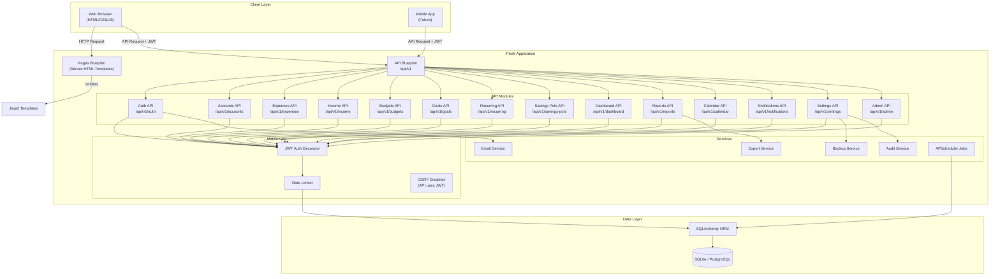
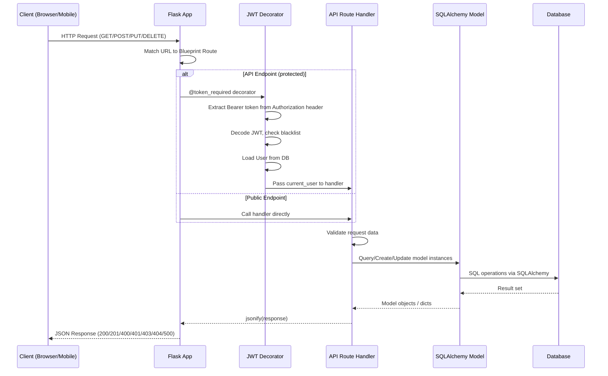
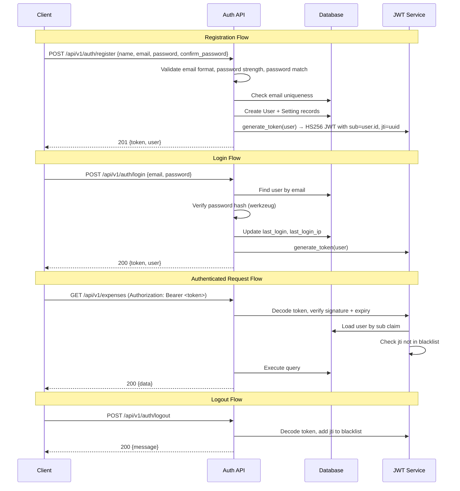
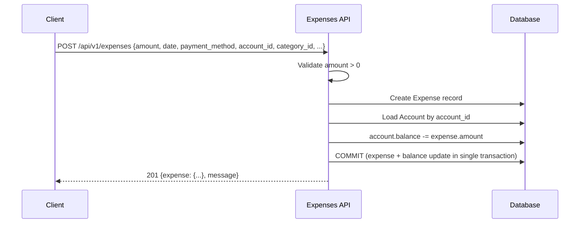
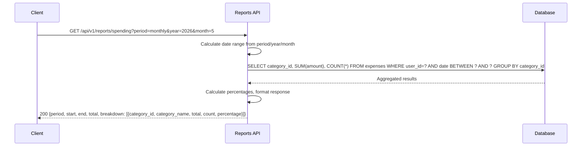
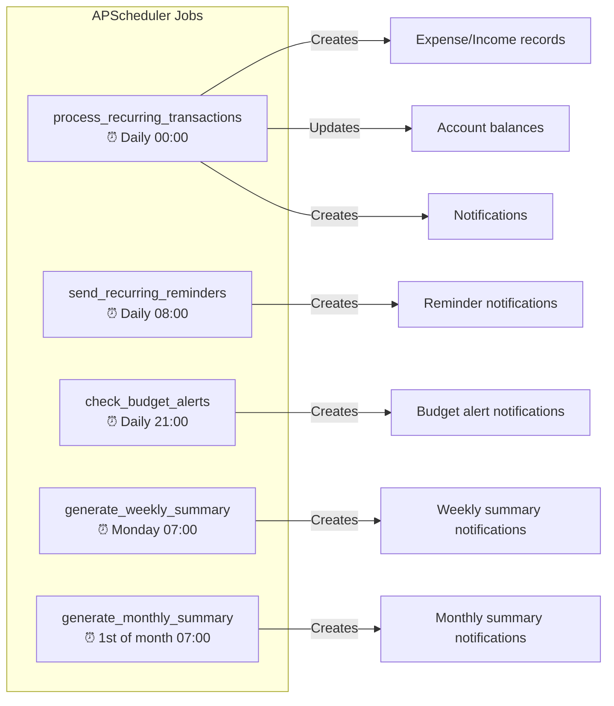

# Finance-Track

**A comprehensive, production-grade personal finance management application** built with Flask (Python) and a pure HTML/CSS/JavaScript frontend. Track expenses, income, budgets, goals, savings pots, recurring transactions, and generate insightful financial reports — all from a single self-hosted web application with a full REST API ready for mobile integration.

---

## Table of Contents

1. [High-Level Overview & Tech Stack](#1-high-level-overview--tech-stack)
2. [Directory Structure](#2-directory-structure)
3. [Architecture & Application Flow](#3-architecture--application-flow)
4. [Database Schema (ERD)](#4-database-schema-erd)
5. [Exhaustive File-by-File Breakdown](#5-exhaustive-file-by-file-breakdown)
6. [Component Connections & Relationships](#6-component-connections--relationships)
7. [API & Integration Details (Mobile/Android Guide)](#7-api--integration-details-mobileandroid-guide)
8. [Authentication & Security](#8-authentication--security)
9. [Error Handling Reference](#9-error-handling-reference)
10. [Background Jobs & Scheduler](#10-background-jobs--scheduler)
11. [CLI Commands](#11-cli-commands)
12. [Setup & Installation](#12-setup--installation)
13. [Configuration Reference](#13-configuration-reference)

---

## 1. High-Level Overview & Tech Stack

### Project Purpose

Finance-Track is a **self-hosted personal finance management application** designed for individual use. It allows users to:

- **Track expenses and income** with categories, payment methods, merchant info, and date/time
- **Manage multiple financial accounts** (bank, cash, credit card, UPI, wallet, investment) with real-time balance tracking
- **Set and monitor budgets** per category or overall, with utilization alerts
- **Define financial goals** with contributions, withdrawals, progress tracking, and auto-save configuration
- **Create savings pots** for earmarking money toward specific purposes
- **Schedule recurring transactions** (rent, subscriptions, EMIs) with auto-generation and reminders
- **Generate reports** — spending breakdowns, income vs. expense comparisons, savings trends, spending heatmaps, CSV export
- **View a unified calendar** of all financial events (expenses, income, recurring dues, goal deadlines)
- **Receive smart notifications** — budget alerts, recurring reminders, weekly/monthly summaries
- **Admin panel** for user management, audit logs, and role control

### Technology Stack

| Layer | Technology |
|---|---|
| **Language** | Python 3.10+ |
| **Backend Framework** | Flask 3.1.1 |
| **Database ORM** | Flask-SQLAlchemy 3.1.1 (SQLite for dev, supports PostgreSQL for production) |
| **Database Migrations** | Alembic 1.14.0 |
| **Authentication** | JWT (PyJWT 2.10.1) + Werkzeug password hashing |
| **API Documentation** | Flasgger 0.9.7.1 (Swagger UI at `/api/docs`) |
| **Rate Limiting** | Flask-Limiter 3.8.0 |
| **Security Headers** | Flask-Talisman 1.1.0 |
| **Email** | Flask-Mail 0.10.0 (SMTP) |
| **Background Jobs** | APScheduler 3.10.4 |
| **Serialization** | Marshmallow 3.23.0 |
| **Frontend** | Vanilla HTML5, CSS3, JavaScript (ES6+) |
| **CSS Framework** | Tailwind CSS (via CDN) |
| **Icons** | Lucide Icons (via CDN) |
| **Charts** | Chart.js (via CDN) |
| **Excel Export** | openpyxl 3.1.5 |
| **PDF Export** | ReportLab 4.2.5 |
| **WSGI Server (Production)** | Gunicorn 23.0.0 |
| **Environment Management** | python-dotenv 1.0.1 |

### Environment Variables

| Variable | Description | Default |
|---|---|---|
| `SECRET_KEY` | Flask session secret | `dev-secret-key` |
| `JWT_SECRET_KEY` | JWT signing key | `dev-jwt-secret` |
| `JWT_EXPIRATION_HOURS` | Token validity period | `24` |
| `DATABASE_URI` | SQLAlchemy database URI | `sqlite:///finance_track.db` |
| `MAIL_SERVER` | SMTP server hostname | `localhost` |
| `MAIL_PORT` | SMTP port | `1025` |
| `MAIL_USE_TLS` | Enable TLS | `false` |
| `MAIL_USERNAME` | SMTP username | (empty) |
| `MAIL_PASSWORD` | SMTP password | (empty) |
| `MAIL_DEFAULT_SENDER` | From address | `noreply@financetrack.com` |
| `FLASK_ENV` | Environment mode | `development` |

> **Production Requirement**: `SECRET_KEY` and `JWT_SECRET_KEY` MUST be set to strong random values. The app refuses to start in production mode with default/dev secrets.

---

## 2. Directory Structure

```
Finance-Track/
├── run.py                          # Application entry point
├── requirements.txt                # Python dependencies
├── .env.example                    # Environment variable template
├── .gitignore
├── package.json                    # Node.js deps (Tailwind CSS build)
├── tailwind.config.js              # Tailwind CSS configuration
├── postcss.config.js               # PostCSS configuration
│
├── app/
│   ├── __init__.py                 # Flask app factory (create_app)
│   ├── config.py                   # Configuration classes
│   ├── extensions.py               # Flask extension instances
│   ├── cli.py                      # CLI commands (seed, create-user)
│   │
│   ├── api/                        # REST API layer (Blueprint-based)
│   │   ├── __init__.py             # API blueprint registration
│   │   ├── auth.py                 # Authentication endpoints
│   │   ├── accounts.py             # Account CRUD + transfers
│   │   ├── expenses.py             # Expense CRUD + duplication
│   │   ├── income.py               # Income CRUD
│   │   ├── budgets.py              # Budget CRUD + utilization
│   │   ├── goals.py                # Goals CRUD + contributions/withdrawals
│   │   ├── recurring.py            # Recurring transactions CRUD + pause/skip
│   │   ├── savings_pots.py         # Savings pots CRUD + deposit/withdraw
│   │   ├── dashboard.py            # Dashboard summary, charts, insights
│   │   ├── reports.py              # Financial reports + CSV export
│   │   ├── calendar.py             # Calendar event aggregation
│   │   ├── notifications.py        # Notification CRUD
│   │   ├── settings.py             # User settings, categories, password, backup, data export
│   │   └── admin/
│   │       ├── __init__.py
│   │       └── routes.py           # Admin API (user management, audit logs)
│   │
│   ├── blueprints/
│   │   ├── __init__.py
│   │   └── pages.py                # Page-serving routes (renders HTML templates)
│   │
│   ├── models/                     # SQLAlchemy ORM models
│   │   ├── __init__.py             # Model exports
│   │   ├── user.py                 # User model (UUID PK, password hashing, roles)
│   │   ├── account.py              # Financial account model
│   │   ├── category.py             # Category model (expense/income/recurring, hierarchical)
│   │   ├── expense.py              # Expense model
│   │   ├── income.py               # Income model
│   │   ├── budget.py               # Budget model (period-based, alert thresholds)
│   │   ├── goal.py                 # Goal + GoalContribution models
│   │   ├── recurring.py            # RecurringTransaction model
│   │   ├── savings_pot.py          # SavingsPot + SavingsPotTransaction models
│   │   ├── notification.py         # Notification model
│   │   ├── setting.py              # User settings model
│   │   ├── audit_log.py            # Audit log model
│   │   ├── reports_cache.py        # Report caching model
│   │   └── otp_token.py            # OTP token model (legacy)
│   │
│   ├── services/                   # Business logic services
│   │   ├── __init__.py
│   │   ├── audit_service.py        # Audit log creation helper
│   │   ├── backup_service.py       # SQLite backup/restore
│   │   ├── email_service.py        # Email sending (OTP, notifications)
│   │   ├── export_service.py       # CSV/Excel/PDF export
│   │   └── scheduler_jobs.py       # APScheduler recurring jobs
│   │
│   ├── utils/                      # Utility modules
│   │   ├── __init__.py
│   │   ├── constants.py            # Default categories, payment methods, enums
│   │   ├── decorators.py           # JWT auth decorators (token_required, admin_required)
│   │   ├── filters.py              # Jinja2 template filters (currency, date, timeago)
│   │   ├── helpers.py              # Date arithmetic, formatting helpers
│   │   └── validators.py           # Email, password, amount validation
│   │
│   ├── static/
│   │   ├── css/
│   │   │   ├── app.css             # Compiled Tailwind CSS
│   │   │   └── input.css           # Tailwind source CSS
│   │   └── js/
│   │       ├── api.js              # API client class (fetch wrapper with JWT)
│   │       ├── auth.js             # Login/register/forgot-password JS handlers
│   │       └── app.js              # Global JS (theme, sidebar, user menu, visibility toggle)
│   │
│   └── templates/                  # Jinja2 HTML templates (41 templates)
│       ├── base.html               # Authenticated layout (sidebar + topbar)
│       ├── base_public.html        # Public layout (landing, auth pages)
│       ├── components/             # Reusable UI components
│       │   ├── sidebar.html
│       │   ├── topbar.html
│       │   ├── modal.html
│       │   ├── pagination.html
│       │   ├── empty_state.html
│       │   └── flash_messages.html
│       ├── auth/                   # Auth pages (landing, login, register, forgot-password, privacy, terms)
│       ├── dashboard/              # Dashboard page
│       ├── expenses/               # Expense list, add, edit pages
│       ├── income/                 # Income list, add, edit pages
│       ├── budgets/                # Budget list, add, edit pages
│       ├── goals/                  # Goal list, add, edit, detail pages
│       ├── savings-pots/           # Savings pot list, add, edit pages
│       ├── recurring/              # Recurring transaction list, add, edit pages
│       ├── accounts/               # Account list, add, edit, detail pages
│       ├── reports/                # Reports page
│       ├── calendar/               # Calendar page
│       ├── notifications/          # Notifications page
│       ├── settings/               # Settings page
│       ├── admin/                  # Admin panel (dashboard, users, user detail, audit)
│       └── errors/                 # 404 and 500 error pages
│
├── migrations/                     # Alembic migration files
│   ├── alembic.ini
│   ├── env.py
│   └── versions/
│
├── instance/                       # Runtime data (auto-created)
│   ├── finance_track.db            # SQLite database
│   └── backups/                    # Database backups
│
└── tests/
    ├── __init__.py
    └── conftest.py                 # Pytest fixtures (app, db, client, auth_headers)
```

---

## 3. Architecture & Application Flow

### High-Level Architecture Diagram



### Request Lifecycle



### Authentication Flow



### Expense Creation Flow (with Account Balance Update)



### Report Generation Flow



---

## 4. Database Schema (ERD)

```mermaid
erDiagram
    USERS {
        string id PK "UUID v4"
        string name "Max 100 chars"
        string email UK "Unique, indexed"
        string username UK "Optional unique"
        string password_hash "Werkzeug hash"
        boolean is_verified "Default false"
        boolean is_active "Default true"
        string role "user | admin"
        string avatar_url "Optional"
        datetime last_login
        string last_login_ip "IPv4/IPv6"
        datetime created_at
        datetime updated_at
    }

    ACCOUNTS {
        int id PK "Auto-increment"
        string user_id FK "→ users.id"
        string name "Max 100"
        string type "cash|bank|credit_card|upi|wallet|investment"
        decimal balance "12,2 precision"
        string currency "Default INR"
        string institution "Optional bank name"
        string account_number "Encrypted, optional"
        boolean is_active "Soft delete flag"
        boolean is_hidden "Hide from UI"
        text notes
        datetime created_at
        datetime updated_at
    }

    CATEGORIES {
        int id PK "Auto-increment"
        string user_id FK "→ users.id (nullable, null=system default)"
        string name "Max 100"
        string type "expense|income|recurring"
        string icon "Lucide icon name"
        string color "Hex color code"
        boolean is_default "System-seeded flag"
        int parent_id FK "→ categories.id (self-referencing)"
        datetime created_at
    }

    EXPENSES {
        int id PK "Auto-increment"
        string user_id FK "→ users.id"
        decimal amount "12,2 precision"
        int category_id FK "→ categories.id"
        int subcategory_id FK "→ categories.id"
        date date "Expense date"
        time time "Optional time"
        string payment_method "Cash|Credit Card|UPI|etc"
        int account_id FK "→ accounts.id"
        string merchant "Max 200"
        text notes
        boolean is_recurring_generated "Auto-flagged"
        int recurring_id FK "→ recurring_transactions.id"
        datetime created_at
        datetime updated_at
    }

    INCOME {
        int id PK "Auto-increment"
        string user_id FK "→ users.id"
        decimal amount "12,2 precision"
        string source "Max 200"
        int category_id FK "→ categories.id"
        date date
        string payment_method
        int account_id FK "→ accounts.id"
        text notes
        boolean is_recurring_generated
        int recurring_id FK "→ recurring_transactions.id"
        datetime created_at
        datetime updated_at
    }

    BUDGETS {
        int id PK "Auto-increment"
        string user_id FK "→ users.id"
        int category_id FK "→ categories.id (null=overall)"
        decimal amount "12,2"
        string period "weekly|monthly"
        int month "1-12"
        int year
        int alert_threshold "Default 80%"
        boolean is_active
        boolean auto_adjust
        datetime created_at
        datetime updated_at
    }

    GOALS {
        int id PK "Auto-increment"
        string user_id FK "→ users.id"
        string title "Max 200"
        text description
        decimal target_amount "12,2"
        decimal current_amount "12,2, default 0"
        date deadline
        string priority "low|medium|high"
        string image_url
        boolean is_completed
        datetime completed_at
        decimal auto_save_amount
        string auto_save_frequency
        datetime created_at
        datetime updated_at
    }

    GOAL_CONTRIBUTIONS {
        int id PK "Auto-increment"
        int goal_id FK "→ goals.id"
        string user_id FK "→ users.id"
        int account_id FK "→ accounts.id"
        decimal amount "12,2"
        string type "manual|auto|withdrawal"
        date date
        text notes
        datetime created_at
    }

    RECURRING_TRANSACTIONS {
        int id PK "Auto-increment"
        string user_id FK "→ users.id"
        string type "expense|income"
        string title "Max 200"
        decimal amount "12,2"
        int category_id FK "→ categories.id"
        string frequency "daily|weekly|monthly|quarterly|yearly"
        string payment_method
        int account_id FK "→ accounts.id"
        date start_date
        date end_date "Optional"
        date next_due_date
        boolean is_active
        boolean is_paused
        boolean auto_add "Default true"
        int reminder_days_before "Default 3"
        text notes
        datetime created_at
        datetime updated_at
    }

    SAVINGS_POTS {
        int id PK "Auto-increment"
        string user_id FK "→ users.id"
        string name "Max 200"
        text description
        decimal balance "12,2, default 0"
        decimal target_amount "12,2, nullable — planned save amount (hover-reveal)"
        string icon
        string color "Hex"
        boolean is_active
        datetime created_at
        datetime updated_at
    }

    SAVINGS_POT_TRANSACTIONS {
        int id PK "Auto-increment"
        int pot_id FK "→ savings_pots.id"
        string user_id FK "→ users.id"
        int account_id FK "→ accounts.id"
        decimal amount "12,2"
        string type "deposit|withdrawal"
        date date
        text notes
        datetime created_at
    }

    NOTIFICATIONS {
        int id PK "Auto-increment"
        string user_id FK "→ users.id"
        string title "Max 200"
        text message
        string type "emi_due|budget_exceeded|system|weekly_summary|etc"
        boolean is_read "Default false"
        string related_entity_type "expense|income|budget|goal|recurring"
        int related_entity_id
        datetime created_at
    }

    SETTINGS {
        int id PK "Auto-increment"
        string user_id FK "→ users.id (unique)"
        string currency "Default INR"
        string timezone "Default Asia/Kolkata"
        string theme "light|dark|system"
        string date_format "Default DD/MM/YYYY"
        int month_start_day "Default 1"
        int session_timeout_minutes "Default 60"
        boolean notification_email "Default true"
        boolean notification_browser "Default true"
        string backup_frequency "Default weekly"
        datetime created_at
        datetime updated_at
    }

    AUDIT_LOGS {
        int id PK "Auto-increment"
        string user_id FK "→ users.id"
        string action "password_change|data_export|user_deleted|etc"
        string entity_type "Optional"
        string entity_id "Optional"
        text details
        string ip_address "IPv4/IPv6"
        datetime created_at
    }

    REPORTS_CACHE {
        int id PK "Auto-increment"
        string user_id FK "→ users.id"
        string report_type
        string period_key
        text data "JSON blob"
        datetime generated_at
        datetime expires_at
    }

    OTP_TOKENS {
        int id PK "Auto-increment"
        string email
        string otp "6 digits"
        string purpose "verify|forgot"
        string name "For registration"
        string password_hash "For registration"
        boolean is_used
        datetime expires_at
        datetime created_at
    }

    USERS ||--o{ ACCOUNTS : "has"
    USERS ||--o{ EXPENSES : "has"
    USERS ||--o{ INCOME : "has"
    USERS ||--o{ BUDGETS : "has"
    USERS ||--o{ GOALS : "has"
    USERS ||--o{ RECURRING_TRANSACTIONS : "has"
    USERS ||--o{ SAVINGS_POTS : "has"
    USERS ||--o{ NOTIFICATIONS : "has"
    USERS ||--o| SETTINGS : "has"
    USERS ||--o{ AUDIT_LOGS : "has"
    USERS ||--o{ REPORTS_CACHE : "has"
    USERS ||--o{ CATEGORIES : "has"

    ACCOUNTS ||--o{ EXPENSES : "tracks"
    ACCOUNTS ||--o{ INCOME : "tracks"
    ACCOUNTS ||--o{ GOAL_CONTRIBUTIONS : "funds"
    ACCOUNTS ||--o{ SAVINGS_POT_TRANSACTIONS : "funds"

    CATEGORIES ||--o{ EXPENSES : "categorizes"
    CATEGORIES ||--o{ INCOME : "categorizes"
    CATEGORIES ||--o{ BUDGETS : "limits"
    CATEGORIES ||--o{ RECURRING_TRANSACTIONS : "categorizes"
    CATEGORIES ||--o{ CATEGORIES : "parent-child"

    GOALS ||--o{ GOAL_CONTRIBUTIONS : "has"

    SAVINGS_POTS ||--o{ SAVINGS_POT_TRANSACTIONS : "has"

    RECURRING_TRANSACTIONS ||--o{ EXPENSES : "generates"
    RECURRING_TRANSACTIONS ||--o{ INCOME : "generates"
```



### Key Relationships

- **Users** own all data. Every table has a `user_id` foreign key ensuring complete data isolation between users.
- **Accounts** are the central balance-tracking entity. Expenses deduct from accounts; income adds to accounts. Transfers move between accounts.
- **Categories** support three types (`expense`, `income`, `recurring`) and hierarchical nesting via `parent_id` (self-referencing). System defaults are seeded on startup; users can create custom categories.
- **Goals** accumulate `GoalContribution` records. Contributions can debit an account; withdrawals credit an account. When `current_amount >= target_amount`, the goal auto-completes.
- **Savings Pots** accumulate `SavingsPotTransaction` records. Deposits debit an account; withdrawals credit an account.
- **Recurring Transactions** auto-generate `Expense` or `Income` records via the scheduler when `next_due_date <= today` and `auto_add=true`.

---

## 5. Exhaustive File-by-File Breakdown

### 5.1 Entry Point & App Factory

#### `run.py`
- **Purpose**: Application entry point. Loads environment variables, creates the Flask app, and runs the development server.
- **Core Logic**: Reads `FLASK_ENV` to select config (development/production). Calls `create_app()`. Runs on `127.0.0.1:5000` in debug mode for development.

#### `app/__init__.py` — App Factory
- **Purpose**: The heart of the application. Creates and configures the Flask app instance.
- **Core Functions**:
  - `create_app(config_name)`: Initializes all extensions (SQLAlchemy, LoginManager, Mail, Limiter, Talisman, Migrate, Swagger). Registers the API blueprint, page blueprint, Jinja2 filters, error handlers, CLI commands. Seeds default categories. Starts APScheduler.
  - `register_error_handlers(app)`: Defines JSON error responses for 404, 500, 401, 403, 429 status codes. Returns HTML templates for browser requests, JSON for API requests.
  - `init_scheduler(app)`: Registers 5 cron jobs (process recurring, send reminders, check budgets, weekly summary, monthly summary).
- **Business Logic**: CSRF is explicitly disabled because the API uses JWT Bearer tokens (not cookie-based sessions). The first user auto-becomes admin. Swagger UI is available at `/api/docs`.

#### `app/config.py`
- **Purpose**: Configuration classes for different environments.
- **Classes**:
  - `Config`: Base config with secrets from env vars, JWT settings, mail settings, rate limiting (200/hour default), session timeout (1 hour).
  - `DevelopmentConfig(Config)`: Debug mode, SQLite database.
  - `TestingConfig(Config)`: In-memory SQLite, CSRF disabled, mail suppressed.
  - `ProductionConfig(Config)`: No debug, database URI from env.
- **Security**: `_get_secret()` helper raises `ValueError` in production if secrets use default `dev-` prefix values.

#### `app/extensions.py`
- **Purpose**: Instantiates all Flask extensions as module-level singletons.
- **Instances**: `db` (SQLAlchemy), `login_manager` (LoginManager), `csrf` (CSRFProtect), `mail` (Mail), `limiter` (Limiter with IP-based key), `talisman` (Talisman), `scheduler` (BackgroundScheduler).
- **State**: `token_blacklist` — an in-memory `set()` storing revoked JWT `jti` IDs for logout support. In production, this should be Redis-backed.

---

### 5.2 Models (16 Models)

#### `app/models/user.py` — User
- **Table**: `users`
- **PK**: `id` (UUID v4 string, 36 chars)
- **Fields**: `name`, `email` (unique), `username` (unique, optional), `password_hash`, `is_verified`, `is_active`, `role` (user/admin), `avatar_url`, `last_login`, `last_login_ip`, `created_at`, `updated_at`
- **Relationships**: Has many: expenses, incomes, recurring_transactions, budgets, goals, savings_pots, accounts, notifications, categories, audit_logs. Has one: settings.
- **Methods**: `set_password(password)` — hashes with werkzeug. `check_password(password)` — verifies hash. `is_admin` property. `to_dict()` — serializes to JSON-safe dict (excludes password_hash).
- **Business Rule**: User IDs are UUIDs (not sequential integers), preventing enumeration attacks.

#### `app/models/account.py` — Account
- **Table**: `accounts`
- **PK**: `id` (auto-increment integer)
- **Fields**: `user_id` (FK→users), `name`, `type` (cash/bank/credit_card/upi/wallet/investment), `balance` (Decimal 12,2), `currency` (default INR), `institution`, `account_number` (encrypted), `is_active` (soft delete), `is_hidden`, `notes`, `created_at`, `updated_at`
- **Relationships**: Has many expenses, incomes.
- **Business Logic**: Accounts are soft-deleted (`is_active=False`), never physically removed. Balance is updated atomically when expenses/income are created, updated, or deleted.

#### `app/models/category.py` — Category
- **Table**: `categories`
- **PK**: `id` (auto-increment integer)
- **Fields**: `user_id` (nullable — null means system default), `name`, `type` (expense/income/recurring), `icon` (Lucide icon name), `color` (hex), `is_default`, `parent_id` (self-referencing FK for subcategories), `created_at`
- **Constraints**: Unique constraint on `(user_id, name, type, parent_id)`.
- **Business Logic**: System default categories (8 expense, 8 income, 8 recurring) are seeded on startup. Users can create custom categories. Default categories cannot be deleted.

#### `app/models/expense.py` — Expense
- **Table**: `expenses`
- **PK**: `id` (auto-increment)
- **Fields**: `user_id`, `amount` (Decimal 12,2), `category_id`, `subcategory_id`, `date`, `time`, `payment_method`, `account_id`, `merchant`, `notes`, `is_recurring_generated`, `recurring_id`, `created_at`, `updated_at`
- **Indexes**: `(user_id, date)`, `(user_id, category_id)`
- **Business Logic**: When an expense is created with an `account_id`, the account balance is decreased by the expense amount. On update, the old account is credited and the new account is debited. On delete, the account is credited.

#### `app/models/income.py` — Income
- **Table**: `income`
- **PK**: `id` (auto-increment)
- **Fields**: `user_id`, `amount` (Decimal 12,2), `source`, `category_id`, `date`, `payment_method`, `account_id`, `notes`, `is_recurring_generated`, `recurring_id`, `created_at`, `updated_at`
- **Indexes**: `(user_id, date)`, `(user_id, category_id)`
- **Business Logic**: Mirror of Expense but in reverse — creating income increases account balance. Update/delete adjust balances accordingly.

#### `app/models/budget.py` — Budget
- **Table**: `budgets`
- **PK**: `id` (auto-increment)
- **Fields**: `user_id`, `category_id` (null = overall budget), `amount`, `period` (weekly/monthly), `month` (1-12), `year`, `alert_threshold` (default 80%), `is_active`, `auto_adjust`, `created_at`, `updated_at`
- **Constraints**: Unique on `(user_id, category_id, period, month, year)`.
- **Business Logic**: Budget utilization is calculated dynamically by summing expenses in the budget's period and category. Alerts fire when utilization exceeds `alert_threshold`.

#### `app/models/goal.py` — Goal & GoalContribution
- **Tables**: `goals`, `goal_contributions`
- **Goal Fields**: `user_id`, `title`, `description`, `target_amount`, `current_amount` (default 0), `deadline`, `priority` (low/medium/high), `image_url`, `is_completed`, `completed_at`, `auto_save_amount`, `auto_save_frequency`, timestamps
- **GoalContribution Fields**: `goal_id`, `user_id`, `account_id`, `amount`, `type` (manual/auto/withdrawal), `date`, `notes`, `created_at`
- **Business Logic**: Contributions increase `current_amount`. When `current_amount >= target_amount`, the goal is auto-completed. Withdrawals decrease `current_amount` and un-complete the goal. Deleting a goal refunds all contributions to their source accounts.

#### `app/models/recurring.py` — RecurringTransaction
- **Table**: `recurring_transactions`
- **Fields**: `user_id`, `type` (expense/income), `title`, `amount`, `category_id`, `frequency` (daily/weekly/monthly/quarterly/yearly), `payment_method`, `account_id`, `start_date`, `end_date`, `next_due_date`, `is_active`, `is_paused`, `auto_add` (default true), `reminder_days_before` (default 3), `notes`, timestamps
- **Business Logic**: The scheduler processes due recurring transactions at midnight daily. If `auto_add=true`, it creates an Expense/Income record and updates the account balance. `next_due_date` is advanced based on frequency. Paused transactions are skipped. Expired transactions (past `end_date`) are deactivated.

#### `app/models/savings_pot.py` — SavingsPot & SavingsPotTransaction
- **Tables**: `savings_pots`, `savings_pot_transactions`
- **Pot Fields**: `user_id`, `name`, `description`, `balance` (default 0), `target_amount` (nullable, planned save amount — hover-reveal on card, `+` when unset, click to inline-edit), `icon`, `color`, `is_active`, timestamps
- **Transaction Fields**: `pot_id`, `user_id`, `account_id`, `amount`, `type` (deposit/withdrawal), `date`, `notes`, `created_at`
- **Business Logic**: Deposits decrease account balance and increase pot balance. Withdrawals do the reverse. Deleting a pot optionally refunds the balance to a specified account. `target_amount` is purely informational (does not affect balance); validated `>0` on create/update, `null`/empty clears it. Migration: `a1b2c3d4e5f6_add_target_amount_to_savings_pots.py` (Alembic) + `ensure_db_schema()` fallback `ALTER TABLE savings_pots ADD COLUMN target_amount` for existing DBs/backups.

#### `app/models/notification.py` — Notification
- **Table**: `notifications`
- **Fields**: `user_id`, `title`, `message`, `type` (emi_due/budget_exceeded/system/weekly_summary/monthly_summary/salary_credited), `is_read`, `related_entity_type`, `related_entity_id`, `created_at`
- **Index**: `(user_id, is_read, created_at)`
- **Business Logic**: Notifications are created by the scheduler (recurring reminders, budget alerts, summaries) and by the system (auto-generated transaction confirmations).

#### `app/models/setting.py` — Setting
- **Table**: `settings`
- **Fields**: `user_id` (unique), `currency` (default INR), `timezone` (default Asia/Kolkata), `theme` (light/dark/system), `date_format`, `month_start_day`, `session_timeout_minutes`, `notification_email`, `notification_browser`, `backup_frequency`, timestamps
- **Business Logic**: One settings row per user, created automatically during registration.

#### `app/models/audit_log.py` — AuditLog
- **Table**: `audit_logs`
- **Fields**: `user_id`, `action` (password_change/password_reset/data_export/user_deleted/role_changed/etc), `entity_type`, `entity_id`, `details`, `ip_address`, `created_at`
- **Business Logic**: Immutable log of sensitive operations. Used for security auditing and admin review.

#### `app/models/reports_cache.py` — ReportsCache
- **Table**: `reports_cache`
- **Fields**: `user_id`, `report_type`, `period_key`, `data` (JSON text), `generated_at`, `expires_at`
- **Constraints**: Unique on `(user_id, report_type, period_key)`.
- **Business Logic**: Caches computed report data to avoid redundant aggregation queries.

#### `app/models/otp_token.py` — OtpToken (Legacy)
- **Table**: `otp_tokens`
- **Purpose**: Originally used for OTP-based registration verification. Currently OTP is handled via in-memory dictionaries in `auth.py`. This model is retained for potential future use.

---

### 5.3 API Modules (13 Modules)

#### `app/api/__init__.py` — API Registration
- **Purpose**: Registers all API sub-blueprints under the `/api/v1` prefix.
- **Blueprints Registered**:
  - `/api/v1/auth` — Authentication
  - `/api/v1/expenses` — Expenses
  - `/api/v1/income` — Income
  - `/api/v1/accounts` — Accounts
  - `/api/v1/recurring` — Recurring Transactions
  - `/api/v1/budgets` — Budgets
  - `/api/v1/goals` — Goals
  - `/api/v1/savings-pots` — Savings Pots
  - `/api/v1/dashboard` — Dashboard
  - `/api/v1/reports` — Reports
  - `/api/v1/calendar` — Calendar
  - `/api/v1/notifications` — Notifications
  - `/api/v1/settings` — Settings
  - `/api/v1/admin` — Admin

#### `app/api/auth.py` — Authentication (8 endpoints)
- **Rate Limits**: Register (5/min), Login (10/min), Forgot Password (3/min), OTP endpoints (5/min)
- **OTP Storage**: In-memory dictionary (`password_reset_otps`). Each entry stores `otp`, `expires_at` (10 min), and `attempts` counter (max 5).
- **Email Enumeration Prevention**: Forgot-password always returns success regardless of whether the email exists.

#### `app/api/expenses.py` — Expenses (5 endpoints)
- **Business Logic**: All mutations (create/update/delete) adjust the linked account balance atomically in the same DB transaction.
- **Duplicate**: Creates a copy of an expense with today's date.

#### `app/api/income.py` — Income (4 endpoints)
- **Business Logic**: Mirror of expenses — balance adjustments are inverted (income adds to account).

#### `app/api/accounts.py` — Accounts (6 endpoints)
- **Transfer**: Atomic balance transfer between two accounts with TOCTOU mitigation (`db.session.refresh()` before balance check).
- **Soft Delete**: Accounts are never physically deleted; `is_active` is set to `False`.

#### `app/api/budgets.py` — Budgets (5 endpoints)
- **Utilization Calculation**: `get_budget_utilization()` dynamically sums expenses in the budget's period and category, returning `spent`, `budget`, `remaining`, and `utilization` percentage.

#### `app/api/goals.py` — Goals (7 endpoints)
- **Contribute**: Deducts from linked account, increases `current_amount`, auto-completes if target reached.
- **Withdraw**: Adds to linked account, decreases `current_amount`, un-completes goal.
- **Delete**: Refunds all contributions to source accounts.

#### `app/api/recurring.py` — Recurring Transactions (7 endpoints)
- **Pause/Resume**: Toggles `is_paused` flag.
- **Skip**: Advances `next_due_date` to the next occurrence without creating a transaction.

#### `app/api/savings_pots.py` — Savings Pots (7+1 endpoints)
- **Create/Update**: `POST /savings-pots` and `PUT /savings-pots/<id>` accept optional `target_amount` (planned save amount, `>0`; `null`/empty clears). Returned in `to_dict()` as `target_amount`.
- **Deposit**: Deducts from account, increases pot balance.
- **Withdraw**: Adds to account, decreases pot balance.
- **Delete**: Soft-deletes pot, optionally refunds balance to an account.

#### `app/api/dashboard.py` — Dashboard (3 endpoints)
- **Summary**: Returns total balance, today's expenses/income, monthly totals, savings rate, savings pot total, average goal progress.
- **Charts**: Returns expense-by-category breakdown, income sources, 7-day trend, 6-month comparison.
- **Insights**: Generates actionable insights (week-over-week spending changes, upcoming recurring dues, goal deadline projections).

#### `app/api/reports.py` — Reports (5 endpoints)
- **Spending**: Breakdown by category for a given period.
- **Income-Expense**: Comparison with net savings and savings rate.
- **Savings**: 6-month savings trend.
- **Heatmap**: Spending by day of week (last 90 days).
- **Export**: CSV download with CSV injection prevention (formula character prefixing).

#### `app/api/calendar.py` — Calendar (1 endpoint)
- **Events**: Aggregates expenses, income, recurring due dates, and goal deadlines into a unified calendar event list for a date range.

#### `app/api/notifications.py` — Notifications (4 endpoints)
- **List**: Paginated with unread count. Supports `unread_only` filter.
- **Mark Read / Mark All Read**: Updates `is_read` flag.
- **Delete**: Removes a notification.

#### `app/api/settings.py` — Settings (9 endpoints)
- **Settings CRUD**: Get/update user preferences (theme, currency, timezone, etc).
- **Categories**: List (default + custom), add custom, delete custom (defaults cannot be deleted).
- **Change Password**: Requires current password, validates strength, logs audit.
- **Export Data**: Full JSON dump of all user data (expenses, income, accounts, budgets, goals, savings pots).
- **Backup**: Creates SQLite backup file and sends as download.
- **Restore Backup**: Upload `.db` file, validates schema, creates safety backup first, replaces database.
- **Delete Account**: Requires password + OTP verification. Deletes all user data in correct foreign-key order.

#### `app/api/admin/routes.py` — Admin (6 endpoints)
- **Dashboard**: Total users, active today, new this week.
- **Users**: List with pagination/search/status filter. Get user detail with counts and recent audit logs.
- **Update Status**: Activate/deactivate users (cannot self-deactivate).
- **Update Role**: Change user/admin role (cannot change own role).
- **Delete User**: Requires admin password confirmation. Cascading delete of all user data.
- **Audit Logs**: Paginated list with user_id and action filters.

---

### 5.4 Utilities

#### `app/utils/decorators.py`
- **`token_required(f)`**: Decorator that extracts JWT from `Authorization: Bearer <token>` header, decodes it, checks blacklist, loads user. Returns 401 for missing/expired/invalid/revoked tokens.
- **`generate_token(user)`**: Creates HS256 JWT with `sub` (user.id), `jti` (unique UUID for revocation), `iat`, `exp` (configurable hours, default 24).
- **`admin_required(f)`**: Same as `token_required` but also checks `user.is_admin`. Returns 403 if not admin.

#### `app/utils/validators.py`
- **`validate_email(email)`**: Regex-based email format validation.
- **`validate_password_strength(password)`**: Requires 8+ chars, uppercase, lowercase, digit. Returns `(bool, message)`.
- **`validate_amount(amount)`**: Checks amount is a positive number.

#### `app/utils/helpers.py`
- **`get_next_due_date(current_date, frequency)`**: Calculates next due date using `relativedelta` for monthly/quarterly/yearly, `timedelta` for daily/weekly.
- **`get_month_start_end(year, month)`**: Returns first and last date of a month.
- **`get_week_start_end(offset)`**: Returns Monday-Sunday of current week (with offset).
- **`format_amount(amount)`**: Formats as Indian Rupees (₹1,234.56).

#### `app/utils/constants.py`
- **Default Categories**: 8 expense categories (Food & Dining, Groceries, Transport, Shopping, Bills & Utilities, Healthcare, Entertainment, Other), 8 income categories (Salary, Freelance, Business, Investments, Rental, Gifts, Refunds, Other), 8 recurring categories (Rent, Subscriptions, Insurance, EMI/Loan, Utilities, Salary, SIP/Investment, Other).
- **Enums**: `PAYMENT_METHODS` (7), `ACCOUNT_TYPES` (6), `RECURRING_FREQUENCIES` (5), `GOAL_PRIORITIES` (3), `BUDGET_PERIODS` (2).

#### `app/utils/filters.py`
- **`currency`**: Formats amount as `₹1,234.56`.
- **`dateformat`**: Formats datetime as `DD/MM/YYYY`.
- **`timeformat`**: Formats time as `01:30 PM`.
- **`timeago`**: Relative time (e.g., "5m ago", "2h ago", "3d ago").

---

### 5.5 Services

#### `app/services/audit_service.py`
- **`log_audit(user_id, action, ...)`**: Creates an `AuditLog` entry with the current request's IP address.

#### `app/services/email_service.py`
- **`send_email(to, subject, body, html)`**: Generic email sender via Flask-Mail.
- **`generate_otp()`**: Returns a random 6-digit string.
- **`send_password_reset_otp(email, otp)`**: HTML email with styled OTP display.
- **`send_login_otp_email(email, otp)`**: HTML email for login verification.
- **`send_account_deletion_otp(email, otp)`**: HTML email with deletion warning.

#### `app/services/backup_service.py`
- **`create_backup()`**: Uses SQLite's backup API for safe hot backup. Falls back to file copy. Stores in `instance/backups/`.
- **`restore_backup(uploaded_file_path)`**: Validates SQLite schema (requires `users` table), creates safety backup, replaces database file, disposes engine connections.
- **`list_backups()`**: Lists backup files with size and creation timestamp.

#### `app/services/export_service.py`
- **`export_csv(data, headers, filename)`**: In-memory CSV generation.
- **`export_excel(data, headers, filename)`**: Excel generation via openpyxl with styled headers.
- **`export_pdf(data, headers, title, filename)`**: PDF generation via ReportLab with styled table.

#### `app/services/scheduler_jobs.py`
Five scheduled jobs run via APScheduler:

| Job | Schedule | Logic |
|---|---|---|
| `process_recurring_transactions` | Daily at 00:00 | Finds due recurring transactions, creates Expense/Income records, updates account balances, advances `next_due_date`, creates notifications |
| `send_recurring_reminders` | Daily at 08:00 | Creates reminder notifications for transactions due within 3 days |
| `check_budget_alerts` | Daily at 21:00 | Calculates budget utilization, creates alert notifications when threshold exceeded |
| `generate_weekly_summary` | Monday at 07:00 | Creates summary notifications with last week's income/expenses for all active users |
| `generate_monthly_summary` | 1st of month at 07:00 | Creates summary notifications with last month's income/expenses/savings for all active users |

---

### 5.6 Frontend

#### `app/static/js/api.js` — API Client
- **Class `ApiClient`**: Fetch wrapper that automatically attaches `Authorization: Bearer <token>` header from localStorage. Handles 401 responses by redirecting to login. Methods: `get()`, `post()`, `put()`, `delete()`. Global instance: `api`.

#### `app/static/js/auth.js` — Auth Handlers
- **`handleRegister(e)`**: POSTs to `/api/v1/auth/register`, stores token+user in localStorage, redirects to dashboard.
- **`handleLogin(e)`**: POSTs to `/api/v1/auth/login`, stores token+user, redirects admin to `/admin`, users to `/dashboard`.
- **`handleForgotPassword(e)`**: POSTs to `/api/v1/auth/forgot-password`.
- **OTP Handlers**: `handleSendLoginOtp`, `handleVerifyLoginOtp`, `resendLoginOtp` — multi-step OTP login flow.
- **`checkPasswordStrength(password)`**: Client-side password strength scoring (0-4).

#### `app/static/js/app.js` — Global UI Logic
- **Theme Management**: `initTheme()`, `toggleTheme()` — persists dark/light theme in localStorage.
- **Sidebar**: `toggleSidebar()` — responsive sidebar with overlay.
- **User Menu**: `toggleUserMenu()` — dropdown with outside-click-to-close.
- **Active Link**: `setActiveSidebarLink()` — highlights current page in sidebar.
- **Amount Visibility**: Per-card eye button toggle. Default is hidden (masked with `••••••`). Persisted per card via `localStorage`.
- **Utilities**: `formatCurrency()` (Indian locale), `formatDate()`, `debounce()`, `escapeHtml()` (XSS prevention).

---

### 5.7 Templates

#### Base Layouts
- **`base.html`**: Authenticated layout with sidebar navigation, topbar (user info, theme toggle, notifications), main content area. Includes all shared JS (`api.js`, `app.js`).
- **`base_public.html`**: Public layout for landing, login, register, forgot-password pages. No sidebar.

#### Components (`templates/components/`)
- **`sidebar.html`**: Navigation links for all features (Dashboard, Expenses, Income, Budgets, Goals, Savings Pots, Recurring, Accounts, Reports, Calendar, Notifications, Settings). Admin link shown conditionally.
- **`topbar.html`**: Page title, search, notification bell, theme toggle, user avatar dropdown.
- **`modal.html`**: Reusable modal component.
- **`pagination.html`**: Pagination controls.
- **`empty_state.html`**: Empty state illustration with CTA.
- **`flash_messages.html`**: Toast-style notification messages.

#### Feature Templates
Each feature (expenses, income, budgets, goals, savings-pots, recurring, accounts) has:
- **`index.html`**: List view with filters, search, pagination, add button.
- **`add.html`**: Creation form.
- **`edit.html`**: Edit form (pre-populated).

Special pages:
- **`dashboard/index.html`**: Summary cards (balance, today's spending, monthly totals, savings rate), charts (expense by category, income sources, weekly trend, monthly comparison), smart insights.
- **`goals/detail.html`**: Goal detail with contribution history, progress bar, contribute/withdraw actions.
- **`accounts/detail.html`**: Account detail with transaction history.
- **`savings-pots/index.html`**: Pot cards with hover-reveal planned amount (`+` when unset, `₹X` when set, left of Edit; click to inline-edit via `PUT /savings-pots/<id>` with `target_amount`), eye-toggle for balance, Deposit/Withdraw/View actions.
- **`savings-pots/detail.html`**: Header planned amount row (hover-reveal + inline edit + remaining hint `₹Y more to reach planned`), balance eye-toggle, transactions.
- **`savings-pots/add.html` / `edit.html`**: Optional `target_amount` input (`₹` prefix) — included in `POST`/`PUT` payload, `null` clears.
- **`reports/index.html`**: Interactive reports with period selectors, charts, CSV export button.
- **`calendar/index.html`**: Monthly calendar with color-coded events (expenses=red, income=green, recurring=amber, goal deadlines=purple).
- **`notifications/index.html`**: Notification list with mark-read, mark-all-read, delete actions.
- **`settings/index.html`**: Profile settings, theme, currency, timezone, categories management, password change, data export, backup/restore, account deletion.
- **`admin/`**: Dashboard, user list, user detail, audit log viewer.

---

### 5.8 Tests

#### `tests/conftest.py`
- **`app` fixture**: Creates app with `testing` config (in-memory SQLite).
- **`db` fixture**: Creates all tables before each test, drops after.
- **`client` fixture**: Flask test client.
- **`auth_headers` fixture**: Creates a test user with settings, generates JWT, returns `{Authorization: Bearer <token>}` headers and user ID.

---

## 6. Component Connections & Relationships

### Dependency Graph

```mermaid
graph TD
    subgraph "Entry Points"
        run["run.py"]
    end

    subgraph "App Factory"
        init["app/__init__.py"]
        config["app/config.py"]
        ext["app/extensions.py"]
    end

    subgraph "API Layer"
        api_init["api/__init__.py"]
        auth["api/auth.py"]
        expenses["api/expenses.py"]
        income["api/income.py"]
        accounts["api/accounts.py"]
        budgets["api/budgets.py"]
        goals["api/goals.py"]
        recurring["api/recurring.py"]
        pots["api/savings_pots.py"]
        dashboard["api/dashboard.py"]
        reports["api/reports.py"]
        calendar["api/calendar.py"]
        notifs["api/notifications.py"]
        settings["api/settings.py"]
        admin["api/admin/routes.py"]
    end

    subgraph "Models"
        user_m["models/user.py"]
        account_m["models/account.py"]
        expense_m["models/expense.py"]
        income_m["models/income.py"]
        budget_m["models/budget.py"]
        goal_m["models/goal.py"]
        recurring_m["models/recurring.py"]
        pot_m["models/savings_pot.py"]
        notif_m["models/notification.py"]
        setting_m["models/setting.py"]
        category_m["models/category.py"]
        audit_m["models/audit_log.py"]
    end

    subgraph "Utilities"
        dec["utils/decorators.py"]
        val["utils/validators.py"]
        helpers["utils/helpers.py"]
        constants["utils/constants.py"]
        filters["utils/filters.py"]
    end

    subgraph "Services"
        audit_svc["services/audit_service.py"]
        email_svc["services/email_service.py"]
        backup_svc["services/backup_service.py"]
        export_svc["services/export_service.py"]
        scheduler["services/scheduler_jobs.py"]
    end

    subgraph "Frontend"
        api_js["static/js/api.js"]
        auth_js["static/js/auth.js"]
        app_js["static/js/app.js"]
        pages["blueprints/pages.py"]
    end

    run --> init
    init --> config & ext
    init --> api_init & pages & filters & scheduler

    api_init --> auth & expenses & income & accounts & budgets & goals & recurring & pots & dashboard & reports & calendar & notifs & settings & admin

    auth --> user_m & setting_m & dec & val & audit_svc & email_svc
    expenses --> expense_m & account_m & dec
    income --> income_m & account_m & dec
    accounts --> account_m & dec
    budgets --> budget_m & expense_m & dec
    goals --> goal_m & account_m & dec
    recurring --> recurring_m & helpers & dec
    pots --> pot_m & account_m & dec
    dashboard --> expense_m & income_m & account_m & goal_m & pot_m & recurring_m & category_m & dec
    reports --> expense_m & income_m & category_m & dec
    calendar --> expense_m & income_m & recurring_m & goal_m & dec
    notifs --> notif_m & dec
    settings --> setting_m & category_m & user_m & dec & val & audit_svc & backup_svc
    admin --> user_m & account_m & goal_m & budget_m & audit_m & dec

    pages --> templates["Jinja2 Templates"]
    templates --> api_js & auth_js & app_js
```



### Data Flow Summary

1. **Browser** loads HTML template via `pages.py` blueprint
2. **JavaScript** (`api.js`) makes API calls with JWT in `Authorization` header
3. **Flask** routes request through `@token_required` decorator → JWT validation → user lookup
4. **API handler** validates input, interacts with **models** via SQLAlchemy
5. **Models** persist to **SQLite/PostgreSQL** database
6. **Account balances** are updated atomically in the same transaction as expense/income mutations
7. **Scheduler** runs background jobs (recurring processing, reminders, alerts, summaries)
8. **Response** flows back as JSON → JavaScript updates the DOM

---

## 7. API & Integration Details (Mobile/Android Guide)

### Base URL

```
http://localhost:5000/api/v1
```

### Authentication Header

All protected endpoints require:
```
Authorization: Bearer <jwt_token>
```

### Standard Response Format

**Success:**
```json
{
  "success": true,
  "data": { ... },
  "message": "Operation description"
}
```

**Error:**
```json
{
  "success": false,
  "error": {
    "code": "ERROR_CODE",
    "message": "Human-readable description"
  }
}
```

**Paginated:**
```json
{
  "success": true,
  "data": [ ... ],
  "pagination": {
    "page": 1,
    "per_page": 20,
    "total": 150,
    "pages": 8
  }
}
```

---

### Complete API Endpoint Reference

#### Authentication (`/api/v1/auth`)

| Method | Endpoint | Auth | Rate Limit | Description |
|---|---|---|---|---|
| POST | `/auth/register` | No | 5/min | Register new user |
| POST | `/auth/login` | No | 10/min | Login with email+password |
| POST | `/auth/logout` | Yes | — | Logout (revokes token) |
| POST | `/auth/forgot-password` | No | 3/min | Request password reset OTP |
| POST | `/auth/verify-reset-otp` | No | 5/min | Verify reset OTP |
| POST | `/auth/reset-password` | No | 5/min | Reset password after OTP verification |

**Register Request:**
```json
{
  "name": "John Doe",
  "email": "john@example.com",
  "password": "SecurePass123",
  "confirm_password": "SecurePass123"
}
```

**Register/Login Response:**
```json
{
  "success": true,
  "data": {
    "token": "eyJhbGciOiJIUzI1NiIsInR5cCI6IkpXVCJ9...",
    "user": {
      "id": "uuid-string",
      "name": "John Doe",
      "email": "john@example.com",
      "role": "user",
      "is_verified": true,
      "is_active": true,
      "avatar_url": null,
      "last_login": "2026-05-23T10:30:00",
      "created_at": "2026-05-23T10:30:00"
    }
  },
  "message": "Registration successful"
}
```

**Password Requirements:**
- Minimum 8 characters
- At least one uppercase letter
- At least one lowercase letter
- At least one digit

---

#### Accounts (`/api/v1/accounts`)

| Method | Endpoint | Auth | Description |
|---|---|---|---|
| GET | `/accounts` | Yes | List all active accounts |
| POST | `/accounts` | Yes | Create account |
| GET | `/accounts/:id` | Yes | Get account details |
| PUT | `/accounts/:id` | Yes | Update account |
| DELETE | `/accounts/:id` | Yes | Soft-delete account |
| POST | `/accounts/transfer` | Yes | Transfer between accounts |

**Create Account Request:**
```json
{
  "name": "SBI Savings",
  "type": "bank",
  "balance": 50000.00,
  "currency": "INR",
  "institution": "State Bank of India",
  "notes": "Primary savings account"
}
```

**Account Types:** `cash`, `bank`, `credit_card`, `upi`, `wallet`, `investment`

**Transfer Request:**
```json
{
  "from_account_id": 1,
  "to_account_id": 2,
  "amount": 5000.00
}
```

---

#### Expenses (`/api/v1/expenses`)

| Method | Endpoint | Auth | Description |
|---|---|---|---|
| GET | `/expenses` | Yes | List with filters & pagination |
| POST | `/expenses` | Yes | Create expense |
| GET | `/expenses/:id` | Yes | Get expense details |
| PUT | `/expenses/:id` | Yes | Update expense |
| DELETE | `/expenses/:id` | Yes | Delete expense |
| POST | `/expenses/:id/duplicate` | Yes | Duplicate expense |
| POST | `/expenses/bulk` | Yes | Bulk create expenses (max 20) |

**Query Parameters:** `page`, `per_page`, `category_id`, `date_from`, `date_to`, `payment_method`, `search`, `sort_by` (date/amount/category), `sort_order` (asc/desc)

**Create Expense Request:**
```json
{
  "amount": 500.00,
  "date": "2026-05-23",
  "time": "14:30",
  "category_id": 1,
  "payment_method": "UPI",
  "account_id": 3,
  "merchant": "Swiggy",
  "notes": "Lunch order"
}
```

**Payment Methods:** `Cash`, `Credit Card`, `Debit Card`, `UPI`, `Net Banking`, `Wallet`

---

#### Income (`/api/v1/income`)

| Method | Endpoint | Auth | Description |
|---|---|---|---|
| GET | `/income` | Yes | List with filters & pagination |
| POST | `/income` | Yes | Create income |
| GET | `/income/:id` | Yes | Get income details |
| PUT | `/income/:id` | Yes | Update income |
| DELETE | `/income/:id` | Yes | Delete income |

**Query Parameters:** `page`, `per_page`, `category_id`, `date_from`, `date_to`, `search`, `sort_by` (date/amount), `sort_order` (asc/desc)

**Create Income Request:**
```json
{
  "amount": 75000.00,
  "source": "Monthly Salary",
  "date": "2026-05-01",
  "category_id": 9,
  "payment_method": "Bank Transfer",
  "account_id": 1,
  "notes": "May 2026 salary"
}
```

---

#### Budgets (`/api/v1/budgets`)

| Method | Endpoint | Auth | Description |
|---|---|---|---|
| GET | `/budgets` | Yes | List budgets with utilization |
| POST | `/budgets` | Yes | Create budget |
| GET | `/budgets/:id` | Yes | Get budget with utilization |
| PUT | `/budgets/:id` | Yes | Update budget |
| DELETE | `/budgets/:id` | Yes | Delete budget |

**Create Budget Request:**
```json
{
  "category_id": 1,
  "amount": 10000.00,
  "period": "monthly",
  "month": 5,
  "year": 2026,
  "alert_threshold": 80,
  "auto_adjust": false
}
```

**Budget Response (with utilization):**
```json
{
  "success": true,
  "data": {
    "id": 1,
    "category_name": "Food & Dining",
    "amount": 10000.00,
    "period": "monthly",
    "spent": 7500.00,
    "remaining": 2500.00,
    "utilization": 75.0
  }
}
```

---

#### Goals (`/api/v1/goals`)

| Method | Endpoint | Auth | Description |
|---|---|---|---|
| GET | `/goals` | Yes | List all goals |
| POST | `/goals` | Yes | Create goal |
| GET | `/goals/:id` | Yes | Get goal with contributions |
| PUT | `/goals/:id` | Yes | Update goal |
| DELETE | `/goals/:id` | Yes | Delete goal (refunds contributions) |
| POST | `/goals/:id/contribute` | Yes | Add contribution |
| POST | `/goals/:id/withdraw` | Yes | Withdraw from goal |

**Create Goal Request:**
```json
{
  "title": "Vacation Fund",
  "description": "Goa trip in December",
  "target_amount": 100000.00,
  "deadline": "2026-12-15",
  "priority": "high",
  "auto_save_amount": 5000.00,
  "auto_save_frequency": "monthly"
}
```

**Contribute Request:**
```json
{
  "amount": 5000.00,
  "account_id": 1,
  "notes": "Monthly contribution"
}
```

---

#### Recurring Transactions (`/api/v1/recurring`)

| Method | Endpoint | Auth | Description |
|---|---|---|---|
| GET | `/recurring` | Yes | List (filterable by type) |
| POST | `/recurring` | Yes | Create |
| GET | `/recurring/:id` | Yes | Get details |
| PUT | `/recurring/:id` | Yes | Update |
| DELETE | `/recurring/:id` | Yes | Delete |
| POST | `/recurring/:id/pause` | Yes | Toggle pause/resume |
| POST | `/recurring/:id/skip` | Yes | Skip next occurrence |

**Create Recurring Request:**
```json
{
  "type": "expense",
  "title": "Netflix Subscription",
  "amount": 649.00,
  "category_id": 16,
  "frequency": "monthly",
  "payment_method": "Credit Card",
  "account_id": 2,
  "start_date": "2026-01-01",
  "end_date": "2026-12-31",
  "auto_add": true,
  "reminder_days_before": 3,
  "notes": "Premium plan"
}
```

**Frequencies:** `daily`, `weekly`, `monthly`, `quarterly`, `yearly`

---

#### Savings Pots (`/api/v1/savings-pots`)

| Method | Endpoint | Auth | Description |
|---|---|---|---|
| GET | `/savings-pots` | Yes | List pots |
| POST | `/savings-pots` | Yes | Create pot |
| GET | `/savings-pots/:id` | Yes | Get pot with transactions |
| PUT | `/savings-pots/:id` | Yes | Update pot |
| DELETE | `/savings-pots/:id` | Yes | Delete pot (optional refund to account) |
| POST | `/savings-pots/:id/deposit` | Yes | Deposit to pot |
| POST | `/savings-pots/:id/withdraw` | Yes | Withdraw from pot |

**Create Pot Request:**
```json
{
  "name": "Emergency Fund",
  "description": "6 months of expenses",
  "icon": "shield",
  "color": "#22c55e"
}
```

**Deposit Request:**
```json
{
  "amount": 10000.00,
  "account_id": 1,
  "notes": "Monthly emergency fund contribution"
}
```

---

#### Dashboard (`/api/v1/dashboard`)

| Method | Endpoint | Auth | Description |
|---|---|---|---|
| GET | `/dashboard/summary` | Yes | Summary cards |
| GET | `/dashboard/charts` | Yes | Chart data |
| GET | `/dashboard/insights` | Yes | Smart insights |

**Summary Response:**
```json
{
  "success": true,
  "data": {
    "total_balance": 125000.00,
    "today_expenses": 1500.00,
    "today_income": 0.00,
    "monthly_expenses": 35000.00,
    "monthly_income": 75000.00,
    "savings_rate": 53.3,
    "savings_pot_total": 45000.00,
    "goal_progress": 62.5
  }
}
```

---

#### Reports (`/api/v1/reports`)

| Method | Endpoint | Auth | Description |
|---|---|---|---|
| GET | `/reports/spending` | Yes | Spending by category |
| GET | `/reports/income-expense` | Yes | Income vs expense |
| GET | `/reports/savings` | Yes | 6-month savings trend |
| GET | `/reports/heatmap` | Yes | Spending heatmap (day of week) |
| GET | `/reports/export` | Yes | CSV export |

**Query Parameters:** `period` (daily/weekly/monthly/yearly), `year`, `month`

---

#### Calendar (`/api/v1/calendar`)

| Method | Endpoint | Auth | Description |
|---|---|---|---|
| GET | `/calendar/events` | Yes | Events for date range |

**Query Parameters:** `start` (date), `end` (date)

**Event Types:** `expense` (red), `income` (green), `recurring` (amber), `goal_deadline` (purple)

---

#### Notifications (`/api/v1/notifications`)

| Method | Endpoint | Auth | Description |
|---|---|---|---|
| GET | `/notifications` | Yes | List with pagination |
| PUT | `/notifications/:id/read` | Yes | Mark as read |
| PUT | `/notifications/read-all` | Yes | Mark all as read |
| DELETE | `/notifications/:id` | Yes | Delete notification |

**Query Parameters:** `page`, `per_page`, `unread_only`

---

#### Settings (`/api/v1/settings`)

| Method | Endpoint | Auth | Description |
|---|---|---|---|
| GET | `/settings` | Yes | Get user settings |
| PUT | `/settings` | Yes | Update settings + profile |
| GET | `/settings/categories` | Yes | List categories |
| POST | `/settings/categories` | Yes | Add custom category |
| DELETE | `/settings/categories/:id` | Yes | Delete custom category |
| POST | `/settings/change-password` | Yes | Change password |
| POST | `/settings/export-data` | Yes | Export all data as JSON |
| POST | `/settings/backup` | Admin | Download SQLite backup |
| POST | `/settings/restore-backup` | Admin | Upload & restore backup |
| POST | `/settings/request-delete-otp` | Yes | Request OTP for account deletion |
| POST | `/settings/delete-account` | Yes | Delete account (password + OTP) |

---

#### Admin (`/api/v1/admin`)

| Method | Endpoint | Auth | Description |
|---|---|---|---|
| GET | `/admin/dashboard` | Admin | Dashboard summary |
| GET | `/admin/users` | Admin | List users |
| GET | `/admin/users/:id` | Admin | Get user details |
| PUT | `/admin/users/:id/status` | Admin | Activate/deactivate user |
| PUT | `/admin/users/:id/role` | Admin | Change user role |
| DELETE | `/admin/users/:id` | Admin | Delete user |
| GET | `/admin/audit-logs` | Admin | List audit logs |

---

## 8. Authentication & Security

### JWT Authentication

**Algorithm:** HS256 (HMAC-SHA256)

**Token Payload:**
```json
{
  "sub": "user-uuid",
  "jti": "unique-token-uuid",
  "iat": 1748000000,
  "exp": 1748086400
}
```

**Token Lifecycle:**
1. **Generation**: On login/register, a JWT is created with `sub` (user ID), `jti` (unique ID for revocation), `iat` (issued at), `exp` (expiration, default 24 hours).
2. **Storage (Web)**: Stored in `localStorage` on the client side.
3. **Transmission**: Sent as `Authorization: Bearer <token>` header on every API request.
4. **Validation**: Server decodes JWT, verifies signature, checks expiration, checks `jti` is not in the blacklist.
5. **Revocation**: On logout, the token's `jti` is added to an in-memory blacklist set.

### Security Features

| Feature | Implementation |
|---|---|
| **Password Hashing** | Werkzeug's `generate_password_hash` / `check_password_hash` (PBKDF2-SHA256) |
| **JWT Auth** | PyJWT with HS256, configurable expiration, JTI-based revocation |
| **Rate Limiting** | Flask-Limiter (IP-based): 200/hour default, stricter limits on auth endpoints |
| **Security Headers** | Flask-Talisman (HTTPS enforcement in production, CSP configurable) |
| **Email Enumeration Prevention** | Forgot-password and OTP endpoints return success regardless of email existence |
| **OTP Brute-Force Protection** | Max 5 attempts per OTP, 10-minute expiry |
| **CSRF** | Disabled (API uses JWT Bearer tokens, not cookie-based sessions) |
| **XSS Prevention** | `escapeHtml()` utility in frontend JS; output is escaped by Jinja2 |
| **CSV Injection Prevention** | Formula characters (`=`, `+`, `-`, `@`, etc.) are prefixed with `'` in CSV exports |
| **Ownership Enforcement** | Every API endpoint checks `user_id` matches the authenticated user |
| **Admin Self-Protection** | Admins cannot deactivate themselves, change their own role, or delete themselves |
| **Audit Logging** | Sensitive operations (password change, data export, user deletion, role changes) are logged with IP address |
| **Data Isolation** | Every database query filters by `user_id`, ensuring complete tenant isolation |
| **UUID User IDs** | Prevents user enumeration via sequential IDs |
| **Account Soft-Delete** | Accounts are never physically removed, preserving referential integrity |
| **Backup Safety** | Restore operation creates a safety backup before replacing the database |

### Mobile App Integration Guide

For building a companion mobile app:

1. **Authentication**: POST to `/api/v1/auth/login` with email+password. Store the returned JWT securely (use Android Keystore / iOS Keychain, NOT SharedPreferences/plaintext).
2. **API Calls**: Include `Authorization: Bearer <token>` header on all requests.
3. **Token Refresh**: The current implementation does not have a refresh token flow. Tokens expire after 24 hours (configurable). After expiration, the user must re-authenticate. Consider implementing refresh tokens for production mobile apps.
4. **Error Handling**: Check `response.success` field. On 401, redirect to login. On 429, show rate limit message.
5. **Pagination**: Use `page` and `per_page` query parameters. Check `pagination.total` and `pagination.pages` for navigation.
6. **Date Format**: All dates in API are ISO 8601 (`YYYY-MM-DD` for dates, `HH:MM` for times, full ISO for datetimes).
7. **Currency**: Default is INR (₹). Configurable per user via settings API.
8. **Offline Support**: Not implemented server-side. Mobile apps should implement local caching.

---

## 9. Error Handling Reference

### HTTP Status Codes

| Code | Meaning | When Used |
|---|---|---|
| `200` | OK | Successful GET, PUT, DELETE |
| `201` | Created | Successful POST (resource created) |
| `400` | Bad Request | Validation errors, missing required fields |
| `401` | Unauthorized | Missing/invalid/expired/revoked JWT token |
| `403` | Forbidden | Accessing another user's resource, non-admin accessing admin endpoints |
| `404` | Not Found | Resource doesn't exist |
| `409` | Conflict | Duplicate email, duplicate category |
| `429` | Too Many Requests | Rate limit exceeded, OTP attempt limit |
| `500` | Internal Server Error | Unexpected server errors |

### Error Codes

| Code | Description | HTTP Status |
|---|---|---|
| `INVALID_INPUT` | Missing request body | 400 |
| `VALIDATION_ERROR` | Invalid field values | 400 |
| `INVALID_CREDENTIALS` | Wrong email/password | 401 |
| `ACCOUNT_DISABLED` | User account deactivated | 403 |
| `UNAUTHORIZED` | Missing or invalid token | 401 |
| `TOKEN_EXPIRED` | JWT has expired | 401 |
| `TOKEN_REVOKED` | Token was revoked (logout) | 401 |
| `INVALID_TOKEN` | Malformed JWT | 401 |
| `FORBIDDEN` | Access denied | 403 |
| `NOT_FOUND` | Resource not found | 404 |
| `DUPLICATE` | Duplicate resource | 409 |
| `INSUFFICIENT_BALANCE` | Account balance too low | 400 |
| `INVALID_PASSWORD` | Current password incorrect | 400 |
| `INVALID_OTP` | Wrong OTP | 400 |
| `OTP_EXPIRED` | OTP past 10-minute window | 400 |
| `OTP_NOT_VERIFIED` | Reset OTP not yet verified | 400 |
| `TOO_MANY_ATTEMPTS` | OTP attempt limit (5) | 429 |
| `RATE_LIMIT_EXCEEDED` | API rate limit hit | 429 |
| `NO_CHANGE` | Role already set to requested value | 400 |
| `BACKUP_FAILED` | Backup creation failed | 500 |
| `RESTORE_FAILED` | Backup restore failed | 500 |
| `INVALID_DB` | Uploaded file is not valid SQLite | 400 |
| `NO_FILE` | No file in multipart upload | 400 |
| `INVALID_FILE` | Wrong file type | 400 |
| `UNSUPPORTED` | Feature not available (e.g., non-CSV export) | 400 |
| `INTERNAL_ERROR` | Unexpected server error | 500 |

---

## 10. Background Jobs & Scheduler

Finance-Track uses **APScheduler** (`BackgroundScheduler`) to run automated tasks:



### Job Details

| Job | Trigger | What It Does |
|---|---|---|
| `process_recurring_transactions` | Daily at midnight | Finds all active, non-paused recurring transactions where `next_due_date <= today`. For `auto_add=true`, creates Expense/Income records, updates account balances. Advances `next_due_date`. Deactivates expired transactions. |
| `send_recurring_reminders` | Daily at 8:00 AM | Finds recurring transactions due within 3 days. Creates reminder notifications (deduplicates within 24 hours). |
| `check_budget_alerts` | Daily at 9:00 PM | Calculates monthly budget utilization. Creates alert notifications when utilization exceeds the configured threshold (default 80%). |
| `generate_weekly_summary` | Monday at 7:00 AM | For each active user, calculates last week's total income and expenses. Creates a summary notification. |
| `generate_monthly_summary` | 1st of month at 7:00 AM | For each active user, calculates last month's income, expenses, and savings. Creates a summary notification. |

---

## 11. CLI Commands

```bash
# Seed default categories (auto-runs on startup)
flask seed-categories

# Create a user interactively
flask create-user

# Seed all defaults + create demo user
flask seed-all
```

### Demo User (from `flask seed-all`)
- **Email:** `demo@financetrack.com`
- **Password:** `Demo@123`
- **Role:** `admin`

---

## 12. Setup & Installation

### Prerequisites
- Python 3.10+
- pip

### Quick Start

```bash
# Clone the repository
git clone <repository-url>
cd Finance-Track

# Create virtual environment
python -m venv venv
source venv/bin/activate  # Linux/Mac
# venv\Scripts\activate   # Windows

# Install dependencies
pip install -r requirements.txt

# Copy and configure environment variables
cp .env.example .env
# Edit .env with your secrets

# Run the application
python run.py
```

The application will start at `http://localhost:5000`.

### First-Time Setup
1. Navigate to `http://localhost:5000/register`
2. The first registered user automatically becomes **admin**
3. Default categories are seeded automatically on first startup

### Production Deployment

```bash
# Set environment variables
export FLASK_ENV=production
export SECRET_KEY=<strong-random-key>
export JWT_SECRET_KEY=<strong-random-jwt-key>
export DATABASE_URI=sqlite:///finance_track.db  # or PostgreSQL URI

# Run with Gunicorn
gunicorn -w 4 -b 0.0.0.0:8000 "run:app"
```

### API Documentation
Swagger UI is available at: `http://localhost:5000/api/docs`

---

## 13. Configuration Reference

### Flask Config Classes

| Setting | Development | Testing | Production |
|---|---|---|---|
| `DEBUG` | `True` | — | `False` |
| `TESTING` | — | `True` | — |
| `SQLALCHEMY_DATABASE_URI` | `sqlite:///finance_track.db` | `sqlite:///:memory:` | From env |
| `WTF_CSRF_ENABLED` | `False` | `False` | `False` |
| `MAIL_SUPPRESS_SEND` | — | `True` | — |
| `RATELIMIT_DEFAULT` | `200 per hour` | `200 per hour` | `200 per hour` |
| `JWT_EXPIRATION_HOURS` | `24` | `24` | `24` |

### Default Seeded Data

**8 Expense Categories:** Food & Dining, Groceries, Transport, Shopping, Bills & Utilities, Healthcare, Entertainment, Other

**8 Income Categories:** Salary, Freelance, Business, Investments, Rental, Gifts, Refunds, Other

**8 Recurring Categories:** Rent, Subscriptions, Insurance, EMI / Loan, Utilities, Salary, SIP / Investment, Other

---

## License

This project is for personal use. See repository for license details.
